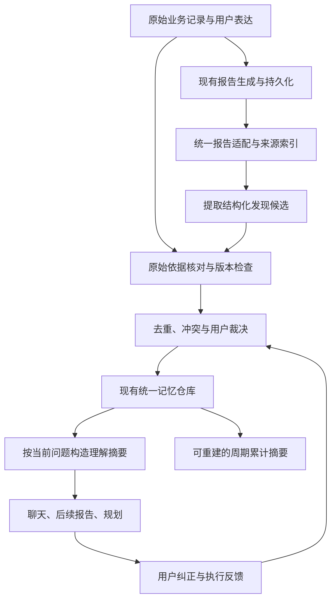

# HoloAI 报告融合理解升级：具体实施方案 V1

日期：2026-10-18；复审更新：2026-10-19。供东林评审。状态：**复审融合版实施规格，业务实现未开始**。保留 GLM 的修订编号便于对照，以下已融合本轮复审结论；具体接受与调整理由见 [GLM 澄清复审记录](03-GLM澄清复审与修订.md)。

> **修订总览（GLM 澄清 + 2026-10-19 复审融合）**：共 9 项正文调整，另有验收文档和源码核对修正。方案推荐已写入正文，不再把常规工程归属列成产品选择题；尚未开始实施或生产发布。
> - 修订1（§二、§8.4）：确认当前源码摘要维护的预算缺口，P0 明确端到端修复规格；启用真实新链路前完成修复。区分 Prompt 类型与真实 purpose，不做仅加名单的伪修复。
> - 修订2（§6.1）：类名勘误 CandidateReconciler → HoloMemoryCandidateReconciler。
> - 修订3（§6.6）：报告链路与日常萃取共用命题、证据去重规则；增量衡量区分纯重复与新增证据、条件、反证和可用性提升。
> - 修订4（§7.2）：财务 S2 T03 与本方案共用一个背景投影接口和消费入口；可先实现最小接口，不要求财务升级等待完整报告理解链路。
> - 修订5（§8.4）：跨设备重复调用占比设为放量门槛。
> - 修订6（§十）：P0 任务扩充；P2 拆分为 P2a 闭环交付 / P2b 盲评放量。
> - 修订7（§十二）：核心场景 30 → 32。
> - 修订8（§十四）：新增 ADR-08。
> - 修订9（§十五）：明确推荐实施边界；日常去重、共享接口等直接列为方案要求，不另设逐项拍板。

## 一、产品结论与范围

这次升级让 Holo 产生的报告能积累成有依据、会更新、能在下一次帮助中使用的用户理解。无需新增产品入口，也不做界面原型；用户继续使用现有报告、对话、规划和记忆管理。

核心交付：**不同报告能延续同一条发现；不同生活领域的线索能在证据允许时联系起来；旧判断遇到变化能修正；后续回答因这些理解变得更合适。**

它不是“把所有报告塞进上下文”，也不是重新写一套用户画像。现有记忆仓库是唯一的理解真源；报告档案保存报告；报告索引只负责找到报告与原始依据；累计摘要逐步成为已核验理解的表达缓存。

### 已确认的产品边界

- 不新增报告关系页、理解中心、知识图谱页、确认弹窗流程或日常通知。
- 内部自动提取、核对、关联和更新；用户可见的解释与纠正复用现有对话及记忆管理。
- 生成过报告不等于用户同意其中结论；收藏、浏览、点赞也不等于事实确认。
- 用户记忆开关、数据处理授权和原有敏感信息规则继续生效，不能因“已经生成过报告”而绕过。
- 不因推断自动修改任务、目标、预算或日程；仍走现有操作权限与确认规则。
- 本次只编写方案，不修改业务代码、Prompt、运行日用数据、调用真实模型或部署服务器。

### 分期边界

| 交付 | 包含 | 暂不包含 |
|---|---|---|
| V1 基础闭环 | 周期回放和对话深度分析接入、证据核对、统一记忆更新、聊天/后续报告消费、纠正删除、预算与恢复 | 全量历史回填、开放跨域因果推断、完整建议效果系统 |
| V1.1 理解深化 | 有证据的跨域关联、条件模式与阶段变化、规划消费、限定范围历史补齐 | 人格定性、健康诊断、自动执行建议 |
| V1.2 效果回看 | 已有执行记录或用户反馈支持的建议状态和结果回看 | 仅凭指标变化宣布某建议有效 |

先完成 V1 再决定是否扩大。架构覆盖后续阶段，但不提前建设用不到的系统。

## 二、现状：已有基础与真正缺口

以下为 2026-10-18 当前工作区的源码核对结论，不代表真机、CloudKit 或生产模型效果验收。源文件见文末与 findings.md。

| 现有能力 | 源码证据 | 本次处理 |
|---|---|---|
| 周期报告生成与档案 | MemoryInsightService、HoloPeriodReplayCoordinator | 复用现有完成与落库路径，云端/本地/恢复归一 |
| 对话深度分析档案 | HoloCloudAnalysisService.finalizeCloudResult、ChatMessageRepository | 从持久化结果接入，不能只监听页面刷新 |
| 周期报告累计摘要 | HoloReplayDigestService：oldDigest + 本期 payload 维护累计文字、模式、目标，另有历史回填 | 已有“报告延续”的雏形；保留过渡用途，升级为可追溯投影，避免再维护一套事实 |
| 部分回放候选记忆 | HoloLongTermMemoryCandidateObserver 监听 memoryInsightDidGenerate，读取卡片 memoryCandidate，受开关保护 | 与新入口统一裁决和去重，禁止新旧链路重复晋升 |
| 统一记忆模型与仓库 | HoloMemoryRecord / Evidence / Repository | 已有事实、模式、假设、来源血统、时间、反证、用户裁决与版本；在此扩展 |
| 现有洞察查询 | HoloDefaultInsightDataSource.recentInsights：仅标题摘要，最近最多 6 条 | 可查近期洞察，不等于对全量报告持续理解；补充按主题/范围查相关报告的内部能力 |
| 检索与回答边界 | HoloContextRetrievalService、HoloMemoryContextEnvelope | 复用相关性、预算、谨慎表达和精确统计回源规则 |
| 后台成本控制 | HoloBackend/src/usage/backgroundCostGuard.js | 当前源码确认直调 purpose 为 replayDigest，云端日志 purpose 为 cloud_replay_digest，但上游请求固定为 agent_loop；三者均不能由 Prompt 类型 replay_digest_consolidation 的名单项替代。现有入口/worker 没有为摘要链路建立该后台预算保护，属 P0 修复规格项；见 §8.4。仅证明本地源码路径缺口，未复核服务器版本、实际支出或历史事故归因 |

**真正的缺口不是 AI 不会读文字，而是报告类型、发现、原始依据、用户裁决与后续消费尚需统一契约和实际验收。**

旧的 10 月 4 日记忆审查指出过输入、校验、纠正和消费问题；本方案不把那些历史问题直接判为现在仍未修复。P0 用当前代码重验相关用例，修复阻塞本次链路的实际缺口。

## 三、用户如何感知升级

### 案例 A：同一个发现延续，而非每次重新认识

- 第一份报告：过去四周，晚间安排的任务较多延期。
- 用户解释：近期项目赶工，晚上已经没有精力。
- 后续提问：“帮我安排明天最重要的三件事。”
- 预期：Holo 将重要事项优先放在白天，并自然说明“考虑到你最近提到晚上精力不足”。时间安排仍需遵守用户当前输入和真实空闲条件。
- 不应产生：“你是早起型人格”“晚上永远不适合工作”。

### 案例 B：不同报告的线索互相补充

- 财务报告发现外卖增多，健康报告发现就寝变晚。
- 当前只能记为同一时期的两个观察；没有工作信息时，不推断工作压力。
- 用户明确说项目赶工后，可将工作阶段作为背景，表达“这可能与近期赶工有关”。
- 未经验证仍不能写成“工作压力导致外卖增加、睡眠恶化”。

### 案例 C：理解跟着生活变化

- 赶工已结束，用户说明接下来恢复正常节奏。
- 当前阶段理解停止用于未来规划；旧报告仍可在历史复盘中查看。
- 仅仅之后没提赶工，不自动解释为赶工结束；按有效期降级为历史信息。

### 案例 D：建议得到回看

- Holo 曾建议把运动放到午休。
- 只有用户确认采纳或执行记录能明确关联时，才建立尝试关系。
- 之后出现运动次数提升，只能说“尝试期间次数增加”；不能直接证明方案造成提升。
- 没有采纳证据时，下一次先核实是否试过，不能问“为什么没有坚持”。

以上均为合成案例，非东林的实际生活结论。

## 四、总体链路与数据职责

四类数据各司其职：

1. **原始记录**：金额、任务状态、睡眠记录和用户原话等事实源。
2. **报告档案**：当时报告说了什么、分析范围是什么，保留历史呈现。
3. **统一记忆**：经过校验、可用于后续帮助的当前理解与历史版本。
4. **报告索引/处理台账/摘要缓存**：定位来源、恢复任务、提高检索效率，不单独裁定用户事实；缓存可重建。

V1 不建设独立图数据库或第二套画像仓库。报告之间通过“共同发现、证据血统、时间窗和修订关系”连接，关系元数据放在现有兼容载荷或报告索引中；核心命题仍只有一份记忆记录。

## 五、统一输入契约：每份报告带什么进入链路

下列为**拟新增/扩展契约**，不是声称目前已经完整具备。字段最终命名在 P0 对齐现有类型后冻结。

### 5.1 报告描述 ReportDescriptor

| 字段组 | 内容与规则 |
|---|---|
| 身份 | canonicalReportID、sourceKind、sourceRecordID、reportRevisionDigest；周期回放在消息与洞察档案中的两个展示共用一个 canonicalReportID |
| 血统 | parentReportID/rootReportID（追问关系），sourceSnapshotHash；一份报告重试/改排版不能创造新独立证据 |
| 时间 | generatedAt 与分析的 periodStart/periodEnd 分开；自定义时区及统计口径一并保留 |
| 范围 | domains、coverage、truncated、metricDefinitions、snapshotCutoffAt；未知明确标 unknown |
| 内容 | 用户可见正文/结构化 claims、claimID、引用 evidenceIDs、结论类型、建议；不能将隐藏推理过程作为输入 |
| 依赖 | usedMemoryIDs 与其 versionID；报告引用了哪些旧理解，供防循环和失效传播 |
| 状态 | ready/failed/deleted/stale、来源版本；失败/流式半成品不进入理解链路 |

适配原则：优先取结构化 claims 与来源映射；只有正文的旧报告可以产生候选，但缺少原始依据时只允许历史查阅，不能直接晋升事实。不能把“已经有 evidenceID”当作已证明内容正确。

### 5.2 发现候选 ReportFinding

每个候选只表达一个可检查命题，包含：

- claimKey：主体 + 命题 + 对象 + 条件；不能只用领域或标题作身份。
- claimKind：复用 observedFact、recurringPattern、phaseShift、association、hypothesis 等现有类型。
- 文本：displaySummary、aiUseSummary、prohibitedInferences。
- 原始依据：evidenceRefs、lineageKeys、sourceRevisionDigests、metricAssertions 或原文 quote；报告/claim 位置另作 provenance 保存。
- 范围：validFrom/validTo、条件、统计样本与覆盖度。
- 关系：supports、contradicts、updates、derivedFrom；V1.2 再加入建议尝试关联。
- 提取版本与验证状态：extractorVersion、promptVersion、verdict/reason。

报告是发现的出处；底层事件、聚合快照或用户表达是证据。二者不能混用。报告摘要写了“你偏爱独处”，不能自行生成 explicitUserStatement 证据。

### 5.3 信息准入

| 信息 | 初始处理 | 可用于什么 |
|---|---|---|
| 有当前有效原始依据的事实 | 经确定性核验与既有决策策略后采用 | 相关背景；精确当前统计仍查业务数据 |
| 有独立时间/事件支持的重复模式 | 保留条件、样本、反例，经策略裁决 | 限定表达的建议，不上升为人格 |
| 跨域共同变化 | association 或 hypothesis，V1.1 接入 | 谨慎提出观察/问题，不作为因果事实 |
| 报告中的动机解释 | 默认假设；无可核实依据不进入可用理解 | 留在报告历史中，必要时自然核实 |
| AI 的建议 | 记录“曾提出的建议”，不成为用户偏好/行动 | 后续询问是否尝试 |
| 用户明确纠正 | 原话及版本进入裁决 | 当前有效的纠正优先，停止沿用旧推断 |
| 无来源/范围缺失的旧摘要 | 历史材料 | 可解释“当时报告写过”，不得冒充现实事实 |

## 六、关系、去重与更新规则

### 6.1 同一条理解如何识别

命题身份不能由措辞决定。两份报告的“近期晚间执行困难”和“最近晚上的任务经常延期”应在主体、行为、条件相同且证据支持时归并；“晚间任务延期”和“偏好独处”不可因同属任务/生活领域而合并。

先复用 HoloMemoryIdentity 与 HoloMemoryCandidateReconciler（🔧【修订2】勘误：实际类名带 Holo 前缀，原稿缩写）；P0 验证不同命题是否会碰撞，若需扩展命题键则做版本化增量迁移，不直接改变旧 ID。语义相似仅用于选取待比较候选，不能单独批准合并。

### 6.2 报告数量不增加证据独立性

- 同一批交易生成周报、月报、深度分析，依然是一批底层事实。
- 同一原始事件的重复引用不增加支持次数，也不刷新“最近被事实支持”的时间。
- 来源内容更新了 revisionDigest，也不自动算第二个独立事件。
- 周/月聚合存在重叠时，按底层事件集合或可比较的无重叠观测窗核对；仅凭不同 aggregate ID 或不同报告 ID 不算独立。
- 无法识别重叠范围时，保守标“独立性未知”，不提升稳定程度。
- 报告引用旧记忆，而没有新增原始依据，不得反过来强化那条记忆。禁止 A 记忆 → B 报告 → A 更确信的循环。

### 6.3 新旧冲突如何处理

顺序：先看是否相同主体、命题、口径、时间与条件，再判断是真冲突还是生活发生变化。

- 不同时间窗：“上月晚间困难、本月恢复” → 阶段变化，不是两个同时有效的矛盾事实。
- 同期口径不同：先核对业务定义，不能让模型选“更可信的一份报告”。
- 同期事实冲突：进入 disputed 或使该用途暂不可用，回源核查；不静默覆盖。
- 用户明确纠正：复用现有用户裁决和版本机制，摘要、结构化载荷、检索索引、缓存全部更新；后台迟到响应不得覆盖纠正。
- 用户自述与记录观测不同：保留“用户表达”与“记录观察”两个层次，避免把用户意图误判为已执行结果。
- 用户确认过的理解也允许因来源失效或事实变化而降级；不能永久免于核验。

### 6.4 有效期

优先复用现有 persistenceClass、expiresAt、freshness 与使用策略，不额外设置相互冲突的 TTL 表。新增规则：

- 显式结束日期优先于默认衰减；生成报告的时间不能替代事件发生时间。
- 短期状态以原始依据时间计算有效期；多次引用不续期。
- 过期信息可用于历史复盘，不能用于当前规划。
- 未再次出现表示证据不足，不等于用户已经恢复或偏好反转。
- P0 输出各类 persistenceClass 的现有衰减值和试评结果，再决定是否调参，不在文档里凭空新增“统一 30 天有效”。

### 6.5 编辑、删除、恢复和遗忘

| 事件 | 必须执行 |
|---|---|
| 删除一份报告 | 移除该报告的出处/索引/关联缓存；报告专属候选与无其他有效来源的派生结论停止使用；原始记录仍独立支持的既有事实可保留 |
| 原始记录编辑或删除 | 立即阻断旧 revision 参与当前回答；重验依赖记忆，证据不再成立则 invalidated，传播到下游派生结论 |
| 用户“忘记这条理解” | 写入现有 tombstone/抑制规则，同一命题不得被旧报告回填复活；检查措辞变体身份映射 |
| 恢复报告/原始记录 | 重新核验有效性和用户裁决版本；恢复数据不自动撤销用户遗忘 |
| 设备间同步迟到 | 以用户裁决版本、来源 revision 和删除标记优先；不能按“最后生成的 AI 文本”覆盖 |

依赖多条证据的理解在删除后应重验剩余依据，不一律全删或全部保留。待重验期间不进入当前回答。跨设备尚未收到的离线删除无法保证瞬间传播，须明确同步边界；同步到达后本地消费立即过滤并使缓存失效。

### 6.6 报告链路与日常萃取管线的同命题合并

> 🔧【修订3】新增小节（评审结论：原稿只覆盖「报告 vs 报告」的证据独立性，未正面处理与既有日常萃取管线的关系——两条链路会从同一批底层事实提取同型发现）。

现有日常记忆萃取（memory_domain_extraction 等 purpose）直接从原始记录提炼发现；报告理解链路从报告提取发现。同一命题（如「外卖支出增多」）可能先后经两条链路进入统一仓库，规则如下：

- 身份归并走同一套 HoloMemoryIdentity / HoloMemoryCandidateReconciler，不因来源是报告而另立身份规则；合并后 provenance 保留两条来源路径；lineageKey 继续指向同一底层事件，不能为两条管线分别创造血统。
- 证据独立性按 6.2 同一标准：两链路引用同一批底层交易/记录仍是一批事实，不得按两次独立验证计数，也不刷新支持时间。
- 「报告带来的增量理解」是收益指标之一。P0 固定对照基线为报告处理前已有的日常记忆，分别统计：①纯重复（命题、证据、条件均无增量）；②同命题新增独立证据；③增加适用条件、时间变化或反证；④补足来源、核验或检索后首次变得可用；⑤新命题。未知独立性单独统计。
- 可归并率只说明命题重叠，不能直接说明价值低。②③④即使合并进同一命题，也可能带来明显收益；只有①占比高且后续回答没有改善，才支持减少或跳过该类报告的维护。
- 提取的候选数、合并率是机制指标，最终价值仍按 §十二 同数据回答对照判断，不能奖励为了提高新颖率而另立重复命题。
- 两链路同命题但结论冲突时按 6.3 处理，不因「报告更晚生成」默认报告优先。
- 对应验收场景 R31/R32（见验收文档 §2）。

## 七、AI 如何真正使用这些理解

### 7.1 统一任务相关摘要

拟新增 HoloUnderstandingContextBuilder 作为消费适配层，底层复用 MemoryQuery 与 PersonalContext 检索。它输出当前问题所需的少量条目，不新增一个无所不包的长期大摘要。

每条包含 memoryID/versionID、事实或假设等级、相关条件、时间窗、允许用途、必要限定、来源定位、反证/过期状态。缺少权限、来源已失效、用户拒绝或用途不符的条目，先过滤再发送给模型。

- 沿用现有候选上限与选取预算，初始最多 8 条，并设总输入大小/token 预算；两套检索结果合并去重后共享上限，不能各塞 8 条。
- 纯统计问题优先查明细和程序聚合，不塞入无关人生背景。
- 解释/建议类问题才补充相关历史理解；必要时受限回看原始报告或来源。
- 当前输入优先；当前用户纠正触发持久更新时，必须有明确可定位的命题，不把随口感叹直接当“遗忘所有相关信息”。
- 冻结请求时保存所用 memory versions；回答交付前复查删除/裁决版本。期间发生遗忘时，不交付包含被撤销内容的旧回答。
- 无可用理解时继续正常回答；不能出现“必须先分析所有报告才能开始”的等待。

### 7.2 消费入口

| 入口 | 预期变化 | 实施阶段 |
|---|---|---|
| 普通对话 | 少重复询问，在相关场景延续发现 | V1 |
| 新的深度分析 | 使用相关历史作为比较/背景，当前数据优先 | V1，与财务 S2 T03 共用 PersonalSituationBrief 接口及单一注入入口。当前 iOS 无该命名类型；接口冻结后可由先实施的一方先交付最小投影，后续报告理解只增加来源适配，不重复注入、不阻塞财务无背景分析 |
| 周期回放 | 说明延续、变化、反例，避免旧摘要滚雪球 | V1 |
| 目标/行动规划 | 考虑有效的精力、时间、责任与偏好条件 | V1.1，复用现有 PersonalContext 载荷与规划验证 |
| 对我的了解/记忆管理 | 可读、可纠正、可忘记，并能定位报告来源 | V1 复用现有入口；如定位/纠正无法完成，只补必要字段或交互 |

**与财务 S2 的实施顺序（修订4复审）：** P0 冻结共享背景契约（来源、时间、裁决状态、用途与版本），HoloUnderstandingContextBuilder 为建议的共享适配位置，不把类名当硬约束。财务先开工时可以从已有合格记忆构造最小 PersonalSituationBrief；报告理解落地后接入同一接口。无背景时传空，财务台账、判断与核验照常升级。相关财务 05/06 文档已补交叉约定，表示文档一致性，不表示财务任务已被实施或获准上线。

不是所有记忆类型都可直接送给规划。领域观察、报告假设需要通过既有 Consumer/Decision Policy；不得为方便消费强行伪装成 explicitPreference 或个人情境事实。

### 7.3 表达与使用证明

自然说明依据：“你之前提到…”“最近两次记录显示…”，避免每次重复署名。保留 selected IDs 与模型声明 used IDs，并区分“提供给模型”和“模型声称使用”；这两者均不能单独证明个性化有效。

真正效果用同一问题、同一业务数据、有无相关理解的对照验证。只多了一句“考虑到你…”而建议内容没有变化，不算收益。

## 八、生成后处理、恢复与成本

### 8.1 触发与持久任务

成功报告先照常交付；理解维护异步运行。不能依赖页面打开，也不能仅靠易丢失的 Notification。

- 在报告持久化完成后登记待处理项。能同一事务写入则同一事务；跨存储无法同事务时，以可重扫游标补偿提交与登记之间的崩溃窗口。
- 复用现有后台调度基础，拟新增报告专属任务类型，不另造全局后台框架。
- 处理键 = canonicalReportID + reportRevision + extractorVersion + policyVersion；Prompt 版本纳入配置指纹。
- 状态：pending/running/succeeded/deferred/rejected/failed；不合格候选不作网络错误重试。
- 持久记录处理键、来源版本、重试时间与失败原因，进程重启/断网后可恢复。
- 模型提取后、写入前再次检查来源版本、权限与用户裁决版本，防删除后写回。
- 多设备可重复计算但语义只写一次；最小独立提交单元为一份已验证候选及其来源。V1 不建设跨设备分布式任务锁，依赖幂等键与仓库合并；重复请求成本纳入观测。

### 8.2 历史处理

V1 默认从启用后的新增/更新报告学习，不自动全量重读日用历史。

- P0 先离线枚举各类报告数量、版本与来源可用率，不上传全文。
- V1.1 试点仅补齐最近 90 天且最多 30 份相关历史报告；这是初始工程上限，不是“用户只能被理解 90 天”。更早内容仍可按明确问题检索。
- 历史补齐不得越过 learningBaselineAt、用户遗忘、自动记忆开关与数据处理授权；现有授权不覆盖的历史范围先不补齐。
- 每批最多 3 份、持久游标、后台低优先级、预算不足即暂停；有更高优先级用户任务时让路。
- 旧累计摘要仅作历史材料；不可作为原始证据直接导入统一事实库。

### 8.3 模型调用策略

优先使用报告已有结构化 claims 与引用，确定性完成映射和校验。只有需要语义提取或冲突解释时才调用模型。初版不让模型一口气重写全量用户理解。

- 每份有增量价值的报告最多一次提取；格式修复最多一次，仍失败则本轮终止。
- 数字、单位、方向、分母、主体、否定和业务状态先做程序核验；语义核验只能补充，不能替代这些检查。
- 语义支持关系无法证明时留为不可用于事实的候选，不为了“记住更多”降低标准。
- 不在深度报告生成中顺手把持久记忆写入，避免报告生成权限与记忆学习权限混淆。
- 候选提取输入只发必要报告片段与依据摘要；敏感内容按已有授权和用途限制裁剪。

### 8.4 成本控制

本次不估造单份价格或承诺节省比例。P0/P1 实测请求次数、输入/输出 token、usage、成本和修复率，按现行后端配置核算。

- 报告理解维护属于后台记忆工作，必须走后台预算；用户主动生成报告仍沿用其原有计费与额度。
- 优先复用现有 memory_domain_extraction / memory_cross_domain_fusion 等符合语义的 purpose；若契约不同则新增 purpose，并同步注册到服务端预算集合和权限校验，禁止借主动聊天 purpose 绕过预算。
- **已确认的源码修复范围（修订1复审）：** replay_digest_consolidation 是 Prompt 类型，直调 /v1/ai/chat/completions 的实际 purpose 为 replayDigest；云端 replay_digest 任务日志写 cloud_replay_digest，而 callProvider 的 provider 请求固定 purpose=agent_loop。只把 replay_digest_consolidation 加进 BACKGROUND_PURPOSES 不会覆盖这两条链路。
- 直调链路须按实际 purpose 进入 checkIngress、可信 subject、模型调用前原子预留和 usage 结算；云端须显式传入已验证的后台任务类别及预算主体，在每次真实上游尝试前建立预算上下文并预留。异步恢复不能依赖启动 HTTP 请求的临时上下文，主体必须可从已验证的任务归属恢复，不能相信客户端传入的 subject。
- 不得把通用 agent_loop 整体归入后台预算，否则会误伤主动深度分析。日志 purpose、Prompt 类型、provider 计费 purpose 和任务类型必须有明确映射。
- 云端/直调/回落/重试共享同一主体额度；预算耗尽或版本闸门拒绝不能触发切轨道绕过，必须在客户端识别并延后。426 闸门需覆盖旧摘要客户端在两条链路的行为。已有“按次数限流”不替代日/月金额预算。
- P0 完成调用映射、失败传播规格与修复任务；修复实现可并入独立后端维护批次，但必须在开启本方案真实提取/摘要维护前完成端到端验收和授权部署。不能只“随下次发版顺手补名单”。本轮未修改后端，也未查询生产部署或消费账单。
- 批准上线前记录当前日/月、个人/全局上限。新链路在原预算内共享，不默认抬高预算。
- 429 等预算暂停遵守服务端 resetAt；网络重试指数退避并限制次数。超时与缺 usage 按既有预留计费规则保守处理。
- 同一处理键的重复通知必须全部在模型调用前被拦截（100%）；跨设备并发窗口与语义等价报告的重复预算消耗单独观测。
- **修订5复审：** 以逻辑处理键跨设备统计：totalCalls 是真实模型尝试数；duplicateCalls 是对同一已成功、或已有有效执行权的处理键所发起的冗余尝试，duplicateRatio=duplicateCalls/totalCalls。网络失败后的合法重试和一次格式修复另外统计，不直接算跨设备重复；总调用与成本仍全部计入预算。totalCalls=0 时比率为 N/A，不能记为 0% 达标。
- 同时统计 duplicateCost/totalCost，缺 usage 按原有预留金额计，不能以估零掩盖重复成本。建议试点冗余成本占比 ≤5% 作为初始放量上限（工程目标，非实测结论），P0 根据报告频率和既有预算校准并冻结；不得只为让试点过关而放宽。
- 放量记录必须附处理键样本量、观察区间、设备覆盖、各类失败/修复和总增量成本；覆盖不足不能凭低比率宣称稳定。即使重复比率低，达到后台总预算上限也不能放量。双设备会产生重复是待测风险，不是已发生事实。

## 九、现有累计摘要与旧候选链路如何收敛

这是本次必须完成的结构工作，不能在已有能力旁边再挂一个观察器就结束。

### 累计摘要

1. 兼容期保留旧摘要用于原有周期回放，但明确标为历史压缩材料，不能作为新事实证据。
2. 已接入报告的新理解只走统一仓库，新的周期背景由有效记忆、必要报告索引与原始范围生成。
3. 使用同一范围做旧摘要/新投影的对照，确认事实、变化和纠正不丢失后，关闭试点人群旧摘要的独立推断写入。
4. 旧 JSON 文件先保留兼容，不做破坏性删除；新摘要包含 source memory versions 和投影版本，可重建。
5. 删除、遗忘、来源更新时先使投影失效；重建未完成使用不带历史摘要的正常回放，不回灌已失效旧摘要。

### 回放候选观察器

- 先确认 HoloLongTermMemoryStore 当前与统一仓库的桥接方式及开关实际状态，不能仅凭命名认定它是独立存储或安全退役。
- 同一 canonicalReportID/revision 只能由旧链路或新链路拥有写入权，不能双写晋升。
- 先影子计算对照；切换时让旧观察器跳过新链路拥有的报告，其他报告维持现状。
- 回滚时关闭新提取/消费，旧链路只处理不在成功处理台账中的合法任务；用户遗忘和删除状态继续生效。

## 十、实施阶段与完成标准

人日为单人连续开发的粗估，不含东林评审等待、真实使用观察及后端审批，P0 后再校准。

| 阶段 | 具体任务 | 可审查交付 | 退出标准 | 粗估 |
|---|---|---|---|---|
| P0 当前基线与契约 | 枚举报告类型/源、核对候选与摘要链路、记忆开关/发布门控、财务 S2 接口、来源覆盖与历史故障回归；🔧【修订6】新增三项：①日常萃取同命题对照口径（§6.6）；②S2 T03 与报告理解共享接口、允许先交付最小投影；③摘要直调/云端/回落/重试的预算映射、主体与错误传播修复清单（修复与发版另按授权执行） | 数据流清单、冻结字段、基线样例与当前测试结果、增量对照口径与发版清单 | 每种试点报告有稳定身份；明确哪些内容能回源；阻塞问题有复现与修复任务；共享接口、重复统计定义与预算端到端修复有明确归属 | 1–2 人日 |
| P1 接入与影子计算 | 两类报告适配、持久队列、来源核验、幂等、防循环；新链路仅输出诊断不进入回答 | 合成样例结果、来源覆盖、成本/失败记录 | 去重、删除/纠正竞态、原始来源核验测试通过；不改变现有回答 | 3–4 人日 |
| P2a V1 闭环交付 🔧【修订6】 | 映射统一仓库、旧候选写入权切换、相关摘要、聊天/深度分析/回放消费、缓存失效与回退 | 同数据升级前后对照、迁移/回滚记录 | 规则类场景（U/I）与真实入口生命周期验证通过、链路闭合可演示；可交付内部候选，未通过 P2b 不算 V1 效果验收、不扩大试点 | 3–4 人日 |
| P2b V1 效果盲评 🔧【修订6】 | 成对对照数据集执行、人工盲评、放量决策 | 20 题成对记录与盲评结论 | 本文与验收文件 V1 全部硬门槛通过，真实入口对照有收益 | 1–2 人日（另需东林本人盲评时间，不占开发人日） |
| P3 V1.1 关联与规划 | 跨域关联、变化条件、反证、规划适配、受限历史补齐、旧摘要投影切换 | 跨域案例、历史批次/预算/双设备验证 | 不虚构因果；规划遵守当前约束；删除/遗忘不复活 | 3–5 人日 |
| P4 V1.2 效果回看 | 建议身份、用户采纳/执行关联、结果/归因分离、相关场景回看 | 已采纳/未采纳/未知的对照案例 | 无采纳证据不宣称执行或有效；不新增日常打扰 | 2–3 人日 |

推荐评审通过后先实施 P0–P2，拆分后暂估 8–12 人日，P0 后依据来源覆盖与存量缺口重新估算；不是已验证排期承诺。P2a 可交付内部候选，P2b 验收帮助性后才能认定 V1 效果完成。工程人员可完成隔离测试、入口验证与盲评材料准备，东林主要评审用户价值及必要的日用真机反馈，不把全部验收工作都推给东林。预算端到端修复的新增工作量单列，不暗含在“补一行名单”的估算里。后两阶段按 V1 效果再进入。

## 十一、主要改动位置

所有拟新增文件名均为设计建议，实施时以实际结构为准。仓库相对路径用于后续开发定位。

| 位置 | 计划改动 |
|---|---|
| Services/AI/MemoryInsightService.swift 与 Insight/HoloPeriodReplayCoordinator.swift | 周期报告完成后归一登记来源；保持原有交付独立 |
| Services/AI/Agent/Cloud/HoloCloudAnalysisService.swift | 保存理解所需的结构化 claim、证据映射和版本，不能只依赖渲染后的文字；接入完成后登记 |
| Data/Repositories/ChatMessageRepository.swift 与现有洞察 Repository | 稳定报告读取、来源版本与删除/恢复事件；不以报告 Tab 分页列表作学习数据源 |
| 拟新增 Services/AI/ReportUnderstanding/ | ReportSourceAdapter、FindingExtractor、EvidenceResolver、Reconciler、ProcessingCoordinator；先限定报告适配职责 |
| Models/AI/HoloMemoryRecord.swift、HoloMemoryEvidence.swift | 复用现有契约；仅增可选、版本化 provenance/处理依赖载荷，未知版本保守降级 |
| Services/AI/MemoryRepository/ 与 MemoryCore/ | 复用写入、裁决、来源失效、遗忘及版本；补命题身份/独立性/来源重验缺口 |
| Services/AI/MemoryQuery/、PersonalContext/ | 统一消费过滤、相关摘要、规划兼容、缓存失效 |
| HoloReplayDigestService、HoloLongTermMemoryCandidateObserver | 试点写入权切换与摘要投影，防双链路重复计算/晋升 |
| HoloBackend/src/prompts/、config.js、usage/backgroundCostGuard.js | 若新增/调整目的与 Prompt，同步服务端契约、输出限制、预算和版本；具体 diff 在实施时确认 |
| HoloTests/Services/AI/ 与 HoloBackend/tests/ | 纯逻辑、仓库集成、预算契约与模型评估；按实际改动选择 |

Core Data / CloudKit 必须增量兼容演进。优先使用现有版本化 JSON 载荷和小型处理台账，不随意新增复杂实体；若必须改模型，开发前列迁移方案并提醒东林全量导出。禁止重置或清空 Development 环境。

## 十二、验收：证明“更懂用户”

详见 [验收与测试用例](02-验收与测试用例.md)。三个层次缺一不可：

1. **规则正确**：错误来源、数字、重复证据、过期、用户否认、删除和预算不被绕过。
2. **链路闭合**：真实入口生成报告 → 学习 → 冷启动 → 后续提问用到 → 用户纠正 → 下一次不再沿用错误理解。
3. **回答有收益**：同问题、同业务数据比较有无理解；人工盲评判断回答是否更贴合，而非只看模型引用数量。

V1 建议门槛：

- 32 个核心合成/仓库场景全部通过（🔧【修订7】原 30 个 + 新增 R31/R32 日常萃取对照场景，见验收文档 §2）；隐私/来源/数字/因果/遗忘/竞态为零容忍硬门槛。
- 至少 20 个问题的成对对照，其中 ≥12 个相关理解有帮助的场景、≥8 个无关/过期/冲突场景。数据集冻结，并留出至少 1/3 不参与调参。
- 有帮助的场景中至少 9/12 被盲评为确实改善；无关/过期场景无明显退化、无强行个性化。
- 至少 3 条经过真实入口的完整生命周期验收，覆盖周期回放、深度分析、纠正/遗忘；多设备实际同步在 P3 上线前验收。
- 所有可用发现都可定位当前有效证据及报告出处；不能定位的必须降级，不以强行追求覆盖率放宽。
- 维护失败不阻断报告交付；每个积压/失败可解释、可恢复、不会无界重试。

以上为待执行验收目标，不是本次已达到的指标。

## 十三、发布、观察与回退

建议增加内部独立开关：reportUnderstandingExtraction、reportUnderstandingAnswering、reportUnderstandingHistoryBackfill。不是给用户增加三套设置，仍由原有用户开关作最高约束。

发布顺序：

1. 本地规则和仓库测试，双端契约兼容验证。
2. 服务端若有改动，先部署兼容旧客户端的版本，验证 Prompt/版本/预算归属；部署需东林授权。
3. 内部账号影子计算；再打开有限试点的提取与消费。
4. 通过真实入口验收，再按实际人群配置扩展；观察 7 天成本、失败、来源失效和人工抽样，不以日历到期自动放量。
5. 后续单独开启历史补齐、跨域关联和规划。

观测只记录必要元数据：处理量、跳过理由、来源覆盖、独立证据去重、验证失败、检索入选、用户纠正后的失效延迟、调用 usage 与成本；日志不写原文、健康样本或完整财务数据。成本按来源类型和 purpose 分开，记录重复设备调用。

回退先关闭消费，再停提取/历史队列；保留现有报告展示、原有用户记忆及裁决。新版本数据按来源和版本隔离，不删除日用记录。旧摘要不能跨越遗忘/删除边界自动恢复使用。遇到事实/隐私/遗忘硬门槛失败立即停止该链路，不等待观察期结束。

**本次文档没有修改 HoloBackend。后续实施若涉及上表后端文件或 Prompt，必须后端发版；本地修改或推送不能视为生产生效。** Prompt 必须同步 iOS PromptManager.swift 后备、后端 defaultPrompts.json、promptVersions，再按项目部署技能发布并验证。本文没有部署授权。

## 十四、关键设计决策记录（ADR）

| 决策 | 选择与理由 | 代价/替代方案 |
|---|---|---|
| ADR-01 产品形态 | 底层升级，复用现有入口；先用真实回答证明价值 | 可见性弱，通过自然依据说明与现有管理承载；暂不建新入口 |
| ADR-02 真源 | 原始记录证明事实，统一记忆维护理解；报告是出处 | 回源与依赖维护较复杂；直接存报告摘要更快但会固化猜测 |
| ADR-03 关系表示 | 现有记忆版本/证据关系 + 报告索引，按需一跳查阅 | 不提供全局图谱探索；换来低运维与清晰删除语义 |
| ADR-04 更新方式 | 增量处理、事件后登记、幂等和有限补扫 | 多维护处理台账；避免每次聊天重读全部报告 |
| ADR-05 校验方式 | 程序核验数值/范围/权限，模型处理语言理解，不能证明则降级 | 接纳率可能较低；优先保证可用理解可信 |
| ADR-06 旧链路 | 影子对照后切写入权，摘要变投影 | 过渡期维护两种读取；禁止双写晋升 |
| ADR-07 历史范围 | 默认新增，历史按授权和上限补齐 | 初期积累较慢；避免不透明的历史上传与成本峰值 |
| ADR-08 共享背景投影 | 财务 S2 T03 与本方案共用 PersonalSituationBrief 契约和单一消费入口；先实施方可先交付最小投影 | 冻结契约需要跨方案对齐；避免重复注入，也避免财务升级等待完整报告学习；空背景正常工作 |

主要风险：报告源映射不足、旧摘要污染、身份误合并、证据重叠虚增、纠正后缓存未失效、后台成本挤占、跨设备迟到。对应控制均纳入 P0–P3 与硬门槛，不靠一次 Prompt 调整承担。

## 十五、本次评审应确认的内容

推荐按以下完整方向评审，不需要设计原型：

- 认可“底层持续理解能力”定位，保留现有入口。
- 优先做 P0–P2，先打通可信的报告学习、对话/报告消费和纠正闭环。
- 跨域关联、规划与建议效果回看按验证结果扩展。
- 保持既有权限和预算；历史回填、上线部署在具体实施阶段按范围执行。

**修订9复审：推荐执行边界。** 日常同命题去重、共享背景接口、预算真实调用链核验均为这份方案成立的必要工程规则，已纳入 P0，不再分别请求产品拍板。实施采用 P0 → P1 → P2a → P2b 的顺序；P0 若发现不能兼容现有数据、预算或明显扩大范围的阻塞，再携具体影响请东林决策，正常推进不新增逐阶段批准流程。

当前请求仅为方案复审与文档修订，故本轮不启动业务实现。后续明确开始实施后，在上述范围内推进；真实数据变更、历史上传与生产部署仍按各自授权边界执行。

批准方案不等于已授权部署生产、修改日用数据或批量上传历史报告。

## 阅读与实施入口

- [GLM 澄清复审记录](03-GLM澄清复审与修订.md)
- [验收与测试用例](02-验收与测试用例.md)
- [源码核对记录](findings.md)
- [方案工作计划](task_plan.md) / [本次工作记录](progress.md)
- [既有记忆萃取审查](../2026-10-04-Holo记忆萃取全面体检与可用性改造方案.md)
- [财务深度洞察最新接入方案](../../../finance/plans/2026-10-17-HoloAI深度洞察升级与财务试评/06-融合版与S2接入方案.md)

**本次完成的是实施规格与源码核对；未进行模型效果、App 构建、真机、双设备或生产验收。**
