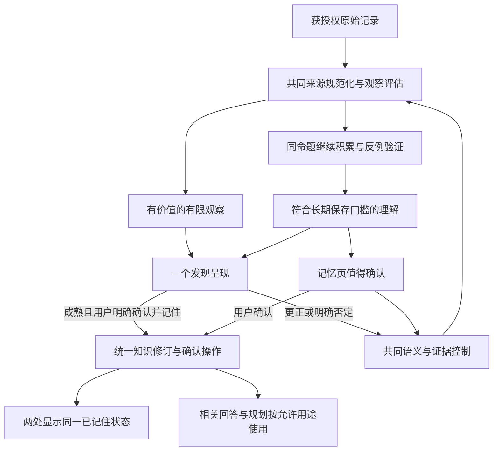

# 「一个发现」与 Holo 记忆的融合契约

日期：2026-10-27。对应主方案 v2.2；状态：设计已补全，代码未实施。  
本文件补足 v2.1 缺少的产品闭环，对本次联动优先于两份 10-23 发现实施包中的“V1 完全不读写长期记忆”约定。默认关闭、来源范围、敏感边界和预算等既有授权不自动改变。

## 1. 产品关系与连续旅程

**同一套观察与证据，两个面向用户的阶段：一个发现负责把值得留意的观察带到眼前；Holo 记忆负责沉淀经过校准、以后有用的理解。** 用户可以在发现处完成校准与保存，不必再去记忆页重复确认。

发现不是所有记忆的必经入口：用户明确表达的重要事实、偏好、约束和手动添加继续直接进入记忆流程。自动发现关闭时记忆仍可独立形成；记忆自动学习关闭时发现仍可按自身授权工作。

### 示例（均虚构）

- 两段记录中，重新开始运动和阅读都采用了较轻的第一步：可呈现这两次经历的联系，不自动写成“你总适合小步开始”。点击“有点像”不补足规律证据。
- 经过足够自然周期与反例验证的阅读节奏：发现详情可展示待保存的准确理解，用户点击“确认并记住”后，记忆页直接显示已确认，不再问一次。
- 用户在续聊补充“我喜欢先把开始门槛放低”：该句是新的用户明确偏好，可按记忆权限保存；它不增加过去行为事件数，也不证明系统先前提出的因果。
- 戒烟等可能涉及健康/敏感推断的内容遵守发现原有边界。记忆可管理这些理解，不代表它们因此进入自动发现。

## 2. 共用的核心与各自的门槛

| 共同能力 | 唯一职责 |
|---|---|
| 来源与证据契约 | 真实业务 ID、源修订、事件血缘、时间精度、测量口径、覆盖、权限与敏感分区 |
| 观察评估 | 支持/反例、适用范围、语义与证据版本；模型表达不变成新的独立证据 |
| 命题身份 | 主题与命题家族、准确语义修订、证据快照；措辞变化不产生独立事实 |
| 用户控制 | 明确的语义否定、纠正、时效、停用/遗忘，以及有范围的展示偏好 |
| 提示记录 | 某个语义版本在哪个入口呈现/询问过、是否已保存、是否暂缓；不按点击推断用户性格 |
| 来源变更依赖 | 编辑、删除、排除、撤权及反例变化，驱动两个产品当前投影重核 |

`ObservationAssessment` 是共同输入契约的建议名，不新增最终事实库。已达到知识持久化授权的命题进入主方案的两类新实体；只有发现授权的临时观察继续保存在现有本机 DiscoveryStore 中，不偷写长期候选库。

两个门槛分工明确：DiscoveryPublicationPolicy 判断“这段有限观察是否值得呈现”；HoloMemoryDecisionPolicy 判断“这个准确命题是否值得保存，以及确认后能怎样使用”。共同的语义与证据核验不得各算一套事实；显示与长期使用的资格可以不同。

发现的 two_episodes、bounded_pattern、change_over_time 不能机械等同为长期 recurringPattern。有限观察成长为跨周期规律时，通常属于同一命题家族的新语义版本，需要新证据与准确范围；不能继承早期轻反馈。

## 3. 关联身份：精确到结论，不只连整张卡

一条发现可能包含多个 claim。程序建立：

`findingID + runID + candidateID + claimID → propositionID + semanticDigest + evidenceSnapshotID`

- 映射必须对应已核验的准确 claim 与原始证据，不能仅按主题文字相似建立事实关系。
- 没有持久化授权时只保留发现目的下的临时关联键，不创建长期语义修订；等手动保存或已有学习授权允许时再落知识。
- 一次“确认并记住”只提交界面明示的一条理解及其范围，不暗中确认整张卡所有句子、上位概括或更广条件。
- 已保存命题不被 DiscoveryStore 的本地缓存覆盖；发现侧的 linkage 是可重建投影，权威确认位于知识操作中。
- 保存后记录 origin finding/claim 引用，记忆详情能说明形成路径；原发现过期或被清理时显示来源入口不可用，仍可核对独立保留的获授权业务来源。

现有 DiscoveryPublishedPayload 有 candidateID、展示文字和 citations，但没有上述知识映射；须在本地发布组装时补版本化 claim 关联。此映射由程序生成，不让模型发明真实记忆 ID，不把新增本地字段直接塞进严格的模型输出 schema。

## 4. 一次确认完成保存，避免重复审批

发现详情仍以阅读和“聊聊这个”为主，不强迫建立记忆。只有某条理解通过记忆门槛、来源仍有效且可保存时，呈现一个内联区域：

> 可以让 Holo 记住：〔准确结论、条件和范围〕  
> 用于：〔相关帮助〕；实际使用遵守记忆辅助回答开关。  
> **确认并记住**

成功后变成“已记住 · 查看或修改”，记忆页的同命题转为已记住。已被保存的发现不再出现“有点像”和新的保存邀请；同一版本不重复问。

未达记忆门槛时维持“有点像／不太准确”，不显示不能兑现的保存按钮。若用户主动要求保存这次经历，可走明确请求通道保存该有限事件，不强行升级成规律。

保存操作复用统一知识控制事务与 operationID：先核对当前语义、源修订、控制和权限，再原子保存修订/确认/收据。发现页面的回执从已提交操作投影，不另写一份可漂移的 remembered 布尔值。

跨存储不做分布式事务：知识保存成功、发现回执刷新失败时，保留有效知识；重进页面按操作查询恢复回执，重试复用 operationID。知识保存失败时不显示成功，不将“有点像”当作补偿确认。

自动学习关闭时，用户明示“确认并记住”属于一次手动保存，不开启自动学习。辅助回答关闭时显示“已记住，辅助回答已关闭”，不擅自开启；用户仍可管理和主动查看。

## 5. 反馈如何关联：事实控制与展示偏好分开

| 用户动作 | 发现侧 | 同命题的记忆侧 |
|---|---|---|
| 有点像 | 仅针对该有限观察的轻反馈/就地回执 | 不新增确认、独立证据、置信度或自动保存资格；可按原授权继续积累 |
| 确认并记住 | 成为已记住回执与管理入口 | 准确语义经统一事务确认一次，未开启辅助回答也不强开 |
| 依据不对 | 立即撤下该冻结发现；标记有问题的引用/计算依据 | 关联证据绑定退出并重算；有其他独立支持的知识不被整主题误删 |
| 理解不对 | 立即撤下该准确语义及其同义改写 | 相同命题/范围的解释被否定或待纠正；不封禁整个主题、不删除原业务记录 |
| 现在不适用 | 当前呈现失效 | 收窄当前有效范围，保留历史事实；不假定以前从未发生 |
| 不想再提示这类 | 停止该范围的主动呈现 | 相同主题不换记忆推荐区继续主动追问；主动管理仍可查，已有有效知识不因此被判假 |
| 关闭面板、未点击、暂不处理 | 不构成认可/否定 | 不改变事实状态，按共同提示记录避免连续跨入口询问 |
| 记忆中纠正或标不准确 | 引用旧语义的当前发现撤下/重核 | 按统一控制结果生效，新发现不得反过来推翻用户纠正 |
| 记忆中停用/遗忘该理解 | 同义发现不能换入口再推荐该受限理解 | 沿用主方案最小阻断与恢复规则；仍允许用户主动查询原业务事实 |

“不太准确”首次点击就立即本地撤下，先记录有范围的最低否定，原因可选且不阻塞。不能等用户完成原因表单才生效；原因未选时先限制该准确结论，不伪造具体证据错误或永久封禁类别。

新动作“不想再提示这类”明确表达共同的主动提示偏好。历史 notInterested 沿用当时发现功能的范围，不借迁移把它扩大为全局事实否定或遗忘。

所有跨产品传播都以准确 claim 映射、语义/时间范围或明示的提示类别为准。某一 claim 被限制后，如果已发布卡片标题/正文依赖它，则撤下整份冻结发现，不能临时删一句后继续显示未经核验的新卡片。

## 6. 去重与反向使用

- 同一成熟命题可以在记忆管理中可查，同时作为一个发现的阅读内容；主动询问只占一次机会。管理可见不等于再次弹出任务。
- 自动发现选题先查询获准的最小提示/限制状态。已经确认、无新信息的命题不作为“新发现”重复包装；用户在发现处明确暂缓后，记忆推荐区同步冷却该语义版本。
- 记忆的主题/版本/来源引用可帮助寻找已有观察与原记录；不把旧记忆摘要当新证据，不向发现模型注入用户未授权的记忆正文。
- 只有新增证据引起重要范围、条件或方向变化，或明确支持一个新问题时才重新评估；仅证据 ID、措辞、生成日期变化不算新信息。
- 记忆辅助回答关闭时不把已保存理解作为发现的生成背景；最小停用/遗忘阻断仍用于防止被拒内容复活，这不是读取正文做个性化。

发现页判断“已记住”只读准确关联的保存/限制元数据，不触发通用记忆全文检索、历史补建或新的模型调用；关闭辅助回答不会被这个状态查询绕过。

## 7. 生命周期：同源变化一起重核，产品期限各自保留

| 事件 | 共同处理 | 不能混淆的边界 |
|---|---|---|
| 原始来源编辑/删除/AI 排除/权限撤回 | 按来源与修订索引定位两侧依赖，当前发现撤下，知识重算支持与用途；在途结果失效 | 支持、反例、基线与版本依赖都纳入；不能只监听页面编辑 |
| 发现 14 天 TTL 到期、换下一条发现 | 清理临时呈现与发现目的缓存 | 已独立保存的知识按自身来源与有效期判断，不因卡片过期被删除 |
| 关闭一个发现/缩小发现范围 | 撤下胶囊、取消对应任务、清理该目的派生 | 不删除已有记忆；不能借共享缓存保留只获发现临时授权的数据 |
| 关闭自动学习 | 停止自动知识写入与补建 | 已单独开启的发现仍可处理其获准原始材料；不得偷存长期候选 |
| 关闭辅助回答 | 停止记忆对一般回答与发现生成背景的注入 | 发现仍可从自身获授权原始记录形成有限观察；管理查看可用 |
| 全局处理授权撤回/来源排除 | 禁止相关新外发，作废相关冻结批次/草稿/缓存 | 恢复授权不自动恢复独立关闭状态，也不解除语义否定/遗忘 |

知识保存需要重新取得面向持久化的来源引用与授权；不能把 DiscoveryStore 的临时摘录整个搬进记忆库。手动保存只授权明示的那条理解及必要依据，不等于允许此后无限扫描这些来源。

## 8. 授权范围、敏感度与预算

当前一个发现 V1 的直接来源是**想法、任务、习惯**，只发布 non_sensitive。记忆覆盖八域不自动扩大发现来源；来自想法的健康/敏感推断同样受限制。保存动作不能绕过来源排除、敏感存储或现有外部处理授权。

共同工具接收 purpose、允许来源集合、保存权限、敏感边界、源修订和控制代数。事实/核验缓存只有在材料、版本和所有授权/策略条件兼容时才复用；发现不得读取记忆更广的材料后再“删掉几个引用”假装范围合规。

共同的取数、独立性、统计和已兼容语义核验能复用就复用；记忆门槛缺少周期或反例时只补相应证据，不重新生成同一篇文字。发现预算、记忆预算保持各自用途，总成本纳入现有后台硬闸；复用的一次外部请求只记一次实际成本，不扣两次，也不把不同授权的材料合并后发给模型。

同时需要运行时沿用已有发现单设备租约与调度预算；共同队列按实际资源让位，不另建跨产品分布式锁。任一功能关闭，撤销该目的授权引用；只有另一功能拥有独立有效保存/读取权的材料才可继续存在。

## 9. 历史兼容与接线范围

- 旧发现正文、旧“有点像”不批量生成长期记忆，旧观察不因标题像某个记忆就获得链接。
- 能重新验证原始 claim、来源与版本的旧发现，可在正常预算下补关联并重新检查门槛；材料不全时保留原有限阅读能力，不给确认并记住入口。
- 旧否定 HMAC 按现有本机密钥/盐和范围继续命中，不反解主题，不当成跨设备共享命题 ID；旧“重置发现反馈”不能解除知识遗忘。
- 新的明确保存/纠正/语义限制经知识操作存储并沿用其分区与同步规则；发现正文、原始临时缓存仍按发现原规则留本机。
- 来源与引用迁移、删除/恢复、在途回执必须同时检查两个存储；知识的权威保存不依赖发现缓存一直存在。

| 当前文件/职责 | 本次联动改造 |
|---|---|
| DiscoveryEvidenceBuilder、SourceAdapter、Retriever、个人情境来源 | 向共同来源与观察契约适配；保持各目的获授权材料范围 |
| DiscoveryPublicationPolicy、MemoryDecisionPolicy | 共用核验事实，各自判断显示与持久化/使用门槛；同一数值不各算一遍 |
| DiscoveryStore/PublishedPayload | 保存版本化 claim linkage 和提示投影；可重建，不承担当已保存知识的真源 |
| DiscoveryServiceProtocol、Coordinator、DetailSheet | 明确保存/查看记忆动作、准确结论预览与回执；最低否定即时生效，复用统一知识操作 |
| DiscoveryContinuationBuilder、聊天来源上下文 | 携带结构化 origin + claim/语义版本 + 来源范围，发送前重核；发现引用不作为新的用户陈述或独立证据 |
| Knowledge 操作与 MemoryCenter | 提供同一确认/纠正/限制结果；记忆状态变化通知发现投影刷新，防止跨入口重复询问 |
| DiscoveryInvalidationService、共同源变更目录 | 接同一依赖失效事实，分别更新两侧投影；不互相靠通知循环触发新分析 |

续聊必须区分用户新写的 authoredText 与系统附带的 attachedObservation。只发送原草稿/引用发现不构成用户再次声明其中事实；新补充的偏好、纠正等分别按本人原文核验，保留附带观察的原始血缘。

本地联动字段不要求立即修改现有严格的模型 JSON schema。若为共享核验而调整 Prompt/后端协议，按项目双端同步、版本号与统一后端发版流程实施；本轮没有做这些改动。

## 10. 补充对抗审查

审查为主代理两次顺序自审，均为设计层检查，未运行新联动实现。

第一遍从产品旅程攻击：①两次经历不能越级为规律；②有点像不能暗中保存；③同命题不能两处重复确认；④事实否定与不想看不能混用；⑤发现关闭/过期不能删记忆；⑥八域记忆不能扩大发现授权。分别由 §2、§4、§6、§5、§7、§8 关闭。

第二遍从实施边界攻击：①一张发现多 claim 不能整体授权；②跨 Store 回执失败不能丢保存或显示假成功；③更广缓存不能跨目的泄漏；④来源变化要覆盖反例/基线；⑤旧 HMAC/轻反馈不能转换为全局知识控制；⑥用户发送的发现引用不能反哺为本人陈述。分别由 §3、§4、§8、§7、§9、§9 关闭。

**补充结论：联动契约设计可进入实施。** 必须与主方案共同交付，不能把上述集成留到不确定的“后续优化”；实际联动测试和生产效果仍待实施后验证。
