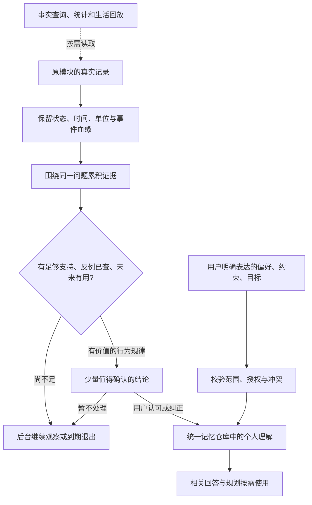

# Holo 记忆：从碎片记录到可用理解

日期：2026-10-27（北京时间）  
状态：产品建议与实施草案，待东林评审。仅新增本文；未修改业务代码、Prompt 或数据，未做模型效果、设备或线上验收。  
依据：东林提供的四张记忆中心截图，以及当前工作区源码（HEAD `ffb3bf75e`，存在其他会话在途改动）。源码说明当前实现，不能替代手机安装包的运行证据。

## 1. 产品结论与推荐决定

**把记忆的基本单位改成“以后能帮助用户的理解”。原始记录先积累、归并和核验，形成值得长期使用的规律后，再请用户确认。**

当前的用户负担来自两处：一是“有来源、说得对”就容易留下候选，却没有充分判断是否值得记；二是内部证据不足的内容进入管理列表，配上确认按钮，形成需要用户整理的工作。

推荐按下面的契约调整：

1. 单次消费、单日打卡、一个待办的状态留在原模块；这些是可查询的事实，不逐条生成个人记忆。
2. 对行为的理解要经过跨时间聚合、反例检查和用途判断，成熟后才进入“值得确认”。
3. 用户确认的是有范围的完整结论，确认后才可作为个人规律用于后续帮助。
4. 保留明确陈述的直达通道：用户主动说出的长期偏好、约束、目标及“请记住”请求，在已有授权和安全边界内直接保存，不重复要求确认。
5. 证据不足时后台继续积累。没有值得说的发现，可以不产出任何记忆。

这里的“面”是同一个问题下逐渐形成的理解：**主题、条件、规律或变化、适用时间、例外，以及未来能怎样帮助用户**。把多条打卡改写成一段更长的流水账，仍不算形成理解。

## 2. 截图内容分别应去哪里

| 截图中的内容 | 推荐处理 | 能成立的更高层理解 |
|---|---|---|
| 3 月 23/24/25 日“戒烟”打卡，数值 1.0 | 作为习惯证据，按该习惯的真实口径计算；不逐条出现 | 在数据足够且语义明确后，描述某段时间的控制趋势或反复出现的困难条件 |
| 两天有餐饮、日用品、停车支出 | 留在财务记录；常见流水无需成为候选 | 只有形成有帮助的长期结构、固定负担或明确变化时才评估记忆价值 |
| 某便利店买饮料、药妆店买美妆 | 不进入个人记忆 | 单笔购买不能证明喜好、所有权或生活身份 |
| 有一条未完成待办，想支持 push | 从任务模块实时查询；不复制成长期记忆 | 若用户明确表达持续产品目标，可关联目标；不把任务正文升级为个人属性 |
| 出行交通卡、离线地图任务已完成 | 作为已完成事件供回放/查询 | 当前旅行阶段可按已有事项提供临时上下文，行程结束后不继续作为当前状态 |
| 用户指出物业费数据没对上 | 作为本次问题和反馈处理 | 不能自动泛化成“用户长期不信任数据”等个人判断 |
| 多次宠物消费，推测养猫 | 合并为内部待证线索，不急于确认身份 | 用户明确说明养猫及照料责任后，才形成相应事实；代购等反例必须保留 |
| 两天体重 83.5、83.1 | 留在数值记录 | 有足够可比较测量后才描述阶段趋势，单次差值不产生长期结论 |
| 用户明确说“我在戒烟，别用责备语气提醒” | 保存目标与沟通偏好，不二次审批 | 后续建议围绕目标，表达遵守用户偏好 |

以上是处理规则和示例，不代表已经从东林的真实记录发现了这些规律。

## 3. 形成理解的流程

### 3.1 证据：原始数据各有所属

- 账单、任务、习惯、健康、想法仍是事实真源。记忆只保存必要的来源引用、修订和理解，不另建一份业务流水。
- 某次打卡同时出现在习惯、想法回顾和周报中，仍只有一次原始事件。AI 报告、摘要、发现和用户点击认可，都不增加独立行为证据数。
- 聚合快照须能回溯底层事件集合或明确的窗口/修订关系；同一习惯多次生成的重叠窗口快照，不能自动算多份独立支持。
- 同一天多条真实数量记录必须按原模块语义保留并累计；“跨天重复性”的支持天数则按天计算。不能把一天吸烟多次删成一次，也不能把一天多次记录当作多天规律。
- 记录创建时间、事件发生时间和补录时间分开。导入或补录集中在凌晨，不能据此判断用户的行为发生在凌晨。

### 3.2 聚合：围绕命题积累，允许不同说法汇入

聚合键至少区分主体、对象、观察维度和适用条件。以习惯 ID 等可靠业务锚点为基础，语义模型只提出关联，程序验证来源与冲突。

例如同一戒烟主题可有“当前目标”“阶段控制趋势”“某类场景下的波动”三个维度；相同维度持续更新同一结论，不因日期或措辞变化新增一条。回答长短偏好与徒步偏好分别保留；不同条件下的相反表现不能被粗暴合并。

聚合的结果必须比原记录多提供可验证的信息：重复节奏、趋势变化、条件差异、明确约束或持续责任。只有“多个日期都打了卡”“餐饮经常有支出”仍可能没有记忆价值。

### 3.3 规律：证据强度与未来用途都要过门

每条候选至少回答以下问题，缺一项就不能进入“值得确认”：

| 检查 | 必须回答的问题 |
|---|---|
| 命题支持 | 证据支持这句完整结论吗？主体、否定、单位、日期和条件是否一致？ |
| 独立性 | 支持来自几个真实事件、几个日期、几个自然周期？有没有同事件重复投影？ |
| 观察范围 | 是单次、阶段变化还是跨周期重复？是否需要对照窗口或未发生的样本？ |
| 反例与缺失 | 有没有相反记录？没记录是未知、未发生、缺测，还是明确的零？ |
| 解释边界 | 只是同期出现，还是用户明确说明了关系？不能从同时出现推导原因。 |
| 使用价值 | 下次哪类具体问题会用到它，能改变建议的哪一部分？只是复述流水则不通过。 |
| 当前适用性 | 来源是否有效、信息是否仍适用、是否被用户拒绝或纠正？ |

“有用”不能只靠模型一句“有助于个性化”。首版要求给出可审核的用途，例如“安排运动时间时优先参考该节奏”“预算规划时计入已验证固定支出”。用途不能引入证据以外的健康、身份或心理推断。

用途类别必须映射到实际已接入的消费者场景，由程序校验；尚无消费能力的场景不能靠模型自报用途晋级。样本评审还需检查这项理解是否确实改变了相关帮助。

## 4. 戒烟这条链路怎样形成闭环

### 4.1 先校准记录含义

当前个人情境适配器把打卡写成“完成习惯打卡 + 名称 + 数值”，提供完成状态和习惯名，却没有完整携带好/坏习惯方向、数值单位、目标口径、零值含义和补录属性。因此仅看到“戒烟，1.0”，不足以判断是一天未吸烟、一次吸烟事件、数量 1，还是其他自定义记录。

实施时先对齐现有习惯模块的统计口径，复用其按日聚合、正负向语义及数值处理。所需字段不够时补来源契约；旧数据含义不明就保持未知，不靠名称猜测，更不能把所有打卡叫作“戒烟成功”。

### 4.2 分开目标、统计和个人规律

- **目标**：“我正在戒烟”可以来自用户明确陈述或已建立的有效目标。只创建了一个名为戒烟的习惯，最多说明设置了该记录项。
- **统计**：“某段时间记录了几天、几次”由程序计算，可以在习惯复盘和用户查询中直接展示，不必请用户认证算术，也不自动变成个人规律。
- **个人规律**：“在有完整记录的若干周中，某类明确场景下更容易出现吸烟记录”需要条件数据、对照与反例支持，并在成为后续个人理解前确认。
- **原因与建议**：即使用户认可了上述观察，也不能自动认定工作压力是原因，或认定某项干预有效。原因和偏好分别取得证据或向用户做最小澄清。

已建立的目标关联原目标 ID，当前状态实时读取；任务/目标模块继续负责进度与变更，不另保存一份可能过时的完成状态。

可供确认的文案形式（仅示意，不代表真实发现）：

> 最近四周，在记录较完整的三个周末里，你的吸烟记录比相邻工作日更集中。这个现象是否符合你的实际情况？
>
> 依据：显示真实起止日期、有效样本和对照；展开可看支持与反例。  
> 用途：你讨论戒烟安排时，帮助留意周末的应对方式。  
> 操作：符合我的情况 / 改一下 / 不准确；可选择暂不处理。

只有零散正例、没有可比工作日或周末记录时，上述结论也不能成立。不能因为“已有 3 次记录”就拼出“周末容易复吸”。

## 5. 首版规律类型与门槛

首版先做好单主题的阶段变化和重复节奏，使用现有数值工具；开放式跨域条件关联作为后续能力。支持多领域不等于每条规律都必须跨域。

下表数字是**待用合成数据和真实模型样本校准的工程起点**，不是统计显著性或医学有效性的证明。通过数量门槛仍须通过反例与用途检查；不展示模型自报的“92% 置信度”。

| 类型 | 首版准入起点 | 边界 |
|---|---|---|
| 明确偏好/持续约束/目标 | 一次清楚的用户陈述即可，核对主体、范围和当前性 | 尊重已有授权和敏感信息规则；本次请求不自动持久化 |
| 按日习惯的阶段趋势 | 至少两段可比完整周；每段至少 5 个有效日；按应观察日计算的覆盖至少 70%；变化达到该指标预先定义的实际意义门槛 | 目标、记录方式或单位变化时不可直接比较；不推断永久习惯 |
| 每周重复节奏 | 至少覆盖 4 个完整周，至少 3 周出现一致方向；每周相关时段及对照均有可比观察 | 缺失不能作零，不能只检索命中的日期 |
| 固定周期负担 | 至少 3 个独立自然周期，属于同一已核实项目；周期和金额容差由规则定义 | 一笔房租或一次话费不能证明每月固定负担；账单数据不套日历覆盖率 |
| 条件关联 | 后续再做；需要明确条件、可比样本、反例、足够重复及限定表达 | 两次共现不足以认定规律；不自动写因果 |

财务是事件记录，覆盖完整性从已导入账期、账户范围和来源完整性判断；健康时间序列按测量覆盖判断；习惯按该习惯的记录约定判断。不能全域共用“有记录天数 ÷ 日历天数”。数据不具备适当分母时，只描述记录范围内的事实。

阶段趋势默认只代表那个阶段。持续多窗口成立后才评估更稳定的节奏；过期或出现反证时重新计算，新信息改变含义才再次确认。

## 6. 用户看到的页面与确认方式

保留独立页面名“Holo 记忆”和现有入口，两个视图调整为“已记住”“值得确认”。“观察中”的后台工作状态不再直接成为内容列表。

### 6.1 已记住

- 按可理解的主题组织，如“习惯与健康”“工作与规划”“消费与预算”；单主题下每条仍对应一项清楚命题，允许继续按领域筛选。
- 每行优先展示主题、完整结论和适用范围；来源、详细统计、限制条件在详情展开。连续列表沿用现有设计规范，不增加层层卡片。
- 清楚区分“你告诉 Holo 的”“你确认的规律”；去掉没有用途的技术标签和考据括号。限定与过期状态仍必须真实显示。
- 详情显示依据、反例、为什么有用、适用时间，并保留纠正、停用、删除及可用的撤销能力。

### 6.2 值得确认

- 只显示已经通过质量门槛的行为规律，或确会影响当前帮助的关键冲突。证据不足、未知版本、系统异常和无价值碎片不进入此视图。
- 页面同时最多呈现 3 条；后台按当前目标相关性、证据质量和新增信息排序，这个上限不是产出配额。其余候选继续内部评估、更新或到期退出，不形成必须清空的积压。
- 每条包含结论、关键依据、具体用途和确认操作。依据默认简短，用户可展开核对。
- 确认表达为“符合我的情况”；纠正允许补充适用条件；“不准确”拒绝该命题；“暂不处理”只延期，不算认可或否定。
- 首次确认只确认当前完整命题及范围，不把一般观察升级成因果或永久属性。数字小幅刷新不重新确认，含义、条件或方向发生实质变化才生成待校准版本。
- 不做红点、推送或每日清空任务。用户进入相关对话时可以自然询问一条确实影响结果的成熟结论，未回答仍提供基于当前输入的帮助。
- 暂不处理后该命题至少冷却 30 天；没有重要新证据不重复问。明确不准确的命题不得换措辞重现；主动停用/遗忘沿用已有墓碑及恢复语义。

### 6.3 空态、失败和可访问性

- 尚无个人理解：“记录积累后，Holo 会把有帮助的规律带到这里。你也可以直接告诉 Holo 想让它记住什么。”只提供现有可用的对话入口。
- 暂无值得确认：“暂时没有需要你确认的新理解。”不展示“还有若干条证据不足”等进度债务。
- 加载与失败保留最后一次有效列表，提供明确重试；网络或模型失败不伪装成没有发现。
- 确认保存成功后给就地回执；失败保留内容与编辑草稿，不能先移走再声称成功。
- 动态字体下结论与操作自然换行，操作热区至少 44pt；VoiceOver 朗读结论、范围、状态及动作。状态不能只用颜色表达，查看详情与确认必须是可区分的控件。

## 7. 为什么当前流程容易产生碎片

以下证据是本次读取源码确认的范围；没有读取东林的个人数据库或联网核验生产 Prompt。

| 源码位置 | 已确认事实 | 产品含义 |
|---|---|---|
| `HoloBackend/src/prompts/defaultPrompts.json` 的 `personal_context_extraction` | 允许提取事件、状态等开放命题；要求包内聚合，但没有完整的未来用途与跨周期准入契约 | 可以正确提取一个孤立事件，同时仍不值得成为个人记忆 |
| `Services/AI/PersonalContext/HoloContextReconciler.swift:98` | supported/qualified 进入后续准入；已有核验限定、敏感性与归并处理 | 现有核验主要解决命题支持问题，需要补价值与规律成熟度判断 |
| `Models/AI/HoloPersonalContextModels.swift:650` | 合并签名比较完整 statement、关系、主体、对象与范围；另有模型 mergeInto 路径 | 已有去重能力，但日期或措辞变化不保证自动汇成同一时序命题 |
| `Services/AI/PersonalContext/HoloLifeSourceObservation.swift:285` | 习惯单条打卡进入个人情境来源，口径主要是名称、数值、完成状态 | 来源粒度很细，需先对齐习惯语义再聚合，减少逐条萃取 |
| `Services/AI/MemoryCore/HoloMemoryManagementProjection.swift:290` | 普通 candidate 被投影为观察中“依据待积累” | 内部候选容易成为前台长列表 |
| `Views/MemoryCenter/HoloMemoryCenterView.swift:505` | 观察行按 allowedActions 显示三颗校准按钮 | 即便不推送，也会制造大量逐条审批的视觉负担 |
| 同投影文件 `:327` 与 `HoloMemoryDecisionPolicy.swift` | 存在 qualifiedAdvice 自动可用并显示在已记住的路径 | 新的行为规律确认门槛必须同时约束召回，单改列表仍会暗中使用 |
| `Services/AI/MemoryCore/HoloMemoryAttentionPolicy.swift` | 默认已关闭每日确认收件箱 | 保持现有低打扰方向；这次补足内容质量与列表准入 |
| `Services/AI/Discovery/DiscoveryPublicationPolicy.swift` | 已有独立事件、跨日/周期、反例覆盖和否定去重机制 | 可抽取适用的证据工具；发现发布门槛不等于长期规律门槛 |
| `Services/AI/Agent/PatternMining/HoloPatternMiner.swift` | 已有从数值工具提取部分确定性趋势的能力 | 复用数值事实计算，不能假定它已经接通后台记忆聚合 |

表中 `Services/…`、`Models/…`、`Views/…` 的项目根均为 `Holo/Holo APP/Holo/Holo/`。

## 8. 工程落地：在统一仓库前补合成与价值门槛

### 8.1 简短决策记录

| 决策 | 选择与代价 |
|---|---|
| ADR-M1 记忆单位 | 采用有用命题与规律；保留按需查原记录。列表数量会减少，形成规律需要时间，但每条更能解释后续帮助 |
| ADR-M2 事实与理解 | 原模块继续持有事实；统一 HoloMemoryRecord 持有个人理解。新增的是可重建聚合索引与策略，避免另一套记忆真源 |
| ADR-M3 两条准入路径 | 明确陈述按现有授权直达；行为归纳成熟且经确认后进入个人模型。减少误记，接受早期个性化较少 |
| ADR-M4 用户确认的含义 | 确认命题、范围及其允许用途；不计作新行为证据。对话、发现点赞和记忆确认分别保留语义 |
| ADR-M5 增量演进 | 新准入与消费策略版本化，存量可追溯整理；不清空数据库，不静默抹掉用户确认历史 |

### 8.2 推荐改动职责

以下新增名称仅为建议，实施时遵循项目现有组织方式，不表示这些类型已经存在。

| 层 | 具体工作 |
|---|---|
| 来源适配 | 在 `HoloLifeSourceObservation` 等补齐习惯方向、单位、目标、发生/补录时间和缺失语义；核对现有统计的真实契约 |
| 增量聚合 | 增加 `HoloMemorySynthesisService`：以稳定主题与维度读取相关历史、更新证据索引，按受影响主题重算；不逐条把业务流水交给模型生成个人记忆 |
| 价值与成熟度 | 增加纯逻辑的 `HoloMemoryValuePolicy`：读取核验事实、独立性、窗口、覆盖与用途，输出继续观察/值得确认/直接陈述可用/无价值退出 |
| 统一决策 | 扩展 `HoloMemoryDecisionPolicy`，接入新准入结果，保持唯一最终裁决。行为推断未确认时不能再借 qualifiedAdvice 成为个人规律 |
| 展示与使用 | 扩展管理投影的可见性理由；UI、计数、查询、规划、云端上下文及缓存共同读取新契约，隐藏内部候选不会自动授予召回资格 |
| 控制与生命周期 | 复用控制事件、修订、墓碑、源失效和撤销；用户纠正优先，新批次提交前复查权限、源版本与控制代际 |
| Prompt | 双端同步调整萃取/归纳/核验契约，允许空结果；数值、日期、覆盖及晋级不由模型决定。升 promptVersions，后端发布后核验实际版本与行为 |

### 8.3 理解载荷最少需要表达什么

- 稳定命题身份：主体/对象锚点、观察维度、适用条件；不以完整摘要文本作为唯一身份。
- 类型：明确陈述、行为规律、阶段变化；事件只作为来源或当次上下文。
- 证据：来源及当前修订、独立事件与日期/周期、真实窗口、指标与单位、覆盖语义、反例及其检索覆盖情况。
- 价值：适用的问题类别、能改变的帮助、已有同主题理解以及本次新增信息。
- 控制：首次确认和当前适用版本、用户纠正/拒绝/停用、复核时间、有效范围与策略版本。

优先评估现有版本化 payload/decision envelope 的增量扩展，不先建新 Core Data 实体。旧端不理解新字段时必须保守读取，不能只依赖它会忽略字段来保证安全；多设备不同版本需要单独验收。

### 8.4 与“一个发现”和报告的关系

“一个发现”负责把值得注意的现象说给用户；“Holo 记忆”负责保存会影响未来帮助的理解。发现可以提供入口，但不能因用户点赞就自动变成长期记忆，也不能把发现正文作为新的独立证据。

可复用其来源归一、事件血缘、反例检索和否定去重工具；不能直接复用“两个事件也可说一个发现”的发布门槛。戒烟等敏感主题必须遵守记忆自身的授权边界，不借复用工具扩大“一个发现”的现有数据范围或敏感权限。

报告和周报如包含可用规律，仍必须回指原始证据、经过同一准入，并复用同一命题 ID；避免报告证明记忆、记忆再证明报告的循环。

## 9. 已有碎片怎样整理

先解决新增准入，再整理存量，避免一边清理一边继续生成。

1. 对现有内容生成只读分类预览：明确陈述、成熟候选、单次事件、失效/冲突、暂不可分类。保留原 ID、用户操作及来源映射。
2. 新版本读取时先执行用途规则：单次事件不作为持续个人属性注入回答；按原时间范围仍可从业务数据查询或回放。
3. 未确认的自动碎片退出主列表和个人规律召回，作为来源引用或历史审计保留；不要求用户逐条处理，也不删除业务数据。
4. 同命题多条内容经检查合成一个候选；旧内容保留替代映射。不能把多条旧 AI 摘要算成多份支持，更不能把多条已确认事件合并后自动认定新规律已获确认。
5. 用户确认/纠正过的内容保留原始确认范围和控制记录；其中单次事件可收至次级“历史记录理解”，不继续占据主页面。修改为范围更大的新结论仍需确认，原有限定事实不被抹去。
6. 墓碑、拒绝和学习基线必须贯穿聚合身份迁移；换主题键或换说法不能复活用户明确遗忘的内容。
7. 真正写入整理前生成可复核清单与可恢复快照；失败保留旧记录与用户控制。当前方案不授权清库、删除原始记录、重置 CloudKit 或执行生产整理。

旧客户端可能仍展示或使用旧规则中的内容，新版本不能远程保证旧端行为。灰度与发布说明必须明确客户端升级范围，并验证多设备一致性。

## 10. 实施顺序与验收

### P0：先停止继续增加负担

- 用共享策略区分内部观察和用户值得确认的内容，列表与计数不再直读 candidate。
- 给单次业务记录补价值门槛，保留用户明确陈述通道；同步约束召回和缓存，不能只在 UI 藏内容。
- 修清习惯来源语义，完成存量只读盘点与整理预览。

### P1：用习惯做完整闭环

- 打通同习惯、同维度的证据聚合、阶段变化、跨周重复、反例检查、确认/纠正和实际消费。
- 先验收戒烟的正负向/数值口径，再扩展其他习惯；保留数字型体重等测量的独立聚合方式。
- 交付新管理页投影和低打扰确认，验证原来多条碎片汇为少量有用理解。

### P2：扩展同一机制

- 在习惯闭环通过后扩展固定财务负担、任务节奏、明确责任与约束；跨域条件关联单独评估。
- 与“一个发现”和报告复用证据工具及命题身份，避免重复写入与重复询问。

### 必测产品场景（均为待验收）

| 编号 | 输入或操作 | 应有结果 |
|---|---|---|
| A01 | 戒烟同日多次 1.0，含重复导入和真实多次事件 | 按业务事件正确去重/累计；不形成多日规律，无逐条确认 |
| A02 | 同名戒烟分别配置正向、负向、数值型 | 正确解释各自含义；不从名称断定成功或失败 |
| A03 | 只有两天打卡或两个体重点 | 不形成稳定规律；数据查询仍可正确回答 |
| A04 | 四周可比记录、三周重复且反例完整 | 形成一条有范围的成熟候选，数字由程序校验；确认前不作为个人规律使用 |
| A05 | 上述记录无有效对照、缺测或只有命中样本 | 不提出条件规律；展示或内部记录真实不足，不用零补齐 |
| A06 | 用户明确说戒烟目标、回答简短偏好 | 保存两个不同命题，无多余二次确认；下一次相关帮助使用 |
| A07 | 普通购买很多，或同次事件进入想法/发现/报告 | 无价值流水不入记忆；独立支持不膨胀 |
| A08 | 确认规律后增添普通新记录或轻微数字更新 | 原命题 ID 稳定，不新增一条，不反复确认 |
| A09 | 出现足以改变条件或方向的反证 | 旧规律降级/暂停相应使用，保留版本；有价值时仅校准变化 |
| A10 | 用户纠正、暂不处理、不准确、停用、删除 | 分别生效；未回答不是同意，否定不换措辞重现，遗忘不借聚合复活 |
| A11 | 源被编辑/删除、权限撤回、旧请求迟到、跨端同步 | 详情、查询、缓存和规划遵守最新控制，旧结果不能覆盖 |
| A12 | 明确确认过的单次旧事件迁移 | 记录与原确认保留；不自动扩成新规律；主列表减负且可追溯 |
| A13 | 记录/创建/补录时间不同，跨时区与自然周边界 | 规律使用正确事件时间与周期，不制造凌晨习惯 |
| A14 | 关注同一主题但条件不同，或偏好对象不同 | 正确区分命题；不粗合并、不因改写重复新增 |
| A15 | 新旧客户端共存、重复运行迁移、整理中断 | 新端规则一致，迁移幂等可恢复；清楚记录旧端局限 |

纯逻辑按项目 standalone 机制验证；再做编译、真实模型样本、隔离模拟器链路和必要的设备/多设备检查。测试通过只证明对应范围，不能替代真实规律的用户价值评审。

## 11. 衡量是否变好

不以记忆数量、确认次数或产出率作为成功目标。优先核对：

- **碎片泄漏**：单次账单/单日打卡/单条待办不再进入主记忆与确认列表。
- **理解质量**：每条规律都有可复查支持、反例覆盖、具体用途和明确范围；抽样核对错误归纳。
- **用户负担**：每周实际看到与被询问的数量、重复询问率、主动纠正成本；跳过不是负反馈或失败。
- **实际帮助**：用户不用重复说明，后续相关回答确实按确认结论调整；无关问题不硬塞记忆，过期规律及时退出。
- **成本与时效**：只对受影响主题增量计算；本地先筛，达到门槛才调用模型；打开管理页不触发全历史萃取。

灰度开关只控制新策略的开放节奏，关闭时仍须保留已生效的用户控制与禁止使用边界；不能通过回退旧列表规则把已拦住的碎片重新作为个人属性使用。

这些指标先用合成/经授权样本与现有诊断评估，不因本方案自动新增后台上传或个人数据埋点。实现如涉及后端 Prompt/协议改动，后端改动需要发版/部署后端；本轮未执行部署。
