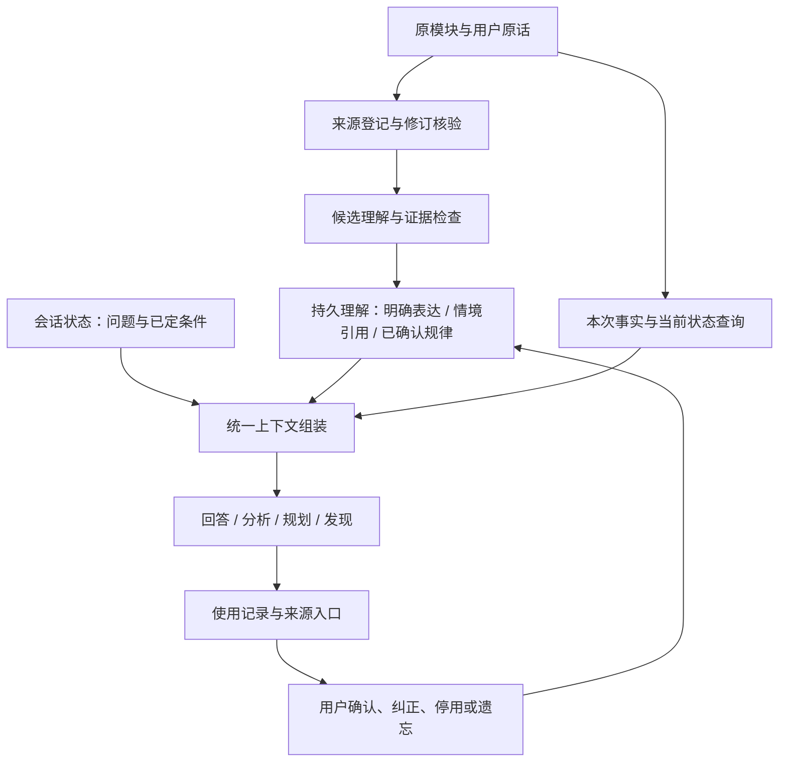

# Holo 记忆与上下文重构：产品与实施方案

版本：实施交接方案 v3.3 · 2026-10-28（继承v3.2范围，最后顺序对抗自审补齐身份、纠正、有效证据、并发、遗忘及写入契约）。

状态：方案已形成，尚未实施或完成效果验收。目标是让用户能核对每条记忆，并在真实任务中获得帮助。本轮仅调研、审查与编写文档，不操作真实记忆、CloudKit、设备或生产后端。

**GLM唯一实施入口：[08-最终实施方案与GLM交接](08-最终实施方案与GLM交接.md)**，含范围、冻结契约、M00–M11工单及可直接复制的开工指令。最后审查及可复跑源码证据见[09-问题闭环](09-最终对抗性审查与问题闭环.md)。本文保留完整产品解释；实施范围、依赖与冲突以08为准。

背景阅读：本文 → [官方调研与技术取舍](01-官方方案调研与取舍.md) → [验收与实施检查表](02-验收与实施检查表.md)。GLM补充见 [03-数据基线与决策摘要](03-东林拍板摘要与数据基线.md)，融合取舍见 [04-GLM方案融合审查](04-GLM方案融合审查.md)，v3.2适配审查见 [05](05-主流方案对比与Holo现状适配审查.md)。

五项主要难点的具体工作分解、既有代码复用和通过条件见[06-五个困难点的解决路径与交付门槛](06-五个困难点的解决路径与交付门槛.md)，属于v3.2实施补充，不代表已修复。

## 0. 明确的产品决定

推荐在现有本地知识仓库上改造，形成一个过程：**保留可核对的来源 → 形成有具体用途的理解 → 按当前任务使用 → 让使用和纠错可见。**

这次交付按六项结果判断：

1. 任意一条“已记住”，都能说明形成方式、准确含义、依据、适用范围和用途。
2. 用户能够打开原话、业务记录或统计组成；依据失效时如实标记并限制使用。
3. 主界面只展示已成立的理解和少量成熟候选，搜索与历史管理仍完整可达。
4. 聊天、分析、规划、回放和“一个发现”使用同一套记忆资格与用户控制。
5. 每次请求只获取与问题相关的资料；当前进度、精确数字读原模块。
6. 能从回答回到当时依据，也能从记忆回到相关使用；用户纠正后不继续沿用旧理解。

### 与既有方案的关系

- 继承 [v2.2 通用方案](../2026-10-27-Holo记忆从碎片到规律的产品与实施方案.md) 的稳定身份、不可变语义修订、限制优先、敏感分区、增量迁移与发现联动，不另建平行事实库。
- 将 [10 月 28 日复盘](../2026-10-28-Holo记忆管理可追溯性与有效性复盘.md) 的八项实际缺口纳入本次必交内容。
- 来源明细、用途判定、上下文组装、引用分级与页面入口采用本文，最终实施裁决见08；其他兼容与生命周期要求继续沿用 v2.2。发现反例时按结论的实际含义判断，不能把“有一个例外”统一解释为所有概率性规律均不可用。
- 既有实施记录包含后续真机与 CloudKit schema 部署的补记。本轮未独立核查线上或设备状态；实施前必须检查实际模型和当前代码，不能直接采用该文件早期“尚未部署”的段落。
- GLM 提供的数量作为待复核的历史基线线索；本文不将“使用字段缺失”解释成“从未使用”，不设置“记忆必须压到几十条”的数量目标，也不把文件标题中的“拍板”视作用户已授权实施、清洗或发版。

### 0.1 完整目标与首版交付分开

源码审查后的判断：方向适合Holo，但v3.1将部分长期能力写得过早、过确定。Holo已具备知识修订、用户控制、混合检索、规划依据与运行恢复，首版优先接齐这些能力；新类型和门面只做必要适配，不替换已有系统。

首版完成A/B/C1：八域共同来源/权限/控制、可核对的记忆中心、生成端与用途准入、合规存量分流，以及现有聊天/情境规划/发现的真实使用闭环。自动规律只开放证据供给已完成的模板；其他领域仍可查询原始事实，不能假称全部规律都成熟。

下列保留为完整目标的后续能力，不捆绑首版，也不能因此降低来源、纠错和隐私要求：

| 能力 | 首版处理 | 后续开放条件 |
|---|---|---|
| 大型证据清单的32KiB分片同步 | 使用有明确窗口、完整成员的有界快照与原模块分页核验；超预算不伪装成可完整复算的持久证据 | 实测证明有需求，确定证据存储职责，完成同步完整性与旧端兼容；不预定塞入控制操作表 |
| 通用长对话自动压缩与新SessionDigest仓库 | 复用现有聊天历史与规划run/frame；保留当前问题条件，记录现有截断问题 | 有实际长会话样本、provider总窗口/输出预算和工具链回归，再选压缩策略 |
| “本次不读写记忆”的新同步控制 | 沿用已有全局与来源级控制；尚未实现前不显示该开关、不承诺临时会话隔离 | 所有相关读写端能理解会话范围限制，且旧端兼容/同步窗口已验证 |
| 句子级短句柄与结构化引用协议 | 先保留现有模型显式记忆ID，删除词重合兜底，新增回答级版本映射；规划复用已有逐项依据 | C2验证各provider、流式显示、原句对齐、业务卡片和版本协议后开放 |
| 所有旧回答/旧统计的精确历史重放 | 旧数据按实际保存程度标“原片段/当前来源/缺历史版本”；不回填成当时已知 | 仅对确有当时快照的历史，及新版本产生的完整引用提供重放 |

“后续”项对应验收保留在清单中，状态标延后/未开放，不算通过；首版安全相关的来源、权限、旧端控制和迁移判据仍必须完成。

## 1. 借鉴其他 agent 后，Holo 应采用什么

官方机制与取舍详见调研。Claude Code 的简短索引与按需读取、LangGraph 的会话/长期状态分离、Letta 的分层与修订、Mem0 的管理历史、Zep 的来源与有效时间，以及 OpenAI 的会话压缩，各自解决不同问题。它们没有共同证明“自动保存越多，用户就会越受益”。[Claude Code](https://code.claude.com/docs/en/memory)、[LangGraph](https://docs.langchain.com/oss/python/concepts/memory)、[Letta](https://docs.letta.com/agent-sdk/memory)、[Mem0](https://docs.mem0.ai/api-reference/memory/history-memory)、[Zep](https://help.getzep.com/graph-overview)、[OpenAI](https://developers.openai.com/api/docs/guides/compaction)

对 Holo 的设计判断：使用这些分层、按需读取、来源和修订机制；继续由 Holo 管理生活数据、知识资格和用户决定。现阶段不引入外部记忆 SaaS、图数据库或新的 agent 编排框架。

## 2. 先把五种信息分清楚

这些是逻辑职责，不是五套独立数据库。

| 层 | 保存什么 | 生命周期 / 权威 | 用户如何感知 |
|---|---|---|---|
| 原始来源 | 账单、打卡、想法、用户消息、任务、目标、档案、健康记录 | 原模块负责；精确数据和当前状态以这里为准 | 点来源进入原模块 |
| 持久理解 | 重要事实、偏好、约束、重要经历、当前情境引用、经确认的规律 | 带来源、条件和版本；受用户控制 | “Holo 记忆”里可查、可改 |
| 会话状态 | 当前问题、用户已回答的条件、已定选择、待解决问题 | 当前会话；可压缩，不自动升级成持久理解 | 追问时不用重复解释 |
| 本次任务上下文 | 此次问答/规划需要的记忆、当前状态、证据与查询结果 | 一次请求或同一任务；使用前核验 | 回答贴合当前问题 |
| 使用记录 | 本次提供过哪些资料、回答标注哪些依据、采用哪些约束 | 关联回答和当时版本；服从遗忘/撤权 | 可回查依据与影响 |

例如：“这次只有两天”留在会话；“我希望周末尽量不排工作”可以成为持续偏好；“本月花了多少”现场查账；“周末支出似乎更高”要有真实统计支持，再决定是否值得形成长期理解。

## 3. 哪些值得记，如何避免确认疲劳

### 3.1 三类持久理解

| 类型 | 准入条件 | 保存与确认 | 使用边界 |
|---|---|---|---|
| 用户明确表达的重要事实、偏好与约束 | 能核对原话；本人、否定、条件、时间和授权明确；对未来有用 | “请记住”即时保存；普通对话中明确、持续且有用的表达可在现有授权下保存，轻回执并可撤销 | 仅按原意使用；一次重要经历可以保留，不要求重复发生 |
| 关联原模块的当前情境 | 对具体任务有作用；关联有效实体或明确陈述 | 保存关联和意图，不复制业务进度；无需逐条确认算术与状态 | 使用时重读原模块；结束后退出当前情境，重要经历另按事实处理 |
| 从记录归纳出的规律 | 独立证据、覆盖、比较口径、反例与具体用途均合格 | 达到成熟门槛才展示“值得确认”；用户确认准确命题后持续使用 | 保留条件、样本与例外；不能外推人格、因果或医学结论 |

用户明确说“今晚说短一点”即时作用于当前会话，不保存成永久表达偏好。关于他人的转述、假设、玩笑、引用和 AI 自己的建议，不能当成本人的确定事实。

### 3.2 每条自动提炼内容必须通过“具体用途”检查

统一记录 `useCases`，包含：适用任务类别、触发条件、预期改变、用户可读的一句话说明。任务类别首发为回答表达、时间安排、方案取舍、持续事项背景、重要经历回顾；这是一套通用能力分类，不按宠物、商家或某个实体写特判。

例如“旅行安排时，要考虑家中照料责任”具有具体用途；“用户有一个喂猫打卡项”通常只是流水摘要。用户显式要求保存的内容保留其意图；与安全、来源授权冲突的请求仍按已有规则处理，不能偷偷扩大权限。

用途判定还要检查：是否只是已有记忆的改写、是否能由原模块随时准确查询、是否仅有本次作用、是否有新的条件或实质信息。模型可以提出用途，程序核对结构和范围，发布评审再判断其真实价值；不能用模型自报的高分替代评估。

### 3.3 候选在后台成熟，不变成用户待办

- “值得确认”首页最多三条，不凑数量，不发红点、每日清空任务或常规催促。
- 只有证据完整且有用途的候选可进入；用户可主动搜索全部成熟候选。
- “暂不处理”同语义默认冷却 30 天；新证据只有造成实质变化才可重新评估，换措辞不能绕过。
- 未成熟模型猜测不作为跨会话建议依据。用户主动问“你观察到了什么”时，可以展示有依据、明确限定的探索结果，不把它登记为已记住。
- 聊天中只在当前问题必须解决且无法合理推断时问一次；跳过后继续帮助，不把确认当作获得服务的前置条件。

### 3.4 生成端防碎片与程序准入同批完成

采纳 GLM 的生成端第一道约束，安排在 B 批次，与用途/证据准入一起完成并验证；A 批次的来源和署名修复可先交付。不能仅靠客户端丢弃候选，让模型继续付费生成大量碎片。

`personal_context_extraction` 及其他实际产生候选的 Prompt 同步表达：

1. 一条候选只表达一个可独立核对的命题；并列原文中的无关实体、活动和时间不混入正文。支持片段必须对应这条命题，不能拿整段文字为无关细节背书。
2. 普通单次流水保留在来源索引，不自动生成持续个人属性；用户明确要求保存、重要单次经历和当前事项限制仍按其真实范围处理。禁止“一切单次事件不得成条”的总禁令。
3. 同一命题重复出现只增加证据；同一主题的不同意图、行为、条件和阶段仍分别表达，不能压成一个宽泛故事。
4. 未成熟、无用途或身份不明时允许没有候选；合格的重要事实和规律正例必须仍能产出。缺失用途或证据不能靠模板化“用于背景理解”补齐。

当前后端模板已有同包聚合、主体/时间、AI 摘要排除与自然语言要求。本次补足的是命题相关性和流水价值边界，不能将已有规则重复描述为完全缺失。Prompt 只约束生成，最终仍经过来源核验与程序准入。

B 批次同步 iOS 后备、后端模板、Prompt 版本和正反例；若协议字段不变，可独立于 C 批次的新引用协议发布。实际部署仍需明确授权。

## 4. 每条记忆必须有一条能核对的证据链

### 4.1 四种身份继续分开

沿用原方案：来源 ID、证据/底层事件身份、命题 ID、语义修订 ID。主题用于组织，不能代替命题；相似句子不自动合并，不同条件不因同一主体而互相覆盖。

同一底层事件被想法、对话和报告多次引用仍只算一份独立事件；重新萃取或生成报告不增加证据次数。措辞变了但命题相同，只更新证据；语义、适用范围或用途权限扩大，生成新修订，原确认不能自动授权扩大部分。

v3.3补充：当前纠正分支只改文案，指纹和修订ID可保持不变；证据ID也漏掉窗口/覆盖等字段。实施必须重建实际结构语义，以版本化规范编码区分完整证据；旧ID保留映射，不全库重算。同ID不同不可变内容不得fetch-first归并。准确协议及探针见08§4.2–4.4、09 R02–R07。

### 4.2 来源引用必须携带的信息

| 字段组 | 必需信息 |
|---|---|
| 定位 | 来源领域、实体/消息 ID、所属会话或业务容器、来源修订、敏感分区 |
| 时间 | 原发生时间及精度、系统获取时间、适用起止、来源时区；禁止拿萃取时刻冒充事件日期 |
| 原文 | 形成时必要片段、来源角色、当时规范化文本摘要校验值；可精确定位到该修订的 UTF-16 范围 |
| 关系 | 支持哪一条明确陈述、支持或反对、独立事件身份、派生自哪些底层来源 |
| 当前状态 | 可核验、内容已变、明确删除、排除/撤权、待同步、暂无法核验 |

片段范围基于确定的规范化文本和修订；覆盖 emoji、换行、附件与截断场景。失配时展示已保存的必要片段及“原文已修改”，不能把当前内容套到旧位置。仅保存必要内容；健康原始样本不因追溯需求复制到云端。

该定位能力对新生成记录逐步补齐；旧记录若只有摘要或当前来源，不追造原文范围、过去修订或事件时间。用户重新核对后形成的是当下的新确认/新依据，不补写成历史确认。

**能找到来源与来源支持结论，分别判断。** 对明确原话检查否定、条件、主体和转述；对程序事实核对数值与口径；对行为解释审查是否由证据支持。“有来源”不能直接等同“已证实”。

### 4.3 统计来源必须可展开

统计证据至少包含指标与单位、计算方法/版本、时区与窗口、比较窗口、真实独立事件数、应有机会数/分母、有效观测数、缺失、反例和组成记录引用。`sampleCount` 不再同时扮演天数、交易数和独立事件数。

例：按计划完成率，分母来自应执行机会，不是自然天数；未记录、明确未完成、数值为零分别处理。财务查询按原模块口径区分退款、转账与调整，不能复制一份不同口径的“记忆账本”。

点“依据”后先显示统计卡，继续展开组成记录或打开原模块带筛选的结果。历史成员的必要数值/修订与当时口径固定，当前重算结果另列。无法还原历史快照时如实标记，禁止承诺能精确复算。

健康提供本机统计和覆盖核验；样本被撤回、无法访问或历史不完整时标注范围，不能为了完整外观保留不应保存的健康明细。

### 4.4 来源类型与形成方式分开

`explicitUserStatement` 只能描述真正的用户原话或独立用户纠正。业务记录片段仍是业务记录；不能因为抽取进个人情境就变成“你在对话里说过”。对话必须定位用户消息及原话，助手回复不作独立个人证据。

统一来源状态服务供详情、管理、确认、消费使用。查不到一条本机记录时先区分待同步、查询失败与明确删除，不能把 nil 全部说成“已清除”。

来源解析必须先规范化 `sourceKey`，再根据实体子类型选原模块。现有直接 `UUID(uuidString: sourceID)` 无法处理 `habit-checkin:<uuid>` 等键；只剥前缀仍可能把打卡 UUID 当成 Habit UUID。裸 UUID、各域前缀、habit 定义/打卡、对话消息和汇总来源共用类型化定位器，路由、存活检查和预览复用同一结果；未知键明确待核，不猜实体。

存活与业务状态条件由各原模块提供，不能给所有实体统一套`deletedAt == nil`；例如任务路径涉及`deletedFlag/archived`，习惯定义与打卡也不同。先验证实体类型与状态谓词，再开放来源跳转，避免修好ID后暴露新的查询错误。

### 4.5 八域与派生输入的落点

| 领域 | 核验位置与关键语义 |
|---|---|
| 财务 | 原交易、预算/账户设置及其修订；金额和余额实时查询 |
| 习惯 | 区分 Habit 定义、HabitRecord 打卡与应执行机会；来源跳转类型不能混用 |
| 健康 | 原健康模块、本机权限与统计；敏感数据及派生留本机分区 |
| 任务 | TodoTask 当前状态；计划时间、截止时间、完成时间分别使用 |
| 目标 | Goal 当前协议与进度来源；不把过期进度保存在记忆摘要里 |
| 想法 | Thought 原文与 AI 排除状态；区分本人的表达和引用内容 |
| 对话 | ChatMessage 的角色、消息/会话 ID、用户撰写正文与附件来源 |
| 档案 | 档案服务当前权威字段；记忆持引用，不另存一份可冲突档案 |
| 报告、发现、规划 | 结论可作为理解修订的入口，但证据必须回到底层记录；AI 输出不自我强化 |

## 5. 规律如何形成、变化与退出

统一流程：变化来源进入增量队列 → 提出候选命题 → 程序构造证据与统计 → 核验支持/范围/反例 → 判断具体用途 → 内部积累或值得确认 → 确认后用于相关任务。

### 5.1 补齐供给，而非降低门槛

- 旧桥接中固定为空的覆盖率与验证周期，改由相应观察器/统计服务给出；无法提供时保留不足原因。
- “没有收到反例列表”只能是未查明；只有带查询范围、版本和覆盖结果的检索才可记为查过未发现。
- 独立事件按去重后的底层身份计算；统计天数不能直接充当实际行为次数。
- 各模板保留原有最少跨度/样本/覆盖等可测试参数；这些是初始产品门槛，不是科学定律。实际含义还需模型盲评和反例测试。
- “每周”“每月”必须检查完整周期，不能只有跨度足够；跨域关联还需冻结候选后的独立验证周期。只表达相关，不声称因果。

### 5.2 例外与冲突按语义处理

“总是”被一个真实反例推翻时必须改写或撤回；“更常在周末”允许明确范围内的例外，但需要把支持比例与反例同时展示。不得通过缩小样本、挑窗口或排除不利数据来保住结论。

用户纠正生成独立陈述及修订；原行为证据仍保留原性质。用户说“我希望早睡”不等于已做到，记录显示晚睡也不否定该目标。希望、偏好、行为与推测是不同关系。

### 5.3 来源变化后的处理

- 内容摘要校验值发生实质变化：受影响命题暂不作为当前事实继续使用，触发重核；纯展示元数据变化不改变语义。
- 某条支持删除：重算剩余证据是否充分，不能永久连坐所有同主题理解；复核前限制受影响内容。
- 来源撤权/排除：立即限制本机消费和外发，失效事件影响缓存、向量、发现、规划和使用记录的可见片段。
- 当前情境结束：退出当前建议，保留合规历史；历史事件不因“过了多久”变成没发生过。
- 新版本与旧版本冲突：来源事实按原模块处理；用户当前明确约束优先于旧偏好；有歧义且影响当前任务时才询问。

实施先修通现有失效链的局部断点：远端变更传入空来源集合与conservative=true，当前守卫会提前返回；来源通知和证据还存在键格式差异。规范化来源、允许保守重核进入调度、合并增量事件并在读取边界核实，完成后才能宣称跨入口失效生效；不得只反转守卫就给全库反复写unknown。证据与验收输入见06§3。

v3.3进一步要求：有效证据绑定准确语义版本，依赖与复核不再只读initial快照；旧证据较晚写入不能解除较新限制。来源依赖不能仅按formation豁免；revised未核语义支持不直接可用。用户控制与旧镜像同分区原子提交，遗忘清除派生正文，下一轮旧消息/草案也不能绕回失效记忆。具体实施见08§4.3–4.6。

用户确认针对准确语义修订；暂停使用、遗忘、恢复、撤销继续按原方案因果与控制代际处理。否定一个理解不封禁整个主题，遗忘后同义改写也不能偷偷复活。

删除原对话时，从它自动提炼的理解按来源删除处理。用户曾明确“请记住”或后来独立纠正的内容，有单独保存的用户陈述来源，可继续保留；删除对话的说明必须明确这一区别，并提供进入记忆管理的入口。来源追溯不能用来反向恢复用户已删除的完整对话。

### 5.4 新鲜度排序与事实有效性分别管理

当前已有 currentState/phase/durable 的 14/60/150 天半衰期参数，可保留为排序实验的起点；`permanentFact` 已有单独处理。参数不能直接作为“到期失效”或“该用户事实不再成立”的证据。

持续约束、用户明确偏好、历史重要经历和适用期内规则按语义与权威来源处理。仍适用于当前动作的明确硬约束不因新鲜度乘积过低被普通召回门槛漏掉；阶段情况到期则按适用范围退出。用户确认不是永久免复核，时间过去也不意味着自动遗忘。不得以“已有衰减公式”代替删除、纠正、撤权和同步等生命周期验收。

## 6. 上下文管理：每次只获取需要的资料

### 6.1 所有消费入口共用一个组装器

在现有 `HoloMemoryQueryService` 与个人情境检索基础上形成统一 `HoloContextAssembler` 门面。聊天、Agent 工具、分析、回放、情境规划和发现使用同一门面；领域只负责提供数据，页面不重新裁决“这个可以作为事实”。

实施时优先适配既有`HoloContextRetrievalService`、`HoloPlanningRequestFrame`、`HoloContextPlanDraft`的`basisEntries/evidenceRefs/planEffects`和运行控制，不再新建一套等价检索器或任务状态库。统一门面是请求与资格的薄适配层，原模块实时查询和原运行恢复机制保留。

输入：当前请求、任务类别、对象/时间范围、消费者能力、现有授权、会话状态、预算。

输出：`ContextPack`，包含当前任务、必要用户约束、已解析理解、实时业务事实、证据句柄、覆盖/不足、来源与控制代际、预算记录。模型收到的是任务资料，来源内容不会取得系统指令权限。

### 6.2 组装顺序

1. 检查用户设置、消费者用途、来源范围与敏感分区；当前请求的明确指令先进入任务状态。
2. 抽取本次对象、时间和需要作出的决定；复用已有意图识别，不新增一次常规 planner 网络调用。
3. 精确查询类读取原模块；需要个人背景时才召回持久理解。
4. 混合召回：业务实体/命题、词法、已有语义索引、时间/条件；沿用候选上限 40、选入最多 8，不凑满。
5. 适用于当前动作的明确硬约束单独检查，不能因向量相似度或 top-k 排名低而遗漏；无关偏好不全局注入。
6. 按来源状态、时效、确认语义、用户控制和具体用途筛选；同一事件和同一命题去重，带入相关反例。
7. 在预算内组装；需要时沿用一次原文补查，最多 4 段、8,000 字符。语义检索失败时使用现有词法/实体/时间检索，并记录覆盖不足。
8. 提交模型前复查来源/控制版本；回答呈现或执行前再次核对受影响部分。用户改变限制时停止继续输出失效建议，已显示历史标记更新。

对临时无法核验的数据不给出过度确定的个人判断；其余合规资料仍可帮助当前任务。不能把一次检索故障说成“你没有记录”，也不能让无记忆命中阻断普通业务查询。

### 6.3 首发预算

下列为 Holo 的初始可调参数，不是厂商推荐值。资料包不包含系统提示、当前用户原话、最近对话和输出预留；最终总输入必须服从实际 provider 的窗口。

| 项目 | 默认上限 |
|---|---|
| 通用持续偏好 | 最多约 200 tokens；仅用户明确的全局表达偏好，计入记忆总预算 |
| 每次记忆内容 | 2,000 tokens、最多 8 条，延续现有查询预算 |
| 普通问答资料包 | 2,000 tokens；精确数据较多时走分页工具结果 |
| 规划 / 深入分析资料包 | 6,000 tokens，其中记忆部分仍不超过 2,000 |
| 会话压缩摘要（C2后续） | 1,000 tokens的待验证初值，保留问题、决定、约束、未决事项和来源引用；首版不新增该仓库 |
| 原文补查 | 沿用最多 4 段、8,000 字符，同时受资料包 token 预算限制 |

不能为满足数量上限删掉必须遵守的约束。必要上下文本身超限时缩小本次任务或分段求解；可以不带次要记忆，不可以只保留半句约束。Token 估算与供应商实际用量对账，不假设所有模型采用同一分词。

### 6.4 会话压缩规则

本节是后续长会话能力的设计目标，不是首版必须新建的系统。当前标准聊天分支取最近20条DTO，情境规划已有frame/run；首版先检查这些路径有没有丢掉影响当前任务的明确条件，并复用已有状态。通用压缩需以实际长会话、工具调用和各provider窗口为依据再实现。

会话摘要保留：当前目标、用户已明确回答的条件、已接受/否定的选择、待解问题、关键实体引用、来源修订、控制代际及最近对话范围。不摘要隐藏思维链，不把模型猜测压缩成用户事实。

达到动态可用输入窗口的约70%可以作为后续实验起点，不作为未经测试的统一阈值。保留最近的完整交互及未完成工具调用，不拆散调用与结果。压缩后显式约束和来源引用通过结构校验，摘要故障时继续使用可承受的原始会话片段或缩小任务，不静默丢掉用户决定。

若后续证明需要通用摘要缓存，再决定是否使用本机`Application Support/AIContext/sessions/<conversationID>.json`；它可重建、不进入长期记忆或CloudKit，并接入删除与撤权。该路径目前不是已存在的仓库，也不为首版提前创建；现有规划run只保留最近20个，不能将它描述成无限历史。

### 6.5 读写设置保持简单

沿用现有“自动形成记忆”和“记忆辅助回答”开关：前者控制后台学习，后者控制消费。关闭辅助回答不删除既有记忆；关闭自动形成后不回填遗漏历史。用户主动“请记住/修改”作为手动操作，不暗中打开自动学习。

后续可提供“本次不读写记忆”的范围覆盖，但首版暂不展示该新开关。范围排除必须被自动抽取、后台补学、所有消费端和相关设备识别；现有操作枚举不认识`sessionMemoryExclusion`，直接写入会被当前解码路径跳过，无法形成承诺的隔离。

开放前先建立可验证的范围控制与协议能力策略；若无法保证相关端理解，就不发布该功能。首版继续使用已存在的全局与来源级控制，不用一个新的本机布尔值假装跨设备排除。离线同步窗口和此前已完成外部请求的边界需明确说明。

## 7. 用户真正看到的页面

实施后的完整场景、三个入口、来源核对与返回、规律确认和纠错动线见[07-实施后的用户体验与完整动线](07-实施后的用户体验与完整动线.md)。它解释v3.2的首版效果，不代表功能已上线，也不把C2目标提前承诺给用户。

### 7.1 统一一个“Holo 记忆”管理体验

保留独立入口。长廊只展示少量相关摘要与“查看全部”，进入同一记忆中心；聊天引用详情也复用同一详情组件。退出旧长廊的全量候选/归档列表与单独升级规则。

记忆中心主界面：搜索；“已记住 / 值得确认”两个视图；已记住按偏好与约束、当前关注、重要经历、生活规律组织，可再按领域筛选；更多里查看历史、停用、全部已保存理解与必要数据管理。领域是筛选项，不要求用户知道内部记录来自哪个抽取器。

默认优先固定的重要约束、当前相关情境和重要更新；不按后台反复萃取的更新时间刷屏。列表使用懒加载与分页，首批 30 条、下一批 30 条；聚合分组在数据变化时计算，不在每次滚动重算。iPhone、iPad 和 Mac 使用同一数据投影。

### 7.2 主卡：先给有用信息

主卡只展示明确陈述、形成方式、短依据与范围。例子均为虚构示例：

> **你希望周末尽量不排工作。**
>
> 你明确告诉 Holo 的 · 1 处原话 · 持续有效
>
> 安排工作任务时，优先放在工作日。

规律卡明确写“你确认的理解”；待确认卡写“Holo 从记录中观察到”，同时露出关键样本、条件与不足，不把“可能”“仅凭……”等诊断括号堆在正文。

### 7.3 详情页六个部分

1. 这条理解：准确陈述、形成方式、当前状态。
2. 来源依据：原话/记录/统计，直接可核对；支持和反例分别展示。
3. 适用范围：何时、何事、例外、最近核验。
4. 为什么保留：对哪类任务有什么具体影响。
5. 相关使用：可打开回答/规划；区分仅提供过背景与回答标注依据；无记录时写“暂无可核对的使用记录”，不说“从未有用”。
6. 修改与控制：符合、修改；不准确可选择依据不对/理解不对/现在不适用；暂停使用与遗忘放次级操作，成功后回执并显示生效范围。

来源加载、已修改、待同步、已删除、无权限和无法核验使用不同文案。不能按“是否有深链”决定它是不是统计；对话能定位用户消息，无单一详情页的来源也可打开证据预览。

核对来源后应能回到原回答/方案与记忆位置。保留原入口和未提交草稿，优先预览、必要时打开原模块并提供明确回跳；只验证深链到达而没有返回路径，不算来源动线完成。

### 7.4 搜索与空态

搜索覆盖已记住和成熟候选，默认不混入停用历史；可主动切到所有已保存数据。支持用户自然表达、关键词和主题；“没找到理解”与“原模块仍有记录”分开呈现，提供进入相应原记录查询的入口。

没有成熟理解时说明“当前还没有形成值得保留的理解”，可以立即使用已有数据问答，不暗示用户必须再记录多少条才能得到服务。设置关闭、同步中和读取失败有各自状态。

## 8. 使用可追溯，功劳不能冒领

### 8.1 四个阶段分别记录

`retrieved`：检索到；`provided`：进入模型资料包；`answerReferenced`：回答显式标注某项依据；`userApplied`：用户采纳了相关方案或明确反馈有帮助。采纳只表明用户选择，不能单独证明结果更好。

不用关键词重合补出可靠引用。现有 `HoloMemoryAttributionReconciler` 退出产品署名通道，最多保留为隔离诊断。模型自报引用也不等于已证明的内部因果；页面表述为“回答标注的依据”或“遵循的偏好”，不把全部提供过的记忆显示为贡献。

### 8.2 引用采用请求内短句柄

本节完整结构协议安排在C2。C1普通聊天继续使用现有模型显式返回的记忆ID，核对本次允许ID与当时版本、记录provided/回答标注阶段，删除关键词重合兜底；不把已有ID标记宣称成逐句证据。规划已有逐项来源和影响，直接复用。这样能先交付可核对的回答级使用，不等多provider的全新协议全部完成。

组装器把合规资料映射为 K1/K2（理解）、S1/S2（来源）、Q1（程序统计）。本机映射携带命题、语义修订、证据快照、范围和权限代际；模型无需回写长 ID 和哈希。

在既有模型引用协议上增加版本化的结构标记：对应回答原句、引用句柄和影响类别。原句必须与最终回答精确对齐；句柄必须属于此次资料包；源状态和用途仍有效。流式阶段不向用户暴露内部标记，结束后校验并渲染；无法对齐只保留 provided，不补成确定引用。

原句存在与句柄有效，只证明结构和来源对齐；语义是否支持仍需相应规则、盲评及反例约束。表达风格偏好属于遵循偏好，不伪装成某个事实结论的来源。统计数值与任务调整中可以程序核对的部分，必须程序核对。

### 8.3 固定当时版本

普通消息在现有`extractedDataJSON`字符串字典里增加`memoryUsageManifestV1`（版本化JSON字符串），合并写入、不覆盖已有业务字段。`memoryUsedCount/IDs`保留旧客户端兼容；新客户端对新回答使用固定版本映射。旧回答如果只有ID，就标为“历史引用未保存当时版本”，不能拿当前记录回填成当时依据。

规划的依据和使用映射扩展现有`HoloContextPlanDraft`，随`ChatMessage.contextPlanJSON`保存；`contextPlanRunJSON`只保留轻量运行身份/状态，不塞完整资料或引用清单。报告和发现沿用各自版本化结果载荷。

引用记录包含请求/输出 ID、阶段、当时命题与语义修订、证据快照、回答片段、作用、生成时间与控制代际。只存必要引用，不复制完整资料包；敏感内容的片段与映射留在本机分区，云端结果只保留合规的无敏感引用占位。

“留本机”在这里约束新增记忆证据及使用片段，不等于现有聊天全文都不出设备。主业务库是CloudKit容器，现有聊天/规划有独立授权与保存行为，必须分别核对外部模型处理、结果保存和记忆分区。敏感使用片段不得写入会随消息同步的JSON；需要本机引用时放在受保护的敏感目录、按消息ID关联并接删除链路。若做不到则仅显示隐私受限状态，不复制敏感正文到普通消息元数据。

从记忆查看使用记录，通过本机可重建的反向索引查消息/报告载荷；该索引不是事实库。删除或撤权清除相应正文、片段、索引与缓存；历史中只保留合规的“依据已移除”说明。更改记忆后，旧回答显示当时版本并提示已有更新，不能偷换。

### 8.4 用量缺失先查链路，不能推断零价值

GLM 报告 Mac 副本的旧记录缺少 `usageCount/lastUsedAt`。它只说明该样本没有这两个计数，不能证明所有设备从未使用或直接认定统计写入通道已坏。

先用隔离样本打通并观测：消费者授权 → 合规候选/选择结果 → 资料包 provided → 回答结构引用 → 统计写入尝试/结果 → 新上下文重新读取 → 必要时两设备同步。对照消息引用载荷、现有使用回执与旧计数，区分未启用、未命中、已提供未引用、写入/解析失败、旧版本和副本同步不完整。诊断只保存必要元数据，不记录用户原文。

发布前必须有一条完整的真实消费路径证明，不以字段存在、手工给计数加一或注入虚构引用来补齐。旧 `usageCount` 暂作兼容诊断；产品解释按 §8.1 阶段事件进行。

## 9. “一个发现”、报告与记忆共同工作

- 发现是有限观察的呈现；记忆是明确、持续、有用途的理解。共用来源、事件、命题、语义修订和失效关系。
- “有点像”可以继续探索，不升级长期记忆；“确认并记住”只保存用户看到并确认的具体 claim、条件和用途，不把整份发现正文或建议存成事实。
- 同一命题已经记住时展示“已记住/新增依据”，不再请求重复确认。跨入口表达有实质差异时保留区别，不能仅凭相似度自动合并。
- 报告、回放和规划只有回到底层原始证据才可提出理解；自己生成的文字、摘要和再次总结不会增加独立样本。
- 来源失效、理解纠正、停用与遗忘同时影响发现、回放、报告背景和规划。用户稍后再打开旧报告，标记来源/理解已更新，不将其作为当前证据回流。
- `HoloLifePatternService` 等独立摘要注入路径必须收口到共同资格与上下文门面，不能保留一条“老服务也能直接讲个人规律”的旁路。

## 10. 数据、同步与历史迁移

### 10.1 复用已有存储

继续使用 `CoreDataHoloMemoryRepository`，以已有知识修订与操作两张表承载语义和控制；已有证据引用继续使用。优先扩展版本化 JSON/binary 载荷，不为每个页面新增独立记忆库。

v3.3写入边界：每份revision只进入自身分区；同分区知识、控制、旧别名限制和收据一起提交；跨库不声称原子，失败限制消费并可续跑。新增敏感使用映射按08§6.3放现有敏感目录的受保护本地文件，不写普通同步JSON。不可变审计不豁免用户遗忘的正文清除。

新增数据契约为 `SourceLocator/ClaimSupport/UseCase/EvidenceManifest/ContextPack/ContextUsageManifest/SessionDigest`。这是角色命名，实施时整合进已有 Holo 前缀类型，避免重复类型表达同一件事。

组成记录清单使用不可变 `EvidenceManifest`，首版仅在已限定的窗口/现有包预算内保存完整成员与口径，编码大小在隔离样本测量后冻结；超预算改走原模块分页查询，明确当前查询范围，不声称已保存完整历史统计。不能为了预算只存前N条，却把它作为全量证据。

v3.1提出在操作表写`evidenceManifestChunk`的方案暂停：当前操作枚举不认识该类型，证据数据也不宜因体积增长不断膨胀控制日志。需要分页持久化时再明确证据容器、完整性与旧端策略，32KiB不再是首版强制设计。

需在兼容工单验证旧客户端读取、写回和晚到操作：未知字段/操作保留原字节；不因一条未知操作让整批失败，不让旧端覆盖新语义或撤销限制。若不能保证旧写入不会破坏新知识，该数据保持只读隔离，不能加兜底放行。

上段是目标要求，当前并未实现通用的旧客户端只读隔离。已用当前声明的隔离探针复现：新增操作种类解码失败，证据快照的未来字段经解码/编码丢失。首版优先使用既有操作语义；不能靠本机新开关限制其他旧设备。无法确认相关端协议能力时，不写入需要新控制语义的数据、不开放相应新功能；旧端原始生活记录继续按现有兼容规则工作。

具体采用兼容桥接顺序：先修原始字段保留、未知操作的受影响命题识别、限制优先与局部写入，再启用新载荷。不可理解控制不能被静默跳过后继续授权；能映射既有disable/forget等决定的使用共同语义，不能表达的范围控制等待端能力验证。服务器已有后台最低build限制可部分复用，但不是所有本机读取和普通聊天的全端隔离；详见06§2。

### 10.2 历史数据分流

| 历史记录 | 处置 |
|---|---|
| 用户明确表达/手动添加/纠正 | 保留原意、时间、控制；补来源能补则补，无法证明的标待核，不伪造原话 |
| 已确认理解 | 只承认原语义确认；补用途和证据，不自动扩范围 |
| 自动流水/重复摘要 | 退出主记忆与持续召回；原始数据保留；历史管理与导出可查 |
| 自动推断未确认 | 作为可追溯的内部输入重新聚合；成熟再进入值得确认 |
| 失效、停用、否定与遗忘 | 先导入限制与基线，再处理新知识；不因重建而复活 |
| 无来源、未知版本或歧义身份 | 逐条隔离并保留管理可见性；不当作当前事实使用 |

先在隔离副本盘点、分类、试跑和对账；再按 Store/分区/旧 ID/修订/策略版本分批迁移。每批有扫描/分类/提交/不足/失败收据，提交成功才推进游标，重复运行幂等。打开管理页不触发全历史扫描。

分流扫描所有状态，不能仅从旧 active 里挑剩余项。主题卡可聚合多条理解，但不设“一个主题最多三条命题”或“全库必须剩几十条”的压缩配额；合并前后核对语义、条件、时间和用户确认，保留旧项到新命题/证据的映射。331 条句式命中、52 条同主题等报告数字用来选样本和查问题，不作为直接批量退出名单。

基线要同时记录原始条数、状态、实际来源类型、用户控制、来源可核验性和语义分类。`thought` 字段分布可能包含既有域错标，需与真实来源键对照，不能直接归因于想法抽取器。取样时保留单次重要经历、不同阶段、同主题不同关系等正例。

迁移前需要应用内全量导出备份与一致性备份；这是实际迁移动工时的前置工作，本次未执行。不能重置 CloudKit Development，也不能用真实数据反复试验。新增 schema 如确有需要，先核当前 schema，再走受控的增量发布流程。

### 10.3 同步与隐私

本机用户控制立即影响本机组装与进行中任务；其他离线设备无法承诺即时收到。恢复同步时先应用限制，再开放受影响知识的消费；同步晚到的旧确认不能覆盖新限制。

健康与敏感派生、证据和使用片段留在本机敏感分区。是否允许调用外部模型继续由现有同意和用途范围决定，本方案不扩大授权。临时会话排除、来源 AI 排除和撤权需要传递到整理、向量、缓存、导出和恢复链路。

## 11. 工程落点与后端契约

| 现有位置 | 必须修改的职责 |
|---|---|
| `HoloKnowledgeContract/Resolution` | 增量表达来源定位、用途、统计口径与完整性；保持身份和未知字段兼容 |
| 八域 SignalBuilder / 个人情境 Extractor | 输出真实来源类型、原事件时间、支持片段和形态正确的统计；补齐覆盖供给 |
| `HoloKnowledgeAdmission/Ingestion` | 具体用途与证据判据；去掉 nil 覆盖、无反例即已搜索等映射假设 |
| `HoloKnowledgeSourceVerifier/InvalidationService` | 核验语义相关修订、实体种类、待同步/明确删除及失效依赖 |
| `HoloMemoryQueryService` / `HoloContextRetrievalService` | 共同组装门面，受限召回、必要约束、预算和覆盖 |
| `HoloMemorySummaryProvider` / PromptRenderer / ChatPlanner | 传递修订、适用范围、允许用途与短句柄，不再退化成无条件摘要 |
| `DomainMemorySection` / MemoryCenter / 引用详情 | 同一投影和来源组件；退出全量旧列表与平行确认规则 |
| ChatViewModel / AttributionBadge | 使用阶段、固定版本、结构引用；删除词语重合即认定引用 |
| Discovery / ReportUnderstanding / LifePattern | 同源身份、准入与失效，消除独立摘要旁路 |
| Migration / RecycleBin / Export / Restore | 新载荷、限制、引用片段与敏感分区全链处理 |

后台整理复用现有调度，不新增独立“反思”任务。当前10次默认值属于领域观察调度通道，个人情境抽取另有每轮包预算，发现也有独立预算；不能声称已是全系统共享上限。先登记领域观察、个人情境提取/验证、跨域融合及发现复用的实际调用与tokens，消除重复生成，再冻结共享记忆预算及各通道公平性；第一轮不以新增整理任务增加开销。

共享后台**成本**守卫已存在：`HoloBackend/src/usage/backgroundCostGuard.js`包含相关提取/验证/领域/跨域/发现purpose，并由`app.js`包装provider和入口；有预留/结算、输入与输出限制、日/月及全局成本额度。这里要补覆盖与核账，不另造共享成本账本。端侧次数限制与服务端成本额度分别管理；主体归并当前按购买身份或设备回退，线上配置与每条路径是否生效仍需实际验证。详见06§5。

低电量、低数据、热状态与前台关键操作时顺延；iOS后台执行按系统机会运行，回前台有界续跑，不能保证固定时刻后台一定整理完成。打开页面不调用模型，普通回答关键路径不额外调用模型来整理记忆。

后端继续使用现有 AI 网关。需要同步修改模型输入说明、短句柄引用协议与相关解析；不新增整套云端记忆 CRUD 服务。涉及 Prompt 时必须同步 iOS `PromptManager.swift` 与 `HoloBackend/src/prompts/defaultPrompts.json`，升 `promptVersions`；不能只改后备端。DeepSeek 等提供方不统一依赖 `response_format: json_object`，按已有能力适配并验证结构输出。

请求/响应字段必须以实际后端代码为真源制作契约夹具，覆盖 iOS 真正的编码/解码与所有生产 provider。测试通过后，后端改动仍需要明确发版；真正部署须单独获得授权并走统一部署技能。本方案不授权生产变更。

## 12. 实施顺序与发布门槛

保持原W0→W1→W2/W2D/W4→W3→W5的安全依赖。A/B/C1构成首版完整使用闭环，C2属于后续增强，D对每个实际发布范围执行；不能先开放新自动写入，再补来源或历史保护。

| 批次 | 实施内容 | 必须交付的证据 |
|---|---|---|
| A 可核对 | 来源类型/时间/定位、单条与统计来源、真实状态核验、统一展示、停止错误署名、既有失效断点修复；W0/W1与相应W3 | 八域来源样本；原话能定位；统计能核对；误归因不再冒领；远端/来源变化真正进入重核 |
| B 有价值 | 生成端防碎片 Prompt、用途与去重、模板供给、限制优先迁移、少量成熟候选与发现联动；W2/W2D/W4；涉及后端发版 | 正例真实成熟、反例不通过；双端 Prompt 与版本一致；历史分流不丢业务数据；不靠全拒绝通过 |
| C1 会使用（首版） | 适配现有检索/规划框架、实时查询、新回答版本映射、回答级显式引用与规划逐项依据、反向查询；W1/W3 | 聊天/情境规划/发现闭环；分析和回放遵守同一资格；当前约束不漏、纠正后不再用错 |
| C2 上下文增强（后续） | 通用长会话压缩、句子级短句柄协议、跨端会话范围排除，以及有需求证据的大型清单分页 | 各项分别通过provider、窗口、旧端、同步与敏感载荷验证，不捆绑首版 |
| D 可发布 | 模型盲评、故障/并发/旧端/多设备/性能/设备门禁；W5 | 逐条验收记录、发布与回滚演练、明确未完成项 |

各批次对正在使用的旧功能保持可读和受控。新能力用可回退的 rollout；回退时停新写入和新消费，不删除新修订或让旧碎片恢复有效。必要的旧客户端只读隔离在 A/B 先完成。

性能目标沿用现有本地记忆查询 p95 ≤100ms（固定设备、数据规模和缓存条件测量）；另记录来源核验与组装的分段耗时，避免把网络检索算成“本地已达标”。模拟器性能不能代替低端真机；大库列表首屏、滚动、搜索与跨页面切换均要实测。

当前`query(.active)`会读取两分区全部旧记录，再加载知识快照裁决；管理页还会逐条核来源。实施先测已有调用/解码/查询量，避免再给每次问答叠加全库来源扫描。共同权限/控制先过滤，命中候选与相关硬约束做有界核验；必要的可重建索引与修订缓存按实测引入、源变更精准失效。缓存不能绕过提交/呈现时版本检查，未知来源不缓存为永久可用。100ms仍是待测目标，不是现有全链路已达成的事实。

完整质量门槛见 [02-验收与实施检查表](02-验收与实施检查表.md)，工单依赖与交付定义以08为准，09的R01–R16反例必须并入相应验收。上线判据包含来源完整性、语义支持、具体用途、相关任务改善、用户控制与成本。记忆条数、引用次数和测试总数只作为诊断信息。

### 12.1 上线看板的五类结果

| 结果 | 观测与分母 | 判定方式 |
|---|---|---|
| 依据可核验 | 当前可用/实际消费项中可定位且能核验依据的比例；未知/失效/待同步另列 | 可用项须有充分依据；不能把“按钮能点”当作证据完整，也不能为凑比例隐藏历史 |
| 结论受支持 | 分层样本中支持/拒绝/不足判定的正确率及严重错误 | 沿用语义评审与严重错误零容忍；有来源不自动算通过 |
| 信息有增量 | 经评审有具体用途的理解比例、重复/普通流水误入率；用户明确保存与重要经历单列 | 依据语义和用途评估，不按句式、主题数或总量配额清理 |
| 任务有改善 | 固定对照任务的改善/无差异/退步；provided、引用、采纳分别记录 | 使用数增长仅作漏斗诊断，不视为收益；相关任务有帮助，无关任务不硬塞 |
| 用户负担与控制 | 每项有效纠正的操作成本、重复追问/重复犯错、跳过后的持续打扰、跨入口控制一致性 | 不要求每周确认数增长，不以确认队列周转考核用户 |

主列表条数、旧计数、来源可点击率与每周反馈量保留为辅助诊断，必须同时展示时间窗、分母和缺失状态。无数据记 unknown，不把空分母写成零使用、零问题或百分之百通过。

## 13. 关键决定与代价（ADR 摘要）

| 决定 | 理由 | 代价与控制 |
|---|---|---|
| 继续使用本地仓库和现有知识实体 | 数据归属、同步与控制已经存在 | 要修齐所有接缝，不能只改一个管理页 |
| 明确表达及时保存，行为归纳成熟后确认 | 兼顾可用性与可靠性 | 严格区分形成方式；不要求每条事实都二次认证 |
| 具体用途作为准入条件 | 防止流水堆积 | 用户主界面数量可能下降；用场景收益证明改善 |
| 来源、语义、证据与使用分别绑定版本 | 让历史归因成立 | 增加必要元数据；摘要和敏感片段有删除链路 |
| 动态状态实时读取 | 避免“记忆”里保留旧进度 | 依赖原模块查询能力；资料缺失时如实限缩 |
| 单一上下文门面与硬约束检查 | 保证所有 AI 入口一致 | 替换旧摘要注入旁路，需真实消费回归 |
| 使用分级，停用词重合署名 | 防止冒领功劳 | 可见引用量可能减少；标注缺失不能暗补 |
| 不引入外部记忆服务或图数据库 | 当前瓶颈不在存储技术 | 自己承担证据与控制实现，用可复核样本验证 |

剩余效果不确定性：具体用途的语义判断、自由命题同义识别、跨域规律质量及预算参数，需要在实施中用固定样本和真实任务检验。对此不再追加泛化兜底代码；用可观察的不足状态、限定用途和迭代评测管理。
