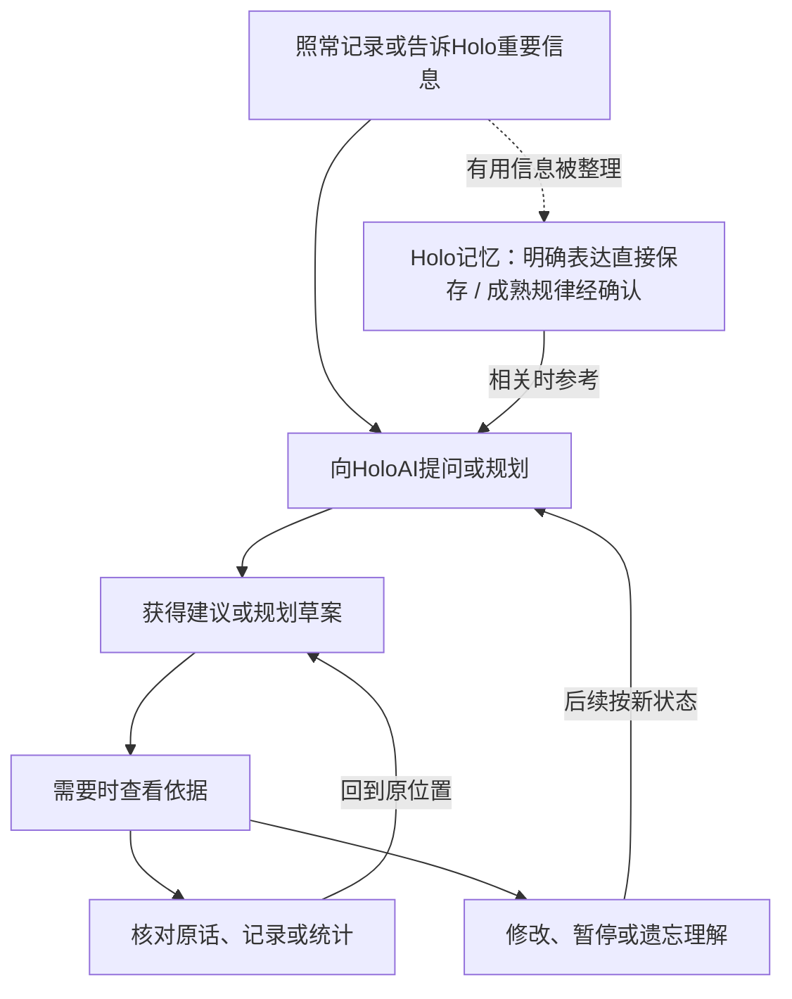

# 实施后的用户体验与完整动线

日期：2026-10-28。基于首版A/B/C1说明用户会感受到什么；最终实施约束以[08-v3.3最终交接](08-最终实施方案与GLM交接.md)为准，尤其是保存/纠正待整理、失败回执和遗忘清除状态。本文件描述推荐产品体验与成功路径，不是已上线状态或最终视觉稿；所有生活场景均为虚构示例。

## 1. 用户应得到的四个结果

1. **看得懂**：主界面展示Holo已经形成的明确理解，重要事实、偏好、当前关注和可靠规律有清楚含义。
2. **查得到**：每条理解能打开原话、业务记录或统计；缺失、修改和过期分别说明。
3. **用得上**：相关问答和规划会参考这些理解，说明相应依据与调整；精确数字和当前进度仍读原模块。
4. **改得动**：用户纠正、暂停或遗忘后，后续帮助服从新状态；保留合规历史说明。

主路径是照常记录、提问和使用方案；记忆管理按需进入。用户不需要先整理记忆、审核大量候选，才能使用HoloAI。

## 2. 和现在相比

“现在”基于前期源码审查与东林反馈，各安装版本/灰度入口可能不同；不据缺少使用计数断言所有记忆从未被使用。

| 用户时刻 | 当前问题 | 首版完成并通过验收后的目标 |
|---|---|---|
| 平时记录 | 多条记录可能被逐条复述，候选和历史堆积 | 原始记录照常保存；持续记忆只保留有增量的信息，同命题增加依据 |
| 打开记忆 | 多入口标准不一致，需要在大量碎片中寻找 | 三个入口进入同一中心，已记住/值得确认分开；搜索和历史可达 |
| 看一条内容 | 不容易判断是谁说的、何时适用、为什么值得记 | 先显示明确陈述、形成方式、短依据、范围和用途 |
| 查看依据 | 部分来源能跳转，部分被误标统计或不能核对 | 原话、原记录和统计采用各自核对方式，真实展示当前状态 |
| 提问与规划 | 已有相关能力，但来源、版本与具体影响不完整，难判断功劳 | 相关记忆和实时记录共同参与，回答可查依据，规划可看因个人情况作出的调整 |
| 纠正错误 | 不易知道其他入口是否继续沿用 | 保存成功后当前设备按新状态处理，相关入口一致；其他设备同步后收敛 |
| 处理旧数据 | 容易把“旧条目很多”当成已积累很多有效理解 | 能补证的重新核对，缺历史版本的如实说明，流水回到原模块职责 |

## 3. 页面与入口：分别解决什么问题

| 入口/页面 | 用户来这里做什么 | 推荐动线 |
|---|---|---|
| 业务模块 | 记录和查看真实发生的事，改账单/打卡/任务/目标等 | 财务、习惯、任务、想法等保持现有入口 |
| HoloAI | 提问、分析、获得规划草案 | 正常发消息；回答或方案上按需打开依据 |
| Holo记忆中心 | 查看、搜索和纠正Holo对自己的理解 | 沿用个人页“长期记忆”位置，管理页统一称“Holo记忆”；HoloAI顶部“记忆”也进入这里 |
| 记忆长廊 | 回顾生活记录、查看洞察 | 洞察区只露少量理解摘要，点“查看全部”进入同一个中心 |
| 一个发现 | 查看Holo从记录里提出的有限观察 | 先核对证据；适合持续保留时“确认并记住” |

推荐不新增一个强制用户每天访问的首页或底部tab。个人页与聊天的入口代码已经存在；此处是统一它们的目的地、名称与内容标准。

记忆中心包含：

- 搜索：先搜已记住和成熟候选，可主动扩到历史/停用。
- 已记住：偏好与约束、当前关注、重要经历、生活规律；领域作为筛选。
- 值得确认：一次最多推荐三条，允许主动看全部成熟候选。
- 更多：历史、停用、全部已保存理解及记忆设置。

原始资料、记忆与发现相互可达，但它们承担不同职责。编辑记忆的文字，不暗中修改原账单或任务；业务数据的改变在所属模块完成。

## 4. 总动线

虚线整理不阻塞主路径。尚未形成长期理解时，用户仍能直接查询、分析原始记录。查看依据与管理是用户选择的分支。

## 5. 一次完整体验：偏好如何真正改变规划

### 第一步：告诉Holo一项持续偏好

用户在HoloAI说：

> 请记住：周末尽量不排工作，我想把时间留给家人。

Holo在现有授权内保存。只有保存成功才显示非打断回执，例如：

> 已记住：安排工作时优先考虑工作日。［查看］［撤销］

“尽量”保留为偏好，不能被改成绝对禁止。操作未成功则显示未保存/重试；不会先说已经记住再丢失。

### 第二步：需要时查看这一条

从回执或聊天顶部“记忆”进入，看到：

> **周末尽量不排工作，把时间留给家人。**
>
> 你明确告诉Holo的 · 1处原话 · 持续偏好
>
> 用途：安排工作任务时优先考虑工作日，冲突时请你取舍。

点开详情能看到原消息及上下文、适用范围和管理动作。来源时间来自真实消息；没有历史信息就不伪造日期。

### 第三步：提出实际问题

过几天用户说：

> 帮我安排下周的工作。

Holo读取当前任务及时间要求，参考仍适用的周末偏好，给出草案：

> 我优先把工作安排在工作日。可能与周末冲突的部分单独列出，交给你取舍。

方案展示“因你的情况作出的调整”和相应依据；只有确实形成了调整才展示，不编造个性化影响。用户仍可选择修改或保存草案，记忆本身不授权自动创建/改动业务事项。

普通聊天提供回答级的“回答标注的记忆”入口；规划复用已有逐项依据。首版不宣称每一句话都已具备精确引用。

### 第四步：核对为什么这样安排

用户点方案依据：

`规划草案 → 相关记忆 → 来源原话/当前任务 → 回到原方案`

记忆详情可反向打开这次规划，查看该理解用在什么地方。用户确认有帮助和模型提供过背景分别记录，不把它们混成“引用次数”。

### 第五步：生活条件变化

用户在记忆详情修改，或明确要求纠正：

> 改一下：周六上午可以安排工作，周日还是留给家人。

保存成功后显示更新后的准确范围；以后相关规划采用新偏好。旧方案保留“当时参考的偏好，现已更新”的提示。用户若希望重做旧方案，主动重新生成/调整，不在后台悄悄改写已保存安排。

当前设备处理成功后生效；其他离线设备在同步前不能承诺已收到修改。

## 6. 自动发现规律时，用户做什么

虚构示例：在已支持模板、有效记录和覆盖足够时，Holo观察到阅读记录更多集中在晚间。

`照常打卡 → 后台核证与收敛 → 值得确认 → 看依据 → 选择`

候选主陈述保持有限：

> 从最近这段时间的有效记录看，你的阅读更多集中在晚间。

依据展示真实观察范围、样本、覆盖和例外；不直接说“你天生适合晚上学习”或“晚间一定更容易坚持”。用途是以后安排阅读时提供一个带限定的候选时间。

| 用户动作 | 发生什么 |
|---|---|
| 符合 | 绑定用户实际看到的准确命题，进入已记住，相关任务可按范围参考 |
| 修改 | 展示当前陈述，允许补条件/改说法；保存用户新表达及范围 |
| 不准确 | 可指出依据错、理解错或现在不适用，分别处理 |
| 暂不处理 | 正常继续使用；同语义冷却，不成为待办 |

没有成熟规律时保持空态，原记录照常可查；不为了每天有发现而凑候选。用户主动问数据表现时，仍可获得当前事实分析，不必先确认一条长期规律。

## 7. 从“一个发现”进入记忆

`打开一个发现 → 核对原始依据 → 确认并记住具体理解 → 记忆中心可查 → 相关任务参考`

- “确认并记住”只保存用户看见的结论、条件、范围与用途，不将整份报告和建议写成个人事实。
- “有点像”继续探索，保留不确定性，不直接升级为长期记忆。
- 已经记住的相同命题展示“已记住/新增依据”，减少重复确认。
- 在任一入口否定或纠正后，另一个入口也反映相应状态；原始记录继续由原模块管理。

## 8. 用户发现错误时，怎样纠正

虚构示例：Holo从代购宠物用品错误理解成用户养宠物。用户可从回答依据或记忆中心找到该条，选择“不准确/修改”，明确表达“这次是替朋友买的，我没有养宠物”。

| 意图 | 入口动作 | 结果 |
|---|---|---|
| 理解错了 | 不准确/修改 | 错误理解退出当前使用，保留用户纠正；以后不能仅换措辞复活 |
| 原引用对不上 | 不准确→依据不对 | 暂停受影响理解，重核来源和剩余支持 |
| 曾成立，现在变了 | 现在不适用/修改 | 更新适用时间或当前说法，历史按当时状态说明 |
| 暂时不希望参考 | 暂停使用 | 保留可恢复内容，后续辅助回答不采用该条 |
| 希望忘掉该理解 | 遗忘并确认影响 | 按范围清除记忆及相关派生，阻止同义重新出现；原始账单等不随之删除 |

这条采购记录仍可以在财务里按真实用途查看和修改。用户纠正记忆不等于改账，更不等于删除整个主题的原始记录。

## 9. 核对来源后必须回得来

来源入口优先给可核对的轻量预览，可继续打开原模块完整记录。跨模块打开前保留原问题/方案与记忆位置，提供清楚的“返回原方案/返回记忆”路径；返回后保持滚动位置和未提交的编辑草稿。

当前代码有dismiss后深链跳转；实施不能只验证“成功到达记录”，还要验证用户核对完可以回到原任务。可采用来源预览加显式回跳，不要求为此重写全局导航。

## 10. 首次升级和异常状态

| 状态 | 呈现与下一步 |
|---|---|
| 旧数据正在分批核对 | 展示实际进度/状态；已核验内容先可用，原始记录仍可查询；打开页面不触发新一轮全量AI扫描 |
| 原文仍在，但没有旧版本 | 展示当前来源和“历史版本未保存”，不把当前内容充当过去原文 |
| 来源已修改 | 展示保留片段与变化状态，受影响理解重核后再作为当前依据 |
| 来源明确删除/撤权 | 标来源失效/无权限，限制相应使用，提供管理入口 |
| 暂未同步/暂不可访问 | 显示待同步/暂无法核验，不误报已删除 |
| 没找到成熟理解 | 提示原记录仍可查询，可从当前问题继续获得帮助 |
| 保存失败 | 不显示成功回执，保留修改草稿并允许重试 |
| 自动形成关闭 | 原有合规记忆仍可查看，是否参考由辅助回答开关决定 |
| 辅助回答关闭 | 当前回答不读取已有记忆，管理内容保留；自动形成按自己的开关运行 |

界面沿用现有Holo视觉体系与字体，不为本动线另造设计系统。重要动作保持44pt有效热区、动态字体和VoiceOver；状态有文字，不只靠颜色；键盘/焦点返回原操作。设置开关和永久控制操作的含义清楚，不为普通核对增加反复确认。

## 11. 首版效果与后续能力

首版A/B/C1验收通过后，用户应能完成本文件的查看来源、少量规律确认、相关问答/规划、反向使用查询和纠错流程。记忆条目可能减少，但完整原始记录保留，信息是否有用按任务结果检验。

后续C2再开放通用长会话自动压缩、逐句短句柄引用、新会话同步排除及有需求证据的大型证据清单；首版不展示尚未可靠实现的开关或承诺。所有旧历史精确还原始终受实际保存内容限制。

## 12. 面向东林的验收问题

1. 不打开记忆中心，能否照常提问，并从相关偏好中受益？
2. 任意点一条当前可用记忆，是否能理解结论、形成方式、范围和用途？
3. 点来源是否核对得到，核对后能否回到原问题或方案？
4. 正例是否能形成有用规律，反例是否被拦住；跳过确认后能否继续正常使用？
5. 修改偏好后新方案是否变化，旧方案是否保留当时依据而非被偷换？
6. 暂停/遗忘是否持续生效，业务记录是否仍在所属模块？
7. 来源缺失、同步中、设置关闭和保存失败是否分别说明真实情况？

以上是待实施的产品验收，不是本轮已执行的UI走查。
