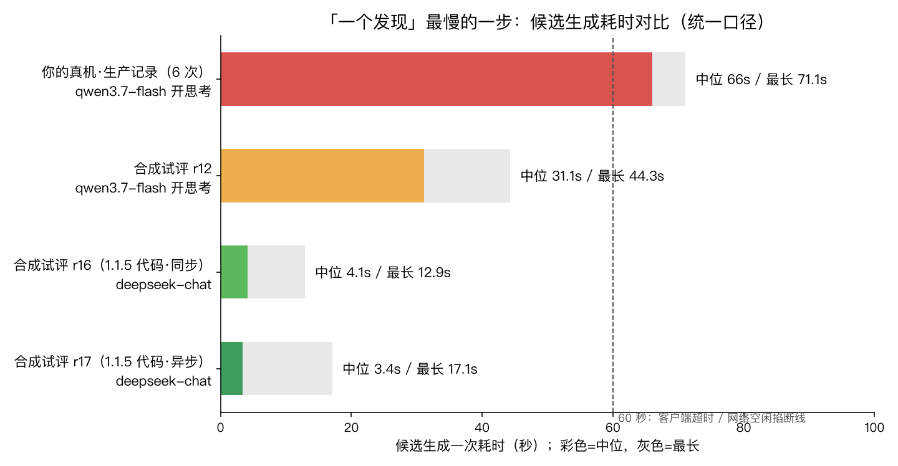

# 「一个发现」真机零产出：根因调研与 1.1.5 方案

> 调研时间：2026-11-02 00:30–00:47。证据来源：东林 iPhone 沙盒日志 `disp-diag.log`（devicectl 只读拉取）、生产库 `discovery_runs` / `ai_call_logs`（只读查询，按 device_id 区分真机 F50B4915 与模拟器 4FCD7B65）、生产容器日志、本机隔离环境两轮真实模型试评（r13/r15，内存库，不碰生产）。

## 一、结论（先说大白话）

这个功能卡了好几天，原因是两件事叠在一起。之前的修复基本只碰了第二件，第一件一直没人动。

**第一件：太慢。** 生成候选这一步走的是 qwen3.7-flash，而且开着「思考」（`reasoningEffort=low`）。用你手机上的真实记录跑，生产记录里成功的 6 次**每一次都在 60 秒以上**（60–71 秒，中位 66 秒）。每次大约 7000 个输出 token，其中 5000–7000 个是模型在「想」，最后真正输出的 JSON 只占一小部分。同样的任务换成 deepseek-chat，今晚三轮试评的候选中位数是 3.4–4.1 秒，最长 17 秒。

**第二件：太脆。** 整条链路要求 App 一直开在前台、亮着屏，等它一口气跑完。只要中途锁屏、切到别的 App 或者被系统挂起，下面这几件事会一起发生：
1. 服务端已经做好的结果没有人来取。
2. 结果只在服务端内存里放 5 分钟，过时就丢。
3. 当天的名额在派发模型调用时就扣了，丢了也不退。
4. App 下次启动时会把没收完的批次直接在本地标成「取消」，不会尝试找回。
5. 下次再开 App 会新建一个 run，被服务端 429 拒掉，客户端就锁到第二天。

所以每天只有一次机会，而这次机会要求你拿着手机盯一分多钟。

**热让位只是放大器。** 手机温度只要不是「正常」（包括「轻微」fair），就不发起批次。可手机这边整个过程只是在等网络回包，重活全在服务器上做，发热跟服务器上的模型没关系，所以这条规则的前提本身就不成立。

## 二、今晚的现场证据（00:28 那一次）

| 时间 | 发生了什么 | 证据 |
|---|---|---|
| 11-01 23:13–23:17 | 多次被「当天名额已用」拦下，等 0 点 | 手机日志 `deferred dailyBudgetExhausted` |
| 23:30:51 | 排好的重试醒了，但扫描到 **23:57:35** 才执行 | App 在后台被冻结了 27 分钟 |
| 23:57–00:20 | 6 次尝试全被热让位拦下 | `yield detail: thermal=true`，其余都是 false（手机在充电） |
| **00:28:42** | 过了 0 点、温度也降了，创建 run、派发候选 | 手机日志 `prepare → creating run`；服务端 `POST /runs 200` |
| **00:29:54** | 服务端候选成功返回，**耗时 71 秒** | 容器日志 `candidates 200 71163ms`；`ai_call_logs` 中 reasoning_tokens=5886 |
| 00:29:54 之后 | **手机日志一行都没再写，也没有 verify 请求** | 00:32 查设备进程，Holo 主进程已经不在了（只剩小组件进程） |
| 约 00:35 | 服务端内存里的结果过期丢弃 | runStore 缓存 TTL 5 分钟 |
| 现在 | 11-02 的名额已扣（`candidate_dispatched=1`），再开 App 会被 429 锁到 11-03 | `discovery_runs` 中 run `86ECCE4B…` 状态为 active |

服务端这次其实是成功的，失败出在结果没能交回手机。

## 三、真机全量调用记录（生产 `ai_call_logs`，device F50B4915）

| 时间（UTC） | 阶段 | 模型 | 耗时 | 结果 |
|---|---|---|---|---|
| 11-01 16:28 | 候选 | qwen3.7-flash | 71.1s | 成功（App 未接收） |
| 11-01 15:16 | 候选 | qwen3.7-flash | 62.8s | 成功 |
| 11-01 05:15 | 候选 | qwen3.7-flash | 60.3s | 成功 |
| 10-31 19:07 | 候选 | qwen3.7-flash | 69.3s | 成功 |
| 10-31 18:48 / 18:25 | 候选 | qwen3.7-flash | 52.9s / 55.2s | 格式不合格 |
| 10-31 06:24 | 候选 | qwen3.7-flash | 70.4s | 成功 |
| 10-30 14:30 | 候选 | qwen3.7-flash | 62.2s | 成功 |
| 10-30 02:55 | 候选 | qwen3.7-flash | 65.4s | 格式不合格 |

**真机 verify 次数为 0。** 一次都没走到核验，链路每次都断在「候选结果交回手机」这一步。

## 四、换模型能不能又快又不掉质量（今晚实测）

我在本机隔离环境里用当前线上的提示词（候选 v6 / 核验 v3）跑了 18 个合成场景：

> 2026-11-02 01:36 更正：早先版本里 r15 写的「中位 1.5s」、图里 r12 的「中位 16.4s」都是统计口径出错。下表全部按同一口径重算（每一次候选模型调用都算，含格式纠错重试）。修正后两个数字都变了，但「换模型」的结论更强了，不是更弱。

| 轮次 | 配置 | 候选格式通过 | 候选耗时 中位 / 最长 | 核验耗时中位 | 核验整体结论与预期一致 |
|---|---|---|---|---|---|
| r12 | qwen3.7-flash 开思考（=线上现状） | 18/18 | 31.1s / 44.3s | 2.1s | — |
| r13 | deepseek-chat，原样 | **11/18** | 5.6s / 15.2s | 1.2s | — |
| r15 | deepseek-chat + 「纯日期补全」修复（原型） | **18/18** | **3.9s / 15.2s** | **1.1s** | **18/18**（4 正例全 accept，14 负例全 reject） |
| r16 | **1.1.5 分支代码**，同步端点 | **18/18** | **4.1s / 12.9s** | **1.1s** | **18/18** |
| r17 | **1.1.5 分支代码**，新异步端点 + 轮询取件 | **18/18** | **3.4s / 17.1s** | **1.1s** | **18/18**；异步启动最慢 12 毫秒返回 |

r13 的 7 个失败全是同一个原因 `time_range_value`：deepseek 把时间范围写成 `2026-10-08` 这种只有日期的格式，双端契约要求带时刻的完整格式。这是机械格式问题，修复层可以确定性补齐：开始补成当天 00:00:00，结束补成当天 23:59:59，时区取客户端发来的 anchorNow 的偏移。补齐不生成任何内容，而且仍然落在客户端「89 天前 0 点～明天 0 点」的时间窗内，不会被客户端门禁误拒。补上之后就是 r15 的 18/18。r16/r17 是 1.1.5 分支里正式实现之后的复测，结果一致。

还有一项要你知情：「生成链」（模型自己从材料里挖候选，再交给核验）在 14 个负例场景里，有 4 个（F05/F09/F11/F13，各轮略有不同）挖出了一条别的候选，而且被核验接受。这不一定是错：负例场景是按「某条陷阱候选应被拒」设计的，模型可能找到了另一条站得住的联系。手机端门禁（敏感、数字纪律、同源去重）也还要再过一遍。上线前建议你人工看一眼这几条原文（在 1.1.5 分支 `试评记录/raw-round-16.json`、`raw-round-17.json`）。

需要说明两点：
- 合成场景的材料大约 2,250 个输入 token，你的真实材料大约 5,000 个，所以真机上 deepseek 的候选耗时预计在 5–20 秒（10-30 有过一次 deepseek 真实调用，7.8 秒）。
- qwen 关思考（`reasoningEffort=none`）的对照组没跑成，本机的 qwen 密钥报上游鉴权失败。按项目规矩我不去读生产密钥。

## 五、顺带查出的三个质量隐患（不阻塞，排进 1.1.5）

1. **引用锚定修复可能切偏。** 服务端用「去掉空白和引号之后的下标」去切原文。原文里有空白或引号时，切出来的片段会整体错位。片段仍然是原文，能过逐字闸，但可能已经不是模型想引用的那句话。
2. **数字纪律兜底在凑门禁。** claim 里带数字但引用不足 2 条时，服务端会自动补一条「支撑证据的第一句」当第二条引用。补进来的这句不一定支持那个数字，等于绕开了「含数字必须有两处出处」这道门禁的本意。
3. **日志会带原文。** 格式失败时 rawTail 会把 300 字原文打进容器日志。交接文档里已经建议过改成只记 reason，我同意。

## 六、方案

### 第一步：止血（只改服务端，1.1.4 和 build 44 不用更新）

1. 修复层加上「纯日期补全为完整时刻」，并补测试，包括双端共用夹具的对拍用例。
2. 候选模型切到 deepseek-chat，生产 env 改两行，随时可以切回 qwen。核验本来就钉在 deepseek。
3. 释放你今天被烧掉的名额：删除 11-02 那一条 run 行。这是一次性运维动作，以前也这样做过。

预期效果：一次完整发现 10–25 秒（候选 5–20 秒、核验 1–2 秒、本地门禁不到 1 秒）。白天手机不烫的时候，打开 App 停留半分钟以内应该能跑完。成本每次约 ¥0.02。
需要你批准：后端发版、改生产 env、删一行 run 记录。

### 第二步：根治（1.1.5 分支）

1. **候选生成改成服务器后台任务。** 手机把材料交给服务器后立刻返回（不到 1 秒），服务器自己跑完，把结果加密暂存 48 小时，取走即删。加密和即焚直接复用云端深度分析 `agent_cloud_analysis_tasks` 现成的 AES-GCM 模式。
2. **任何一次打开 App 都先取件。** 哪怕只停留 3 秒，有结果就在本地逐字核对引用、做反例召回（这一步必须在手机本地做，额外数据发不发由手机决定，这是隐私设计），然后核验（deepseek 1–2 秒，并申请系统后台宽限，切走也能跑完），最后呈现。
3. **App 重启不再把没收完的批次标成取消**，而是凭本地保存的 run 凭证继续取件。
4. **名额改成「成功产出才算用掉」。** 服务端故障或格式失败不再烧掉当天，同一天最多尝试 3 次。
5. **热让位只在「严重/危急」时生效。**
6. 修掉第五节的三个质量隐患。
7. 可选：系统后台刷新时也顺手取件，你打开 App 的时候发现已经在那里了。
8. **验收**：真机连续观察 3 天，「技术链路完成率」和「有价值发现产出率」分开统计。

## 七、分支与发版的注意点

- 1.1.4 工作区现在还有 185 个文件没提交，发现功能的全部手机端修复（build 44）都在里面。CHANGELOG 里也写明了「1.1.4 已提交版本单独检出编不过」（知识系统等代码一直没提交）。所以 1.1.5 的 iOS 部分只能从 1.1.4 **封板之后的那个提交**拉出来，不能从现在的 HEAD 拉。
- 后端发版脚本支持 `HOLO_REPO` 指定目录，1.1.5 的后端改动可以在独立工作区里提交和发布，不碰 1.1.4 工作区。但要约定一件事：从此以后后端只从 1.1.5 发，或者先把 1.1.5 的后端改动合回去再发。否则 1.1.4 的某次后端发版会把线上回退掉。
