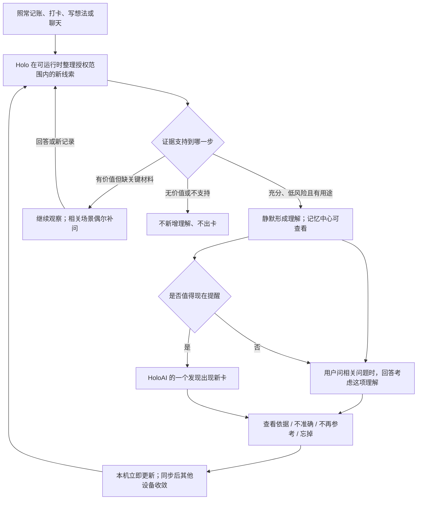

# 用户动线、Use Case 与最终效果

2026-11-11｜v2 产品示例，尚未实现。所有记录、文案与路径均用于说明方案，不是对东林个人生活的分析；条件不成立时，示例结论不得生成。

## 1. 一条完整用户动线

没有“先完善六类画像才能使用”的流程。没有批量确认列表，也不要求用户每天到记忆中心审核。画像六个维度用于后台组织；主要体验仍发生在日常记录、HoloAI 回答和既有记忆中心。

首次使用依当前 AI 数据处理授权决定可用范围；未授权不自动取数。授权范围不足时说明能用的范围，不把开放更多数据作为继续使用的前提。

## 2. 用户在哪些位置看到什么

| 位置 | 可见内容 | 操作与结果 |
| --- | --- | --- |
| 日常记录页面 | 保存仍然是普通保存，无萃取确认弹窗 | 后续后台整理，不阻塞继续记录 |
| Holo 记忆 · 已记住 | 当前可使用的认识；每条区分“你告诉 Holo 的”“你确认的”“Holo 从记录中理解” | 点开查看适用时间、主要依据、影响哪些回答；可纠正/停止参考/遗忘 |
| Holo 记忆 · 值得确认 | 只呈现一个真实需要用户补充的事实或适用范围 | 回答、暂不确定或跳过；不把后台每个假设都倾倒进来 |
| HoloAI 对话 | 先回答当前问题，必要时自然考虑相关理解 | 推断仍带限定；可从引用进入依据，或直接说“这个理解不对” |
| HoloAI · 一个发现 | 有当前价值的变化或联系，附简短意义和关键依据 | 查看依据、继续聊、补充情况；“已看过”不等于确认事实 |
| 旧统计收纳 | “此前确认的统计”可逆折叠，仍可搜索查看 | 保留原确认与依据，不偷偷转成更强的人物画像 |

拟议状态文案：

- **你告诉 Holo 的**：明确表达，保留原话和范围。
- **Holo 从记录中理解**：符合自动使用门槛，正文保留必要限定。
- **值得进一步了解**：有价值线索，尚不能作为关系事实使用；优先出现在用户相关问题中或有限补问里。
- **已停止参考**：纠正、撤权、过期或用户停用后，当前回答不再采用。

当前代码已经存在“Holo 推断”等来源标记。此次变化是让新采用规则、正文限定和页面状态保持一致，并非声称旧界面完全没有来源区分。

## 3. Use Case A：逐渐认识用户在养猫

### 输入与形成过程

1. 用户记了几笔猫粮支出。后台发现猫相关消费，暂不确定是谁的猫，不打扰。
2. 后来出现不同日期的猫砂、本人照料任务、自己写的照料经历。若证据充分，系统形成低风险认识：“你很可能长期照料猫。”
3. 这项认识进入“已记住”，标记“Holo 从记录中理解”。原始购买间隔放在依据里。

### 用户第一次感受到价值

用户问：“下周出门四天，帮我列准备清单。”Holo 正常给出清单，相关位置补充：

> 如果这几天仍由你照料猫，把喂养和照看安排也一起确认好。

它不会为了养猫画像删掉出行选项、自动增加预算，也不会擅自创建喂养任务。用户已经明确说过“我养猫”时，可以直接写“把猫的照看安排好”。无关问题不引用这项认识。

### 纠正分支

用户说：“猫粮都是帮邻居买的。”界面反馈：

> 已纠正，后续不会再按“你自己养猫”来考虑。

当前清单可重新生成，错误理解及其依赖不再影响未来回答。历史对话作为历史记录保留，不悄悄改写已发送的原文；继续打开旧建议时，相关引用标记已经失效。

### 材料始终不足分支

如果始终只有购买记录，系统可以长期停留在线索状态。用户开始规划相关出行时，可在补问预算允许且确有影响时问：“这些猫粮是给你照料的猫买的吗？”用户不回答也能得到普通清单。

## 4. Use Case B：咖啡与睡眠，分阶段给出价值

### 初期只有可观察事实

用户已有睡眠记录，最近入睡时间比本人平常更晚，另有咖啡支出。此时可提供“近期入睡时间变晚”的事实理解；不能把咖啡写成原因。

用户主动问“最近为什么总晚睡”时，可以说明：

> 记录显示你最近更晚入睡。咖啡是可以继续核对的一条线索，但账单还不能说明你什么时候喝，也不能据此判断它与晚睡有关。

只有该线索相对其他已知因素有查询价值时才提出，不因看到咖啡就总谈咖啡。

### 补问

“这些咖啡通常什么时候喝？”若用户说“通常下午”，只记住这项一般性自述。不回填过去每天的时间，不据此声称已完成逐日对照。若用户说“都给同事带的”，相关本人饮用假设即停止。

### 逐日证据充分分支

只有后续已有明确日期的饮用记录、对应睡眠、有效对照和独立时段复查，才展示关系：

> 较晚喝咖啡的记录日，你也更容易晚睡。
>
> 在这段可比较的记录里，这个差异重复出现；工作安排等因素仍可能参与。

“查看依据”展示比较范围、原记录、未覆盖的日期和限制。可“继续聊”，由用户选择是否自愿补记或观察，不默认创建新的健康习惯。

### 不能成立分支

- 每天都喝、条件没有变化：没有有效对照，继续观察或结束该候选。
- 只有支付时间：只能谈购买行为，不能换词成饮用。
- 工作日分组后关系消失：撤回原关系，保留真正有支持的阶段变化。
- 新时段不重复：停止作为稳定背景，已经展示的卡标记“后续记录未支持，已停止参考”。

## 5. Use Case C：体重与运动，缺数据时不误判

### 有可比活动数据

体重在可比测量中呈现上升，活动分钟/训练记录持续可用且下降，形成阶段理解。若与当前目标有关，可展示：

> 最近活动比平常少，体重同期有所上升。
>
> 这两项变化同时出现，可以先看看近期日程是否挤占了活动时间。目前还不能确定体重变化的原因。

用户说“最近出差”，系统加入该阶段限制；后续安排建议考虑现实条件，不给“自律变差”的标签。

### 只有记录减少

健身没打卡，Apple 健康也没读数。系统保留体重的可靠变化，活动状态为未知。

只有当用户正在讨论体重或活动、而答案会改变建议时，补问：“最近运动确实少了，还是主要没记录？”

- 回答“没戴表，照常运动”：停止活动下降假设，保留该范围的用户自述。
- 回答“确实少了”：作为用户表达的近期状态，可以用于相关回答，仍不证明增重原因。
- 不回答：不作“疏于运动”判断，也不反复追问。

## 6. Use Case D：发现目标被现实安排挤压

输入：用户明确在推进某个项目；多周计划里该项目的工作持续顺延；对应时段被用户实际记录的临时任务占用。

可形成的发现：

> 这个目标最近一直被临时事项挤到后面，可能需要先给它留一个更稳的时间段。

依据来自实际顺延、任务时段与用户明确目标。若只有“任务未完成”，不能推断占用时间，更不能推断懒惰或缺乏动力。

用户让 Holo 安排下周时，建议中会考虑保护该时间段；具体调整由用户选择，不自动移动日程。反例是用户已暂停目标：应更新目标状态，停止催促。

## 7. 特殊场景的用户结果

| 特殊场景 | 用户可见结果 | 系统处理与边界 |
| --- | --- | --- |
| 新用户、资料少 | 已有明确表达可被记住；发现为空时显示“暂时没有值得提醒的新发现” | 不伪造画像，不承诺第几天必有洞察 |
| 只有一个模块 | 可有该模块内的长期理解或变化 | 不要求为了跨域而补齐所有模块 |
| 未授权、查询失败、设备没数据 | 在相关依据页解释可用范围；没有读数不写成没行为 | 不把未知误标为拒绝授权或零活动 |
| 用户跳过补问 | 当前功能照常继续 | 不当作确认；同题冷却；新记录数量增加不自动解除冷却 |
| 用户点“已看过” | 卡片不再重复强调 | 不改变该认识的事实等级 |
| 用户点“不准确” | 停止当前理解，可补一句纠正 | 不要求证明自己；依赖该认识的建议也重评 |
| 用户点“不再参考” | 此认识不再用于回答 | 保留可管理状态；不自动变成否定事实 |
| 用户点“忘掉” | 按现有遗忘链移除并阻止旧证据复活 | 保留必要的无正文抑制信息；不删除原业务记录 |
| 批量导入旧账 | 逐步形成对应历史认识 | 按发生时间处理，不说“今天消费骤增” |
| 时间/单位不可靠 | 显示依据不足或限定范围 | 不插值、填零或替用户补出精确时间 |
| 已形成认识，但很久没新记录 | 近期状态到期后不再冒充当前；长期角色保留适用性提示 | 不把没再买猫粮推断成不再养猫 |
| 断网、温升、额度不足 | 可用的旧理解仍可读；不宣称已看过最新数据 | 后台待处理状态可恢复；页面不永久显示加载中 |
| 删除/修改来源发生在生成期间 | 过时结果不进入当前记忆 | 应用前复核来源与控制版本 |
| 多设备离线纠正 | 本机立即停止；另一端收到同步后收敛 | 不承诺无法联网的另一台设备即时知道纠正 |
| 旧卡引用已失效理解 | 卡片注明已停止参考；不会继续推荐 | 历史对话不被暗改，新的上下文排除失效内容 |

## 8. 与当前实现的差别

“当前”指本轮核对的工作区代码及用户截图，不代表已验证所有线上路径。当前已有个人情境、跨域融合、自动形成、纠正和遗忘能力，以下比较的是新方案补足的关键差异。

| 比较项 | 当前实现的主要限制 | 修订方案的变化 |
| --- | --- | --- |
| 形成什么 | 部分规律生产者直接保存统计句 | 统计成为依据，另形成有用途、带范围的认识 |
| 怎么关联 | 按域萃取；跨域候选依赖已形成记忆和共同锚点 | 围绕生活主题召回原始线索，再按问题取证 |
| 模型看到什么 | 发现端点主要是形状和填空信息；部分领域输入被聚合 | 受控语义证据视图，保留概念、归属、条件和验证结果 |
| 怎么判断 | 行为推断较依赖统计模板与确认门槛 | 按角色、偏好、状态、关联及具体用途分别判断 |
| 不确定时 | 有等待/谨慎参考机制，但不构成这轮完整的查证过程 | 可解释缺口、有限补问、分阶段使用；不回填不存在的数据 |
| 用户感受 | 常看到记录摘要，需自己理解“然后呢” | 相关回答考虑生活责任与现实条件，主动卡说明意义 |
| 何时修改认识 | 已有纠正、失效与遗忘机制 | 将新推断及衍生建议纳入同一套失效关系，加入新时段复查 |
| 如何验收 | 既有测试覆盖不少结构与准入规则 | 同时比较新旧回答、未见主题、用途越界、稀疏数据与实际成本 |

## 9. 与本次初稿的差别

1. 把“可观察事实—待查证线索—有支持的理解—重复验证的关系”区分清楚，解决长期等待时用户没有收益的问题。
2. 自动使用按“认识 × 用途”判定，避免一个低风险标签在重要决定中被过度使用。
3. 补问答案不能回填历史事件；模型提案不能被其他 AI 输出反复证明。
4. 前置健康时序/数值习惯依赖，明确最小语义材料的能力验证，修正初稿阶段安排矛盾。
5. 补齐实际入口、来源文案、按钮含义、旧统计收纳和旧卡失效反馈。
6. 明确运行恢复、补充核验和多设备执行权，补问次数上限不再假设各设备自然共享。

本稿说明的是目标效果与处理规则，尚不能证明模型已经能稳定做到。两个能力门槛及十项自审结论见 [对抗性自审](03-对抗性自审与修订记录.md)。
