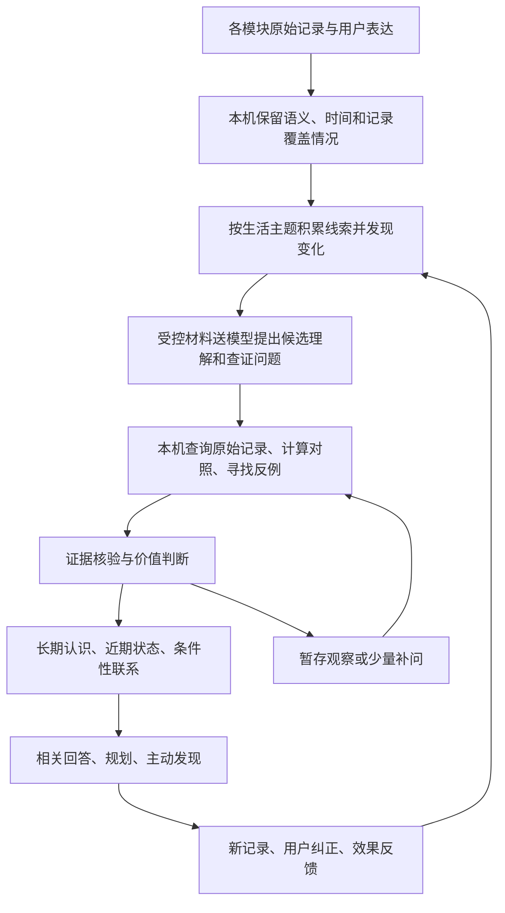

# Holo 记忆萃取与洞察引擎重构 · 产品评审稿

2026-11-11｜v2：完成对抗性自审后的修订稿。状态：待东林评审，未实施。

本方案依据本轮需求、东林对两项产品边界的明确答复，以及当前工作区代码。核对时分支为 `1.1.8`、HEAD 为 `84d7458b4`，工作区存在大量并行未提交改动；下文“现状”仅指读到的工作区实现，不代表手机已安装版本或线上运行状态。本文没有执行真实用户数据重算、模型评测、部署或数据迁移。

阅读顺序：本文讲产品结果与完整工作方式；[工程设计](01-引擎设计与改造边界.md)讲改动位置、数据与运行机制；[验收方案](02-场景与效果验收.md)讲怎样证明它确实更懂用户。

本轮新增：[对抗性自审与十项修订](03-对抗性自审与修订记录.md)、[用户动线、Use Case 与效果对照](04-用户动线与最终效果.md)。自审补齐了证据不足阶段的用户价值、推断使用范围、补问语义、输入信息保留、旧统计展示与多设备执行权；模型效果仍待验证。

## 1. 推荐结论

把现有萃取升级为一套持续工作的理解过程：

**收集有语义的线索 → 围绕生活主题积累证据 → 发现变化并提出解释 → 查证与比较 → 形成有使用范围的理解 → 改善回答 → 根据新证据修正。**

用户画像是这套过程产出的“当前认识”。它由可单独更新、可回到来源的判断组成，不保存成一篇越来越长的用户简介。短期状态、长期认识和待验证的联系共同构成用户模型。

最重要的产品变化是：

- “买过三次猫粮”进入证据层；证据充分时，形成“你很可能长期照料猫”的理解。
- “睡眠减少”触发进一步观察：哪些生活因素同一时期变化，有没有更值得验证的联系。
- “你偏好晚上工作”必须区分主动偏好与被工作安排迫使晚间工作，不能只看次数贴标签。
- 一条理解形成后，要能说明它会改变哪类回答；仅把统计改写得更漂亮不算完成。

一期必须同时完成“长期认识”和至少一类真正的跨领域查证闭环，避免再次把洞察推迟到只有统计摘要的版本之后。

## 2. 本轮已经明确的产品边界

| 项目 | 已明确方向 |
| --- | --- |
| 自动使用 | 证据充分、低风险的推断可自动用于相关回答；保留推断身份，允许纠正 |
| 不确定性 | 证据不足的保留为线索；健康原因判断不能作为事实 |
| 主动补问 | 允许少量、答案能明显改变判断的问题；用户不回答也能继续使用 |
| 本轮范围 | 设计与评审方案；不修改业务代码，不部署，不改真实记忆 |

以下为本方案推荐默认值，尚不是新的已批准实现：每日最多一条主动发现、普通入口滚动七天最多一次补问、同题跳过后三十天冷却。补问节奏复用现有协调器；发现节奏沿用当前项目评审稿。

存储原则以目前项目中的《2026-11-08 一个发现》**第三稿**和现有 `discoveryTopicController.js` 为依据：本机与 CloudKit 保存用户数据和控制决定，服务端负责计算。本方案保留该原则。更早稿中“服务端持有确认权威”的方向不作为本次设计依据；本文也不采信旧稿对生产环境、部署完成度的描述。

## 3. 怎样才算有洞察

一条值得交给用户的发现，至少回答以下四件事：

1. **发现了什么**：关于这个人的认识，或相对他自己平常状态的变化。
2. **为什么值得关心**：影响哪个目标、选择、持续责任或当前问题。
3. **凭什么这样判断**：支持证据、反例、时间范围和记录缺口。
4. **接下来有什么用**：改变回答、补问、后续观察或由用户选择的行动。

允许有价值的发现来自单一模块，也允许只形成后台理解、不展示卡片。用户明说的一次重要变化可以立即有价值，例如“开始上夜班”；日常消费重复三次，并不自动等于值得展示。

“惊喜”来自发现用户没串起来的联系，不能靠夸大确定性、心理揣测或制造问题。发现积极变化也有价值，例如找到某种安排下更容易完成任务的条件。

## 4. 用户画像如何组织

### 4.1 内容维度

| 维度 | 保存什么 | 示例与使用价值 |
| --- | --- | --- |
| 属性与角色 | 用户明确提供的属性，以及有依据的生活角色 | 用户说自己是产品负责人；长期照料宠物影响出行安排 |
| 长期行为与责任 | 持续行为、家庭/工作责任、相对稳定的限制 | 有固定照料安排；每周某晚被固定事项占用 |
| 偏好与条件 | 明说的偏好，或在可比较选择中持续出现的倾向 | “喜欢安静环境”与“只能晚上学习”分开保存 |
| 当前目标与项目 | 正在推进什么、当前阶段、关键约束 | 推广 Holo；近期重点是改善付费转化 |
| 近期状态与变化 | 最近与个人基线相比发生了什么 | 近三周有效记录中的活动量下降 |
| 条件性联系 | 在什么条件下，哪些现象更容易一起出现 | 特定工作安排下，习惯更容易中断；条件改变时需重评 |

维度允许重叠和开放扩展，不要求每个用户把表填满。性别等属性以用户明确提供的信息为准，不从消费、姓名或习惯猜测；职业也不从单笔职业用品支出直接确定。不会根据零散记录建立人格、疾病或心理诊断标签。

### 4.2 每条认识都带三个独立标记

- **根据什么知道**：用户明确说过 / 记录直接显示 / 系统推断。
- **适用于什么时候**：某次事件 / 最近阶段 / 持续有效 / 特定条件下有效。
- **可以怎样使用**：仅内部观察 / 可有限参考 / 可作为明确背景 / 可以主动展示。

“长期”不等于“确定”，“用户确认”也不等于“永远有效”。例如用户确认“最近每天加班”，只确认这个阶段；确认“我觉得咖啡影响睡眠”，保存的是用户的主观体验，不把因果关系升级成科学事实。

## 5. 三个案例的完整产品结果

以下为设计示例，不是对东林真实生活的结论；具体措辞取决于实际证据。

### 5.1 猫粮：从购买行为到照料责任

**仅有三笔猫粮账单时**：识别“猫相关消费”主题，提出“可能在照料猫”的线索，同时保留代购、救助等解释。不直接保存“有一只猫”，不推断数量、品种、宠物名字。

**继续出现其他独立线索时**：猫砂支出、照料任务、用户自己写的相关经历可以共同支持长期照料；同一张账单及其 AI 摘要只能算同一份证据。只有“猫粮”重复购买，也可能长期代购，数量本身不能解决归属问题。

**达到低风险自动使用门槛后**：记住“你很可能长期照料猫”，用于相关回答，保留依据与可纠正入口；不需要每次打断用户确认。

**实际回答变化**：用户规划连续外出时，增加一项有条件的照料提醒：“如果这段时间仍由你照料猫，出门前可以把喂养安排一起考虑进去。”用户已明确确认后，表达可以更直接。与问题无关时不引用。

用户说“都是帮邻居买的”后，立即撤销“自己养猫”的解释；不能因为历史购买次数更多而覆盖纠正。是否另形成“帮邻居照料”的理解，要看用户实际说了什么。

### 5.2 咖啡与睡眠：从并列数据到值得验证的联系

先分别判断“睡眠时间变晚”和“睡眠时长变短”，与用户自己的既往记录比较；不把“少于七小时”自动等同于晚睡。

发现咖啡消费线索后，生成需要查证的问题：咖啡相关记录的时段是否变化？有这类记录的日期与其他可比较日期，当晚睡眠是否有差异？工作日、周末或已知加班是否提供了另一种解释？

核对交易时间的含义：支付时间只支持支付行为；批量补账、默认时间、代买、未记录的自制咖啡都影响判断。“没有咖啡支出”不能充当“没有喝咖啡”的对照组。

如果饮用时段缺失且能改变判断，可补问：“这些咖啡通常什么时候喝？”回答“下午”只补充一般性自述，不能回填为过去每天的饮用事件，也不等于用户确认了睡眠原因。逐日对照需要明确日期的行为记录；若每天都喝、缺少比较条件，系统应保留待观察状态，不强行给出关系。

满足可比较性与复查要求后，才可能展示：

> 在可比较的记录中，较晚饮用咖啡的那些天，你当晚也更容易晚睡。这是一个值得继续观察的联系；目前还不能排除工作安排等因素。

如果目前只有购买记录，必须改为“较晚购买咖啡的记录日”，并说明饮用时间仍未知。没有证据支持的情况下，连上述句子也不展示。

后续可邀请用户自愿补记饮用时间，观察新一段时间是否仍成立；不自动创建习惯、修改目标，也不输出医疗诊断。

### 5.3 体重与运动：先分清变化和记录缺失

体重先统一单位、来源、测量时段与趋势窗口；区分单次波动和持续变化。活动侧分别读取训练、活动分钟、步数，以及习惯完成记录，避免把“未完成健身打卡”当成全部活动量。

**活动记录持续可比较且下降**：可以形成“最近活动量比平常减少，体重同期上升”的阶段理解；它支持关注活动变化，不能单凭这些数据证明体重增加的原因。

**只有打卡减少、HealthKit 没读数**：只能说运动记录不足。优先检查可观测的来源变化，必要时补问“最近运动减少了，还是主要没记录？”不得写成“你最近疏于运动”。

**活动减少与旅行/恢复期等明确经历同时出现**：保留情境条件，建议更符合当下条件的安排；不把阶段变化升格为“缺乏自律”。

## 6. 引擎如何工作

### 第一步：保留细节，让弱线索有机会积累

保留必要的事件语义、实际发生时间、来源和可观测范围。例如“猫粮”只有两个字，却比几十字的无关备注更有用。不会按备注长度统一丢弃；一条记录可以先成为线索，暂不成为记忆。

统计计算继续由程序完成。聚合时同时保留可回查的细粒度数据，不只留下平均值。来源重复、导入日期与发生日期、默认午夜时间、计划与已完成都要分清。

### 第二步：按生活主题组织，而不是把各模块各看一遍就结束

“宠物照料”可以聚集消费、任务、想法与聊天；“工作节奏”可以聚集日程、任务、睡眠与习惯。主题是线索组织方式，主题名称本身不证明用户具有该属性。

可比较的行为变化、明确生活转折、目标受阻、长期重复责任都能触发观察。跨领域关联不要求原先两条记忆已有完全相同的标签。

同时保留受预算控制的主题探索：周期性检查尚未归类的高信息线索，发现新的主题，避免画像越完善，系统越只看到自己已经相信的事情。

### 第三步：模型提出可以查证的解释

每个候选必须说明：准备形成什么认识、支持线索是什么、还有哪些合理解释、什么证据会使它失效、为什么值得了解、能改变哪类回答。

例如：“咖啡可能与近期晚睡有关”只是候选。其查证计划要落实为可执行的问题：饮用时间是否可得、能否对齐到当晚、是否存在有效对照。无法提出可执行查证或有效补问的候选，继续观察或丢弃。

### 第四步：带着问题回查，避免让模型给自己作证

程序计算差异、覆盖情况、对齐关系与重复性；检索明确的反例与替代解释。模型负责解释材料支持到什么程度，程序决定是否有资格使用。

对数量关系，需要区分发现用的时间段与后续验证的时间段；在同一批数据里搜出最强关系后再重复描述一次，不算验证。数据不足时，允许只留下线索。可靠的单项变化可以先用于相关回答；有价值的未证实联系可在相关场景解释缺口或触发有限补问，不必等到长期关系成立才提供任何帮助。

### 第五步：分别决定“能不能用”和“值不值得打扰”

| 结果 | 保存与使用 | 用户体验 |
| --- | --- | --- |
| 用户明确表达，范围清楚 | 作为该范围内的明确背景 | 静默记住，可查看与纠正 |
| 证据充分的低风险推断 | 自动采用，保持推断身份 | 相关回答可使用，不强制弹确认 |
| 有潜在价值但缺关键证据 | 内部观察；可用于选择补问，不用于断言 | 仅在合适时机问一个问题 |
| 有证据的近期变化或联系 | 按窗口、条件限定使用 | 价值高才进入主动发现 |
| 无新增价值、反例强或资料失效 | 降级、撤回或淘汰 | 不凑数，不重复展示 |

“自动记住”不等于“每天展示”。画像安静地变准，发现则负责呈现少量能影响当前选择的内容。

自动使用还取决于具体用途：“可能照料猫”可支持一项可忽略的出行提醒；不能据此替用户限制行程、增加固定预算或创建任务。两个推断组合也不能升级成确定事实。每个下游使用都继承其依赖的不确定性与有效范围。

### 第六步：让理解真正参与回答，并能退出

按当前问题选取相关认识：规划出行可取照料责任，调整日程可取最近作息与已知限制。后台假设不能混成确定事实注入。界面沿用“已记住/值得确认”，自动采用明确标记“Holo 从记录中理解”；已看过、确认、不准确、不再参考、遗忘分别处理。旧统计可逆收纳为“此前确认的统计”，不继续挤占当前理解的主要位置，也不删除原确认。

近期状态随新记录更新；无新证据时降低当前适用性，不把“没再买猫粮”解释成“不再养猫”。用户纠正或遗忘优先；依赖被纠正认识的建议与缓存也失效。AI 自己写的报告、摘要和重复引用不增加独立证据数量。

## 7. 什么保留，什么重构

| 当前能力 | 决策 | 产品理由 |
| --- | --- | --- |
| 各模块取数、确定性统计 | 保留，补齐语义、时间、覆盖与回源信息 | 数字准确是理解可信的基础 |
| 财务/健康规律挖掘器 | 改为生产观察证据；取消统计句子直接成为新理解的主路径 | 防止再次用摘要占满记忆 |
| 个人情境萃取 | 保留明确表达的快速路径；行为推断进入统一查证流程 | 用户告诉 Holo 的事能及时记住，猜测获得相应核验 |
| 跨领域融合 | 重构候选发现与取证方式 | 支持从原始线索形成新联系，减少对既有记忆标签的依赖 |
| 准入规则 | 从统一统计模板门槛改为按命题类型判定 | “可能照料宠物”和“周末规律”需要的证据不同 |
| 统一知识库、纠正、遗忘、证据引用 | 复用并增量扩展 | 不丢失用户控制与既有数据 |
| 对话记忆调用 | 扩展条件、时效和使用级别 | 保证新理解确实改善回答 |
| 一个发现与记忆中心 | 读取同一套理解与证据 | 避免各自产生一套互相冲突的认识 |
| 服务端选题填空端点 | 保留旧版本兼容；新引擎获得语义提案与核验能力 | 只重写统计文案无法实现这轮目标 |

不需要为了这轮目标先引入图数据库、微服务或更多模型。先复用当前 Swift/Core Data/CloudKit 与 Hono/Node.js 结构，把理解过程与验收标准补全。

## 8. 数据边界与打扰程度

本机保留原始账本、健康数值、具体时间序列与用户控制状态；服务端按现有授权只计算必要材料，不建立长期用户画像库。

新引擎上送的最小材料需要比现有发现端点更有语义：非敏感概念、声明的适用范围、变化方向、覆盖情况、程序核验结果和来源代号。涉及健康的原始数值、明细和派生正文维持本机处理；模型可处理受控的结构化形状，具体数值由本机渲染。详见工程设计中的逐字段边界。现有授权是否覆盖新增材料，实施时必须逐项核对，未覆盖的材料不发送。

不新增前端“推断强度”“确认阈值”等设置。用户只需要能看到依据、纠正、不再参考、遗忘；补问自然地出现在相关对话或发现详情中，不做批量审核清单。

Apple 明确说明，HealthKit 不向 App 透露具体读权限是否被拒绝；因此空结果不能直接当作零运动或拒绝授权。新引擎将其标记为“没有可用读数/原因未知”。[Apple 官方说明](https://developer.apple.com/documentation/healthkit/authorizing-access-to-health-data)

## 9. 实施顺序与成本约束

| 阶段 | 交付内容 | 通过条件 |
| --- | --- | --- |
| 0. 固定效果基线与能力验证 | 用合成材料比较旧形状包、新语义证据视图及完整材料，建立回答对照集 | 确认最小化材料仍能支持目标理解；包含应发现、应保留不确定、应不说话三类 |
| 1. 完成一条完整新链路 | 七域来源登记查询能力；前置三例所需数值习惯、健康时序/覆盖，完成主题、查证、采用、回答与纠正闭环 | 猫粮案例及一个真实跨领域验证案例跑通；健康缺失案例不误判；不伪造尚未接入的字段 |
| 2. 覆盖更多主题 | 扩展目标限制、其他开放主题及更多可比条件 | 陌生主题不改硬编码也能产生候选并查证；成本与错误率过门槛 |
| 3. 小范围真实使用 | 影子运行后逐步启用自动使用及主动发现 | 查看真实误判、撤回、回答改善与等待时间，不以编译或单测代替 |
| 4. 收敛旧路径 | 按生产者切换，停止重复萃取与统计直写 | 同一来源不重复调用、不重复入库；可回退且不恢复用户已否定的理解 |

第一阶段做通用协议并复用七域取数，选三类案例验证；不为猫、咖啡、健身分别写专用业务规则。纪念日、事项等来源预留同协议适配，接入后需专门覆盖测试，未接入前不宣称所有模块已完成。

成本采用“有实质变化才重算、按主题合批、程序先查证、模型有预算”的方式。后台额度与想法组织等既有功能共享，不能把现有总预算全部分配给新萃取。当前代码默认总后台额度为每主体每月 ¥2，线上环境值未核对，不能拿它当实际单用户成本。

一期不承诺一个未经测量的金额或开发天数。先记录每个完整理解的真实 token、失败重试、取证轮数与下游使用收益，分别测新用户历史导入和日常增量；DeepSeek 系只允许 `deepseek-flash`，不调用被项目禁止的 pro 档模型。

## 10. 怎样证明方案成功

主指标是**在真实相关问题上，有依据的个性化回答改善率**。配套观察自动采用准确性、有效发现覆盖、错误撤回、无用打扰、成本与新鲜度；记忆数量、确认按钮点击率不作为成功的替代指标。

一期评审必须看到：

- 同一份输入，新旧引擎形成的理解和后续回答并排比较。
- 三个案例的成功分支，以及代购、补账、没戴设备等反例分支。
- 用户纠正后，记忆中心、对话、发现和另一台设备是否一致停止使用错误理解。
- 没有可证明的洞察时，能否安静地等待，仍保留有用线索。
- 完整链路成本是否可接受，是否重复分析同一份材料。

具体样例、测量口径和发布门槛见[验收方案](02-场景与效果验收.md)。任何目标值均为建议门槛，未执行前不得称为达标。

## 11. 关键设计决定与代价

以下决定均为 **Proposed（待评审）**；两项用户已确认的产品边界见第 2 节。

| 决定 | 为什么推荐 | 代价与替代方案 |
| --- | --- | --- |
| ADR-01：画像由有证据的独立命题组成 | 可以修正某一项认识、区分条件和时效 | 比一段简介复杂；纯长文本画像容易混淆历史与当前 |
| ADR-02：模型提案，程序取证，分级采用 | 同时保留发现能力与可核对性 | 需要完整取证协议；只改提示词成本低但解决不了输入丢失 |
| ADR-03：先统一观察与写入，不一次替换全部记忆系统 | 复用已有来源、控制和同步，分步验证 | 切换期需标明每类来源由谁生产；多条旧链长期并跑会重复计费 |
| ADR-04：本机/CloudKit 为用户数据权威 | 符合当前项目存储方向，离线可读和可纠正 | 服务端无法主动读取手机的新证据；取证等待需可恢复 |
| ADR-05：自动使用与主动展示分别判定 | 少打扰，同时让理解持续生效 | 需要验证两种资格；全部要求用户确认会把理解成本转嫁给用户 |
| ADR-06：保留探索与反例检索 | 不让既有画像把系统锁死 | 消耗一小部分后台预算；完全围绕旧画像检索更省但易形成偏见 |

## 12. 外部参考的作用与限制

“从经历形成更高层认识，再用于行动”的结构可以参考 [Generative Agents](https://arxiv.org/abs/2304.03442)。该研究评估模拟角色行为，不能证明 Holo 能准确理解真人，也不替代本方案的证据验证。

长期记忆的验收需要覆盖提取、多轮整合、时间推理、知识更新和证据不足时不作答，可参考 [LongMemEval](https://arxiv.org/abs/2410.10813)。本方案将其评测维度扩展到 Holo 的业务事件和下游回答，未宣称复现该论文的效果。

本轮交付只有方案文档。后续实施会涉及双端接口与 Prompt，**需要部署后端**才能使服务端能力生效；部署必须另按明确授权和项目统一技能执行。
