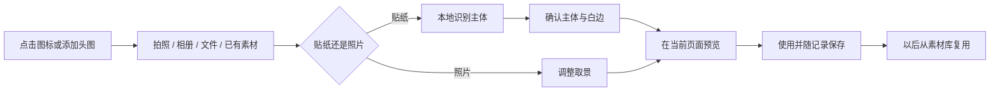

# Holo 贴纸与跨模块视觉素材：产品方案

> R2 · 2026-11-17。状态：实施交接方案，尚未实施。依据四张参考图、当前 `1.1.9` 工作区和 Apple 官方资料整理。新增记忆长廊与深色规格，并完成主会话对抗审查；不代表代码或真实设备已通过验收。
>
> 从 [00-实施交接](00-实施交接与决策清单.md) 开始；本文讲产品，[04-长廊与深色](04-记忆长廊与深色视觉规格.md)讲回看与视觉，[02-技术](02-技术落地方案.md)讲数据实现，[03-验收](03-排期与验收.md)讲交付条件，[05-审查](05-对抗审查与修订记录.md)说明修订原因。

## 1. 产品结论

把贴纸建设为 **Holo 共用的个人视觉素材能力**：用户拍下自己生活中的物品，做成贴纸，并把同一素材放进不同记录。面向用户的名称建议用「我的贴纸」；图片选择器同时支持「贴纸」和「照片」。无需增加一个一级模块。

第一版集中打通 **制作 → 保存 → 固定支出使用 → 想法头图使用 → 记忆长廊回看 → 跨设备再使用**。月历放入长廊现有「找日期」入口，后续习惯、任务和目标共用素材能力。

核心价值假设是：耳机、汽车、书、跑鞋等真实物品比通用符号更容易让用户辨认记录；有个人生活痕迹的记录，也可能提高回看和继续记录的意愿。这些是待验证的产品假设，不把贴纸使用量直接等同于留存提升。

### 1.1 哪些地方能不用 AI

| 环节 | 推荐方式 | 是否需要外部 AI 服务 |
|---|---|---|
| 拍照、选图、裁剪 | iOS 相机与系统选图器 | 不需要 |
| 自动识别物体、去掉背景 | Apple Vision 的端侧主体分割 | 不需要；但它本质上仍是机器学习 |
| 按轮廓加白边、加阴影、排版 | Core Image / Core Graphics | 不需要 |
| 素材库、跨模块引用 | Holo 本地数据模型 | 不需要 |
| 多设备同步 | Holo 现有 Core Data + CloudKit 路线 | 不需要大模型；同步本身需要网络 |
| 自动命名、理解照片内容、生成不存在的贴纸 | 可以另立 AI 功能 | 第一版不引入 |

**准确的对外说法是「照片在设备上处理，无需上传给抠图或大模型服务」**。不宣传「完全没用 AI」，也不宣传「图片永远不离开手机」——开启 iCloud 同步后，素材会随用户数据同步。

Apple 的 `VNGenerateForegroundInstanceMaskRequest` 从 iOS 17 / macOS 14 提供；当前工程的最低系统版本正好为 iOS 17 / macOS 14，无需仅为此抬高门槛。API 可用不等于所有设备、所有图片都能抠出理想结果，真机能力和质量需完成第一阶段验证。[Apple API 文档](https://developer.apple.com/documentation/vision/vngenerateforegroundinstancemaskrequest)

如果严格要求一点机器学习都不用，可以让用户手工描边、套固定形状或导入透明 PNG；但复杂背景下的自动抠物体体验很难靠这些方式替代。因此推荐系统端侧分割。

### 1.2 四张参考图分别转化为什么

| 参考 | 借鉴的体验 | 在 Holo 中的落地 |
|---|---|---|
| 图 1：日历里放生活物品 | 用视觉线索唤起当天记忆 | 首版记忆长廊「图片月历」：每天一张代表图，显示当天真实记录总数 |
| 图 2：相机取景 | 把真实物品带进记录 | 统一「拍照制作贴纸」入口，先拍静态照片再处理 |
| 图 3：物体轮廓白边 | 从照片到可贴素材的完成感 | 抠图结果预览、白边和轻阴影、一次短促完成反馈 |
| 图 4：上方大图＋下方纸面文字 | 生活片段有主角、有叙事 | 想法增加独立头图，可选贴纸或普通照片 |

参考图不能证明原应用采用了哪种技术，也不能证明拍摄的任意对象都能被完美分离。尤其图 2 的肉串与人物重叠，可能需要重选、裁剪或人工修边。

## 2. 三个产品对象，避免以后每个模块重做

1. **素材**：用户保存的一张贴纸或照片。贴纸保留透明背景，照片保留画面；可以有名称和收藏状态。
2. **使用位置**：固定支出图标、想法头图、习惯图标、任务清单封面、目标封面等。同一素材能用于多个位置。
3. **本次外观**：这个位置上的大小、取景、白边和允许的角度。调整想法里的耳机，不会同步改变固定支出里的耳机。

例如用户拍一双自己的跑鞋：给「跑步」习惯做图标，给「半马训练」目标做封面，给一篇跑步想法做头图。无需创建三个独立抠图副本，也不自动推断三个业务对象存在目标关联。

**一份像素素材，多处独立排版；业务关联仍由用户或既有业务流程明确建立。**

### 2.1 第一版的能力边界

- 每个位置最多一张主视觉，贴纸和照片二选一；已有正文附件数量规则继续适用。
- 先支持固定位置，不提供任意拖贴、无限画布、多图层和拼贴编辑器。
- 图标位保持整齐；想法/目标大图可以有很轻的倾斜。
- 不加入 AI 自动识物命名、图片生成、贴纸商店或社区分享。
- 不把制作贴纸作为记录必经步骤；不设置贴纸时，原来的页面仍完整可用。

## 3. 制作一张贴纸的完整流程

### 3.1 入口

主要入口就在用户需要使用它的地方：

- 固定支出新增/编辑页：「外观」行，点击当前图标。
- 想法编辑器图片工具：「添加头图」；原「添加图片」继续作为正文附件。
- 后续习惯、任务、目标的图标/封面编辑入口。
- 个人页或设置的个性化区域：「我的贴纸」，用于集中管理；不占底部主导航。

选择器展示「最近使用 / 我的贴纸 / 照片」；顶部提供「拍照」「从相册选」「从文件导入」。图标场景把已有 Emoji/系统图标放在同一外观选择流程里，进入拍照或素材库后再展开细节，避免第一屏变成复杂编辑台。

普通照片默认只用于当前记录，不自动进入可复用素材列表。贴纸制作完成后默认加入「我的贴纸」。照片可通过「存入素材库」显式加入。

### 3.2 主路径



拍摄页默认跟随调用场景：从「制作贴纸」进入即选贴纸，从「添加照片头图」进入即选照片。保留「贴纸 / 照片」切换。

取景框只用于构图提示，不宣称框内就是最终抠图范围。第一版不在相机每一帧上持续分割，避免发热和耗电；按快门后才处理。

### 3.3 主体确认页

页面上方显示结果，中部可切换「贴纸 / 原图」对照，下方只保留必要操作：

| 控件 | 行为 |
|---|---|
| 选择主体 | 若识别到多个物体，点选其中一个；允许组合已识别的多个主体 |
| 重新裁剪 | 回到原图，缩小画面范围后重新识别 |
| 修边 | 擦除多余区域、恢复被去掉区域、撤销、重置；藏在二级入口 |
| 纸边 | 自适应纸边 / 纯白 / 无；厚度细 / 标准，默认自适应＋标准 |
| 完成预览 | 放回来源页面，确认小图标或大头图的实际效果 |
| 使用 | 交给当前记录的保存流程，同时按选择加入素材库 |

修边不是首屏必学工具，但第一版应有基础擦除/恢复能力；系统无法把手和杯子分成两个主体时，只有「点选」不能解决。

边缘装饰第一版只做实纸边和浅色下的轻阴影，深色默认关闭投影。参考图中的虚线、闪光、纸屑属于可选风格，放在第二阶段；在 40pt 小图标上这些装饰会变成噪点。

### 3.4 默认视觉参数

| 场景 | 默认规则 |
|---|---|
| 40–48pt 图标 | 等比完整显示，约 1–1.5pt 可见白边，主体居中，角度 0°，轻阴影或不显示阴影 |
| 120–180pt 列表头图 | 等比完整显示，约 2–3pt 白边，保留透明留白 |
| 240–320pt 详情头图 | 等比完整显示，约 3–5pt 白边；默认 0°，可选小角度倾斜 |
| 普通照片 | 默认保留完整内容；可切换铺满，并调整焦点；不自动抠图、不强加物体轮廓白边 |

上表是视觉范围，具体role边宽以04 §5.3的唯一参数表为准，需真机校准。纸边按展示尺寸重绘，贴纸保留完整形状，不按照片的铺满裁剪。

保持 Holo 现有 Tool 色板和长廊/纸张样式。默认纸边是可重绘的外观：浅色近白、深色柔和浅灰；用户明确选择纯白则保留。物体/照片像素不反色、不自动改灰。烘焙白边PNG不自动拆边，带白底矩形图片作为照片展示；完整规则见04 §5。

### 3.5 等待与失败

| 情况 | 用户看到什么 | 可继续做什么 |
|---|---|---|
| 读取 iCloud 原图 | 「正在读取照片」 | 取消；下载失败后重试或换图 |
| 正在抠图 | 「正在提取主体」 | 可取消；不伪造百分比 |
| 多个主体 | 多个可选对象或高亮区域 | 点选或组合 |
| 未找到主体 | 「没有找到清晰的主体，可以裁近一点再试」 | 裁剪、换图、改用照片 |
| 边缘不好 | 保留可编辑预览 | 擦除/恢复，或保留原照片 |
| 设备不支持或调用失败 | 「这张图片暂时无法自动制作贴纸」 | 普通照片、透明 PNG、换设备制作后同步 |
| 保存失败/空间不足 | 留在结果页，不丢已完成的编辑 | 重试保存、导出结果或取消 |
| 用户退出 | 当前页面继续可用 | 丢弃未应用的结果，不产生空记录 |

约 3 秒后可补充「正在处理，可以先取消」；10 秒作为初始等待超时目标，返回恢复操作并丢弃迟到结果。系统请求未必能瞬间中断，产品取消必须立即响应，不把取消等同于底层计算已经结束。

本地已下载照片和相机拍摄应可离线制作；只在 iCloud 中的原图仍要先下载。同步失败不阻断本机保存。

## 4. 「我的贴纸」怎么管理

- 初始空态显示「把身边的一件东西做成贴纸」，提供拍照与选图；不预生成用户生活记录。
- 展示最近使用、全部、收藏；初期不做标签树、文件夹和 AI 分类。
- 命名可跳过，默认「贴纸 1、贴纸 2……」；搜索仅查用户命名，不承诺识物搜索。
- 长按菜单：重命名、收藏、重新制作一份、查看使用位置、导出透明 PNG、移出素材库、彻底删除。
- 「查看使用位置」列出本机已同步到的记录；点入仍走该模块的正常导航和可见权限。未知/未到达记录不伪造名称。
- 「移出素材库」仅从以后选择的列表里隐藏，已有记录照常显示，可从管理页恢复。
- 「彻底删除」明确提示会让所有引用位置失去该素材，包括其他设备尚未同步过来的使用；确认后保留删除标记，防止旧设备恢复素材。不能把当前显示的引用数量当成全设备完整计数。
- 在业务页面选择「移除头图/恢复默认图标」，只取消此处使用。
- 重新抠图会产生新素材；不静默替换所有历史记录中的旧素材。

## 5. 财务：先让物品有辨识度

### 5.1 固定支出：第一批上线

当前固定支出列表使用分类图标；详情包含周期性支出和一次性购买两种语义。贴纸应绑定具体项目，不直接修改全分类的图标。

**耳机示例**：新增一次性购买 → 填金额与购买日期 → 点击「外观」拍耳机 → 生成贴纸 → 列表左侧显示自己的耳机，右侧继续显示金额和日均成本。详情上方显示较大耳机主视觉，下方继续呈现持有天数等原有信息。

**汽车示例**：汽车可以用于「一次性购买」项目的车辆照片，也可以用于独立建立的「车位费」周期支出。贴了同一辆车不代表系统自动把两条账目合并为一项成本。

建议布局：

```text
列表： [耳机贴纸 44]  我的耳机                ¥1,299
                       已购 168 天          日均 ¥7.73

详情：         [耳机贴纸 140–180]
                    我的耳机
            金额 / 购买日期 / 持有天数 / 日均
                      [编辑外观]
```

以上金额为示意数据。未设置素材时恢复原分类图标。更换贴纸不触发自动记账、不回写金额、不重建周期流水。生成的历史账本流水第一版继续保留账本分类图标，不随项目外观修改而改写。

### 5.2 其他财务场景

| 场景 | 价值与具体放置 | 阶段 |
|---|---|---|
| 预算分类 | 「咖啡」预算旁使用自己的杯子图标，仍显示分类名称与预算金额 | 第二阶段 |
| 财务项目 | 旅行、装修、婚礼项目使用封面，便于辨认 | 第二阶段，随现有项目入口接入 |
| 分类图标 | 外观选择器新增贴纸来源，影响该分类展示而非分类语义 | 第二阶段，单独验收所有分类入口 |
| 账目生活图 | 可作为附加生活图片；与小票凭证分开 | 后续；不将装饰图塞入小票识别流程 |
| 统计卡片 | 标题旁小贴纸，分类明细行用分类贴纸 | 第二阶段 |
| 分享账单/报告 | 在图表之外的封面或页角增加个人视觉 | 第二阶段，导出前预览 |

### 5.3 图表规则

图表可以个性化，但不把每根柱子改成杯子、每个数据点改成贴纸。图片面积不是数值编码，容易误导比较。

- 贴纸只占图表标题区、外部留白或分类明细图标位。
- 不盖住坐标、金额、百分比、图例、参考线、选中提示。
- 当前圆环中心承担固定读数，不直接替换成贴纸。
- 图表装饰不接收点击；「修改外观」在菜单里，横滑选数和纵滑滚动保持现有行为。
- 先接明确有稳定身份的图表卡片。例如财务总览卡用固定设置键，某分类预算卡用分类/预算 ID；不为每个屏幕坐标存一张贴纸。
- 切换周期默认保留同一图表卡片外观，不为每个月复制一份；含多个分类的总览不自动选某一分类的贴纸。

## 6. 想法：把「记录」变成可以回看的生活页面

这是本次体验改造的重点，包含头图、编辑、列表、分享的完整链路；不需要重写现有文字编辑器或改变分类逻辑。

### 6.1 三项设置彼此独立

| 设置 | 决定什么 | 不负责什么 |
|---|---|---|
| 头图 | 这条记录的视觉主角；一张贴纸或照片 | 不替代正文附件，不判断记录主题 |
| 正文与附件 | 用户要表达的文字、其他图片、引用、标签 | 不承担头图排版状态 |
| 记录样式 | 现有纸张、字体和装饰 | 不强制用户上传照片或使用贴纸 |

现有「原样、远行邮笺、晴日观察、生活票根、一日一页、对折手记、光影胶片、页边书签、点阵便笺」继续使用。头图能与任一纸张组合；不为「贴纸」再复制九套新模板。

### 6.2 详情/编辑页的目标结构

```text
返回                                          更多

                 [主视觉区域]
          透明贴纸：完整物体＋白边＋轻阴影
          普通照片：完整显示或用户选定裁切

┌──────────────────────────────────┐
│ 西瓜丸子碎冰浆                    │ ← 可选的正文标题
│ #奶茶             8 月 22 日       │
│                                  │
│ 手握着这杯冰旋……                  │
│ 正文、引用、任务标记与其他附件      │
└──────────────────────────────────┘
                         [原有编辑工具栏]
```

设计取图 4 的「视觉主角＋纸面叙事」关系。贴纸区建议高 240–320pt，照片头图建议 4:3 展示容器；宽屏和大字号按实际可用空间调整。没有头图时整段折叠，不留空的大占位区域。

标题第一版不新增一个与正文竞争的数据字段。新增或完善「标题」格式动作，把用户输入保存为正文开头的 Markdown 一级标题；展示层可把这个标题放大并与后续正文分开呈现，但只渲染一次。没有标题就直接展示正文，不自动将任意首句变成大标题。现有 `HoloContentNode.text` 承载 Markdown，实施时必须验证编辑器、列表与分享的标题渲染，不假设已有专门标题节点。

纯头图想法的目标体验是可无文字保存，列表显示日期及「图片记录」，不生成标题、不反复触发文本AI。但此能力需通过旧端另一设备编辑的安全验证；若未通过，首版关闭仅头图提交，保留可恢复草稿并提示补充正文后保存，不能静默丢图或生成空记录。此条件只限制纯头图，带正文/原附件的记录仍可设置头图，见00 §6。

### 6.3 添加与修改

1. 编辑器的图片菜单新增「添加头图」；新记录空态可给一个轻入口，开始打字后不占正文空间。
2. 选择「拍照制作贴纸 / 从相册选 / 我的贴纸 / 现有附件」。
3. 预览实际头图：贴纸可调大小、白边、轻微角度；照片可调完整/铺满、焦点。
4. 点「使用」纳入当前编辑草稿，沿用现有编辑保存契约；素材和引用一起提交。
5. 头图菜单支持「更换、调整、移除、查看图片」。移除不删除原附件或共享素材。
6. 从某个现有附件设置头图时，保留原附件数据，在展示时跳过这个来源附件，避免头图与附件网格重复。移除头图后恢复网格展示。
7. 后续删除来源附件时，头图已经有独立素材副本，继续显示；操作文案说明只删除正文附件。头图来源 ID 仅用于去重，不作为能否渲染的依赖。

第一版头图是记录级属性，不编码为新的富文本内嵌图片节点，不允许在文字中任意拖贴。这样正文选择、光标、语音插入、`#` 标签、`@` 引用和转任务可以沿用原有路径。

### 6.4 列表展示

保留现有列表结构及排序。设置了头图的记录，在卡片上部出现 120–180pt 主视觉预览，正文摘要继续可读；没有头图的记录保持原密度。初期不同时引入瀑布流、自由拼贴和全新分类导航。

- 贴纸等比完整显示；照片按该位置保存的取景规则显示。
- 如果用户选择照片「完整显示」，列表保留完整图像，不擅自换成裁切。
- 标题和正文留出原有文本层级，标签、主题和操作菜单保持可点。
- 卡片点击主区域延续现有编辑入口；显式「查看图片」进入图片浏览，不给透明部分制造失效点击区。
- 想法模块增加「紧凑显示头图」偏好：将列表头图收为约 64pt 缩略图，详情不变；属于查看偏好，不改每条记录内容。
- 首页、搜索结果、引用选择器继续紧凑摘要，最多带一张小缩略图，不展示整块大头图。

### 6.5 与现有纸张及分享的组合

- `光影胶片` 原先照片前置；有显式头图时先展示头图，只对剩余附件应用胶片排版。
- 票根边、折痕、邮票等装饰仍限于原纸面，不能覆盖头图主体或工具栏。
- 编辑、列表、预览和分享使用同一份头图描述与比例规则，不各写一套裁切。
- 分享卡包含头图、正文、日期和用户选择的标签；导出前看到最终成图。
- 分享中的临时头图/纸张调整不改原记录；「应用到本条」必须是独立明确动作。透明PNG默认用固定浅色导出配置，不因当前深色预览而偷偷导出灰边。
- 分享卡固定浅色纸面的既有策略可保留；透明 PNG 单独导出只含贴纸，不带整张页面背景。

### 6.6 AI 和检索边界

- 只换贴纸、白边、角度，不触发重新分类、主题提取或记忆萃取。
- 用户修改正文标题属于文本变化，沿用原文本索引和整理规则。
- 素材名称可以在素材库搜索；不直接把「跑鞋」贴纸名称当作想法正文或事实。
- 一张车贴纸可能表示愿望、已购车辆或装饰；不因贴了它就认定用户买过车。
- 对图片内容做理解是另一项需求，需要独立说明使用方式；本方案不上传照片给 HoloAI。

## 7. 习惯、任务、目标：共用素材，不共用业务含义

| 模块与场景 | 用户操作与呈现 | 必须保留的语义 | 优先级 |
|---|---|---|---|
| 习惯图标 | 在已有 Emoji/图标选择器增加「我的贴纸」；用跑鞋、水杯、书做图标 | 完成状态、次数、连续天数仍由打卡数据决定 | 第二阶段优先 |
| 习惯详情头图 | 训练装备、阅读环境做封面 | 不把封面作为某天打卡照片 | 第二阶段 |
| 习惯打卡照片 | 今天拍到的照片可以制作贴纸，并显式附于当天打卡 | 拍照或制贴本身不自动完成打卡 | 后续独立接入 |
| 任务清单 | 「出游准备」「装修清单」添加清单图标/封面 | 复选框、优先级、日期和逾期标识不被替代 | 第二阶段优先 |
| 单个任务 | 详情可配一张主视觉；列表只在有设置时增加小图 | 不占复选框位置；任务附件仍可单独存在 | 第二阶段 |
| 重复任务 | 在模板上改外观影响以后生成的实例；已完成实例保存原选择 | 实例日期、完成状态不跟随素材变化 | 接入时专项验证 |
| 目标 | 给「买车」「旅行」「完成半马」添加贴纸或照片封面 | 进度、截止日期、领域图标保留清晰文字/徽章 | 第二阶段优先 |
| 目标里程碑 | 用户明确上传某次完成照片，放在里程碑条目旁 | 上传图片不等于完成里程碑 | 后续 |

习惯磁贴完成后不把彩色贴纸整体染白或染成习惯色；外框、背景和勾选标记承担完成态。低分辨率小图标不展示复杂虚线。目标领域与任务优先级等语义小徽章继续使用稳定的既有标识，用户贴纸承担主视觉。

记忆长廊的当日代表图、图片月历与随机漫步纳入首版，详见下一节。其他可扩展场景：纪念日的礼物/纪念物封面、主题集合封面、月报分享页中的个人物品。健康测量数据图和药物等强语义状态图标不作为第一批自由替换位置。

## 8. 记忆长廊：时间线、图片月历和随机漫步

月历统一放在记忆长廊，不再在想法里单独建设。想法可提供「在长廊看这天」跳转，原记录仍留在想法。

- **默认时间线**：每天优先展示用户指定记录、带头图想法、带附件想法，再回到文字与其他实际记录；展开后可看当天全部来源。没有图片时保持原排版。
- **找日期 → 图片月历**：每天一张代表图，日期和总记录数保持可见；点击某天先看底部预览，再点「在长廊看这天」定位时间线。保留「日期」模式的快速点选跳转。
- **随机漫步**：同一想法头图出现在长廊内阅读页，返回仍在原日期和同一轮漫步；有贴纸不改变随机抽样概率。
- **手选当天封面**：选择当天带头图或附件的真实想法，绑定原记录，可恢复自动选择。首版不能随意给一个没有记录的日期贴图。
- **其他模块的素材**：习惯/任务/财务原事件可以显示所属图标，但默认图标不是当天照片，不能自动成为当天代表生活图片；固定支出、目标换封面不生成新事件。
- **统一来源**：条数按去重后的原记录计算，主预览包含在「当天N条记录」中。素材、附件、引用本身不增加条数。某模块取数失败时显示「已载入N条」，不伪装完整总数。
- **同步与变化**：手选图没下载好先占位；原记录换头图后长廊跟随；软删/归档时回退，恢复后可恢复手选。日期沿用业务记录日期，换图不改变归属日。

现有长廊已经有按日时间线、找日期和随机漫步；此次在这些真实入口上增加视觉内容，保留最近的减法结构，不恢复周回顾/统计看板。面板层级、七列网格、小屏、日键和返回锚点以 [04-记忆长廊与深色视觉规格](04-记忆长廊与深色视觉规格.md) 为准。

## 9. 可访问性、隐私与质量

- 可点击图标即使视觉只有 40pt，热区至少 44pt；透明像素不造成点击漏洞。
- 为素材提供可编辑名称作为辅助说明；纯装饰图对 VoiceOver 隐藏，业务对象仍读名称、金额、状态。
- 大字号优先保正文与状态，主视觉可缩小；键盘弹出后编辑光标可见，不能被大头图顶走。
- 减少动态效果时，制作完成只做静态替换或淡入；列表滚动不持续晃动贴纸。
- 素材抠图与压缩在后台执行；列表不读原图，不边滚边抠图。
- 相机权限只在拍照时请求；选图优先用系统选择器。不能因相机被拒绝而阻断相册路径。
- 保存的工作图与导出贴纸去掉定位等无关 EXIF；素材不额外记录照片原始 GPS。
- 沿用 Holo 既有数据保护与可见性规则，不新增“因为是贴纸就可以被 AI 或跨模块摘要任意读取”的路径。

## 10. 推荐的上线次序与商业位置

**第一版**：共用制作与素材库、固定支出、想法头图及分享、记忆长廊时间线/图片月历/漫步、深色适配、透明格式、iCloud同步、删除与恢复、素材导入导出。

**第二版**：习惯图标、目标封面、任务清单/任务主视觉、少量财务图表外观。逐项复用同一基础能力，不一起大改全部页面。

**以后**：多贴纸拼贴、更多边缘风格、打卡照片、跨来源回顾分享、可下载素材包。先根据使用和回看反馈决定。

建议基础拍照制贴与跨模块使用免费，先建立习惯。将来若需要 Plus 差异，可考虑额外纸张、边缘风格和成套分享模板；不以每次抠图扣 AI 次数，也不因为会员结束而破坏用户已保存的素材。此处是商业建议，本轮不改权益或付费代码。

衡量顺序：制作是否顺利 → 是否真的应用到记录 → 是否跨模块复用 → 是否增加回看和继续记录。具体事件与验收见第三份文档。
