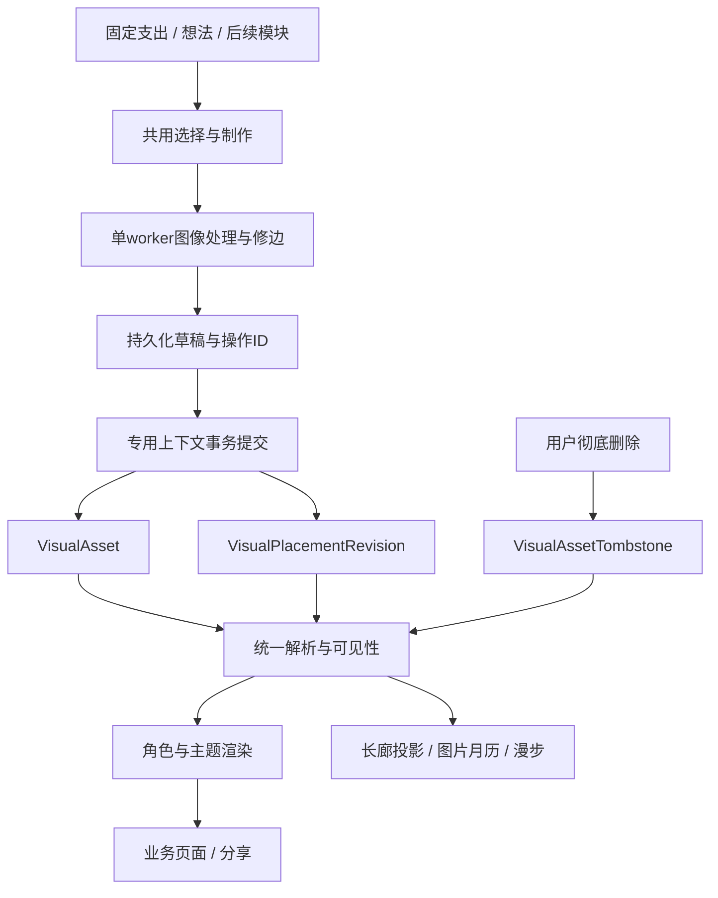

# Holo 贴纸：数据、图像与实施契约

> R2 · 2026-11-17，完整替代 R1 技术设计。产品行为见 [01](01-产品方案.md)，长廊/深色见 [04](04-记忆长廊与深色视觉规格.md)，执行入口见 [00](00-实施交接与决策清单.md)。
> 以下均为待实现要求。没有执行原生构建、抠图或 CloudKit 验证。

## 1. 现有工程事实与接入范围

主代码根 `Holo/Holo APP/Holo/Holo/`，以下 Swift 路径相对此根。

| 事实 | 当前入口 | 实施要求 |
|---|---|---|
| 最低 iOS17 / macOS14 | `../Holo.xcodeproj/project.pbxproj` | 使用 VN 前缀的 iOS17 分割 API，不误用仅更新系统可用的 Swift 同名接口 |
| 固定支出用分类图标 | `Views/Finance/SpendingProjectsView.swift` | 项目自己的 icon/hero 来源共享一个位置选择，不能改分类或生成账单 |
| 想法有纸张、附件和富文本 | `ThoughtStyle.swift`、`ThoughtStationeryDocument.swift`、`HoloContentNode.swift` 对应 Models/Views 子目录 | 头图是独立外观，正文不新增 sticker 节点 |
| 附件处理压成 JPEG | `Services/AttachmentFileManager.swift` | 新增透明通道，旧小票/附件保持原编码 |
| 图片读取已有后台解码缓存 | `Services/AttachmentImageLoader.swift` | 借鉴按大小后台取图，不在 body 解码/读原图 |
| 想法编辑有自动保存、稳定草稿ID、恢复日志 | `ThoughtEditorView.swift`、`ThoughtRepository+EditorCommit.swift`、`ThoughtEditorRecoveryStore.swift` | 必须接入完成判定和幂等事务，不只加一个 Image |
| 长廊真实月历在找日期 Sheet | `Views/MemoryGallery/RandomWalk/MemoryGalleryFindDateModel.swift` | 04指定真实宿主，旧MonthCell不是唯一入口 |
| 长廊事件判等按id | `Models/Calendar/CalendarEvent.swift` | 视觉更新另带revision，不依赖事件id改变 |
| 长廊按原记录生成投影 | `Services/Calendar/CalendarEventProvider.swift` | 新素材不变成新事件；按稳定业务UUID关联 |
| 数据模型程序化生成 | `Models/CoreDataStack.swift` | 新增实体，尽量不改旧实体hash；全target同模型 |
| 升级只放行纯加表或登记形态，拒绝降级 | `Models/CoreDataStoreUpgrade.swift` | 不能用安装旧包回滚已迁移本地库 |
| 升级备份已用SQLite backup并复制_SUPPORT | 同上 `makeBackup` | 扩充外置素材完整性/恢复测试，不再另做只有SQLite的备份 |
| 财务JSON没有全量恢复能力 | `Services/DataExportService.swift`、`Models/ImportExportModels.swift` | 素材包不得宣称Holo全量备份 |

首版不改 HoloBackend、Prompt 或业务接口；Apple CloudKit Schema 的生产发布另需明确授权。工程已有并行改动，实施前重新核对。

## 2. 共用架构和不可破坏的约束



不变量：

- 像素素材内容不可变；重新制作生成新ID。外观版本和删除墓碑不可变。
- 素材复用不创建业务关联、事件或AI事实。
- 任何可显示素材必须同时满足当前store/account scope、可见owner、有效位置、无删除墓碑。
- 所有写操作有稳定 operationID，所有业务引用用业务UUID；NSManagedObjectID只用于本机取数。
- 系统主题变化、派生缓存和加载结果不产生同步写入。
- 位置解析、删除判断、日代表选择各有一个公共实现，不让各模块自行兜底。

## 3. 图像管线与alpha契约

### 3.1 输入规范

接受相机照片、系统PhotosPicker选定内容和用户选定文件；文件提供者URL持有security scope期间复制到本机草稿目录，完成后释放；不持久化外部临时URL。图片来源可含个人信息，日志只记录操作ID、错误分类、尺寸等级。

支持JPEG/HEIC/PNG；Live Photo仅静态帧；GIF/视频提示暂不支持动画。读取真实UTType、像素尺寸和文件大小再解码，不信任扩展名。初值上限60MB编码文件、100MP；损坏/超限保留明确换图出口。

用ImageIO直接降采样到长边2048px，应用EXIF方向且只应用一次，转sRGB SDR工作图并移除GPS等无关元数据。不得先全解码48MP UIImage再缩小。保留源图透明度；RGBA输入不能先转JPEG。原始相册文件不改动。

### 3.2 主体分割与选择

`VNGenerateForegroundInstanceMaskRequest` → 后台 `VNImageRequestHandler` → `VNInstanceMaskObservation`；这是iOS17基线。[Apple API](https://developer.apple.com/documentation/vision/vngenerateforegroundinstancemaskrequest)

一次只执行一个重分割请求。多个主体用实例索引选单个或组合；背景0不可选。实例索引仅当前分析有效，重新裁剪分析后不能沿用。UI点转换须完整考虑显示letterbox、裁剪、朝向、缩放和坐标轴方向；高质量alpha采用系统缩放蒙版，不能将实例标签图直接当alpha。

对无主体、合并主体、复杂遮挡、能力不可用分别返回类型化失败/待确认状态。不能以“有一个结果”当作物品正确。重拍/裁剪/修边/改照片始终可用。自动取所有实例仅用于用户明确选“全部主体”。

第一阶段可以用VisionKit演示比较交互，正式数据只由这一条统一管线生成。旧设备能力按真实设备结果记录，不借模拟器结果保证支持。

### 3.3 保存工作遮罩，修边可逆

同时保留：归一化工作图、工作画布上的最终主体遮罩 `maskData`、紧裁且保留透明的主体 `contentData`、精确的source→content变换。工作遮罩为8bit灰度PNG，尺寸与工作图一致，保证恢复被擦除区域时能从原工作图取回像素。

修边的笔画坐标使用工作画布归一化坐标；擦除/恢复只改mask，不生成被遮挡内容。预览用较小图，完成在工作尺寸重放笔画；取消只丢预览。已有贴纸重新修边得到新素材，不重写全部引用。

### 3.4 白边不等于在主体下铺一整片白色

R1的“白底D直接盖主体”和“外环D−A”等价说法撤销：在半透明像素处它们并不等价，铺整片底色还可能填白玻璃、孔洞。

定义：

- `A`：原工作图alpha × 分割/修边mask，作为主体像素的实际alpha。
- `M`：用于外轮廓的主体占用遮罩，不用玻璃自身的半透明颜色计算物体是否存在。Vision来源用主体mask；透明PNG来源用alpha大于1/255的占用区并做最多1输出像素的边缘抗锯齿，不按白色RGB抠图。
- `D = dilate(M, radius)`，`R = clamp(D − M, 0, 1)`；R只用于纸边环，源图RGB及A保持不变。
- 纸边环在底，主体在上，以source-over合成。若主体alpha为A、纸边为R，最终alpha是 `A + R × (1 − A)`，不能假定等于D。

四周先补透明padding；输出bounds包含纸边、外细线、阴影、旋转后的全部范围。保留杯柄/耳机镂空，不做全局孔洞填充；厚边自然缩小细孔需要实测，不能无限加粗。Core Image可用形态学最大值生成D；输入灰度和premultiplied/unpremultiplied转换由处理器统一，不能误把RGB膨胀成彩边。[Apple Core Image](https://developer.apple.com/documentation/coreimage/cifilter-swift.class/morphologymaximum())

纸边按04的role和pt参数转px一次。修边发生在源坐标，纸边发生在目标渲染尺寸；先从无纸边主体做输出，不对已经烘焙的纸边重复扩张。透明PNG导入默认无新增纸边。

### 3.5 规范文件与大小

| 文件 | 规范 |
|---|---|
| sourceData | 2048px长边工作图，不透明JPEG / 透明PNG，去无关EXIF |
| maskData | sticker必需的工作画布灰度PNG；原本透明图也生成占用遮罩；photo为空 |
| contentData | sticker为RGBA PNG，紧裁主体长边≤1536px，无生成纸边；photo可使用sourceData不重复存 |
| thumbnailData | 320px长边，贴纸PNG、照片JPEG；无主题纸边，所有设备可重渲染 |
| 派生图 | 本地缓存，icon/calendar/list/hero按实际像素生成，不同步 |
| 导出贴纸 | 透明PNG，明确的固定导出主题与边缘配置 |

保留文件合计10MB作为初始软限；超限先提出降低尺寸并给预览，不能静默丢alpha或源工作图。修改输出尺寸后重新计算映射和hash。源内容小于目标尺寸时不放大伪造细节。

### 3.6 调度、取消与错误状态

`ImageProcessingCoordinator`管理一个实际串行worker，不能只用可重入actor包装多个Task.detached。输入快切时只保留最新待处理请求；正在执行的请求可发取消，但未真正退出前不启动另一重请求。

任务携带 `(scopeGeneration, editorSessionID, requestGeneration, operationID)`。结果回UI和入库前四项均匹配才接受。3秒显示仍在处理，约10秒恢复用户操作/标记超时；底层取消不保证瞬停，迟到结果只清理自己文件。视图退出后不偷偷创建素材。

状态：idle → acquiring → processing → editing → prepared → committing → committed；错误保留相应草稿可重试；cancelled/obsolete不可反向进入committed。取iCloud原图属于acquiring，可联网；本地分割不联网。

## 4. 三类实体与稳定身份

### 4.1 Core Data建模约束

三类实体在 `CoreDataStack+VisualAssetEntities.swift` 注册，同一store、同一CloudKit configuration；不改旧实体关系。首版不加跨模块Core Data relationship，用明确业务ID及owner adapter解析。

模型属性使用optional或合法静态默认值，满足CloudKit要求；不得把建模时生成的UUID/当前Date当每条记录默认值。创建时由仓库显式赋值，DTO读取时验证必需值。新增实体不设unique constraints；逻辑重复由仓库合并。所有target包含相同模型；旧实体加字段时必须登记 `propertyHistory`，本设计优先纯加表。[Apple CloudKit建模约束](https://developer.apple.com/documentation/coredata/creating-a-core-data-model-for-cloudkit)

### 4.2 VisualAsset

| 字段 | 类型/约束 |
|---|---|
| id / creationOperationID | UUID，创建时一次分配，重试复用 |
| kind | sticker/photo；未知值只读占位 |
| sourceData/sourceUTType/sourceHash | Binary/String/String；工作图事实源 |
| maskData/maskHash | Binary/String，sticker必需，工作画布尺寸一致 |
| contentData/contentUTType/contentHash | Binary/String/String；photo可无contentData，明确fallback到sourceData |
| thumbnailData/thumbnailHash | Binary/String，安全可重建但不能用它替代完整素材导出 |
| sourceWidth/sourceHeight/contentWidth/contentHeight | Int32，正数，和实际解码尺寸核对 |
| transformJSON | 源画布、裁剪矩形、输出比例、schemaVersion；不能靠UI临时推算 |
| processingVersion / metadataVersion | Int32；支持版本清楚定义 |
| displayName/isFavorite/libraryVisibility | 名称、收藏、visible/hidden/recordOnly；管理元数据可变，不改像素 |
| createdAt/metadataUpdatedAt | Date，用于展示/排序，不参与位置冲突裁决 |

大Binary字段允许external binary storage。此选项不证明已上传，镜像由NSPersistentCloudKitContainer完成，不另写手工CKAsset上传协议。

像素与变换字段创建后不可变；仅管理元数据可单独修改。元数据写入不能携带旧像素或删除状态快照。重复创建operationID返回原assetID；物理副本id相同且hash一致可去重投影，hash不一致视为完整性错误，不按fetch顺序任取一个。

### 4.3 VisualPlacementRevision

| 字段 | 类型/约束 |
|---|---|
| id / operationID / mutationID | UUID；一次逻辑应用/移除/日代表选择固定身份；mutationID与id可同值 |
| ownerKind / ownerKey / slot / placementKey | String，按规范编码；UUID小写标准串；不得使用分隔符碰撞的随意拼接 |
| logicalClock | Int64，正数，当前slot本机已见最大值+1；溢出失败，不回绕 |
| writerID | 安装级稳定UUID串；重装生成新值；不是人名/设备名 |
| payloadJSON | UTF-8 String，完整不可变负载，见下一节 |
| payloadHash | 对规范编码的负载求SHA256，用于重复与完整性检查 |
| changedAt | Date，仅展示/诊断 |

`placementKey`为规范JSON数组 `[ownerKind, ownerKey, slot]` 的稳定编码，不把金额/名称/坐标当身份。允许scope仅来自当前store namespace，不将私人Apple账号标识写入记录。

首版owner/slot白名单：

| ownerKind | ownerKey | slot | set负载 |
|---|---|---|---|
| spendingProject | 项目UUID | primaryVisual | asset引用；列表icon与详情hero都由此投影 |
| thought | 想法UUID | hero | asset引用＋可选sourceAttachmentID |
| galleryDay | 04定义的日键规范JSON | featuredRecord | 原事件引用，首版只接受thought |
| habit/todoTask/todoList/goal | 对应UUID | primaryVisual | 第二批才开启的asset引用 |
| financeChart | 已登记的稳定chart设置键 | chartAccent | 第二批；禁止任意View标识 |

图库一天的手选复用此表，不额外造一份业务日记。未支持的owner/slot在读取时保留原数据，显示不支持；不得偷偷映射到thought。

### 4.4 负载v1

以下是契约示意，UUID由实现生成；JSON实例字段、类型以此为准，不使用NaN/Infinity或任意字典：

```json
{
  "schemaVersion": 1,
  "action": "set",
  "selection": {
    "type": "asset",
    "assetID": "00000000-0000-0000-0000-000000000001",
    "sourceAttachmentID": null
  },
  "presentation": {
    "fit": "contain",
    "focusX": 0.5,
    "focusY": 0.5,
    "scale": 1.0,
    "rotationDegrees": 0,
    "borderStyle": "adaptivePaper",
    "borderWeight": "standard",
    "softenPhotoInDark": false
  }
}
```

clear为 `{"schemaVersion":1,"action":"clear","selection":null,"presentation":null}`。

galleryDay set的selection为 `{"type":"record","module":"thought","recordID":"<业务UUID>"}`，presentation为null；不得复制原图crop/assetID，否则更换来源头图后长廊会停在旧图。

约束：focusX/Y∈[0,1]；scale∈[0.6,1.2]；rotationDegrees∈[−6,6]；sticker只允许contain，最终几何必须完整放入安全区；photo可contain/cover；边缘枚举adaptivePaper/white/none，厚度thin/standard。图标/日历禁旋转、取消阴影属于role适配，不写回负载。softenPhotoInDark仅对photo生效。未知枚举与高版本不能以默认值覆盖原值。

### 4.5 VisualAssetTombstone

字段：id、operationID、assetID、deletedAt、schemaVersion。记录只追加，绝不编辑清空或物理删除墓碑；任一墓碑命中assetID，该素材在所有位置都不可显示/重新绑定。

永久删除分两段：先在同一事务写墓碑并清空当前素材Binary字段，成功后刷新UI/清缓存；远端收到墓碑后同样清理本地副本。离线旧记录若晚到，墓碑继续压过它，再次触发内容清除。当前客户端元数据更新不得把Binary字段重填。外置文件物理回收由Core Data负责，不手工删_SUPPORT中的单文件。

“彻底删除”意味着同步后的在线副本清除，不能保证离线设备和用户外部备份即时消失。素材库隐藏是可逆管理状态，与墓碑无关。

### 4.6 位置解析算法（禁止简化）

1. 根据当前scope、placementKey取全部有效包络；按operationID去重。同ID的placementKey、logicalClock、writerID、mutationID、payloadHash必须一致，否则报完整性错误；仅changedAt不同不改变业务选择。不能只对比payloadHash而漏掉被改写的clock。
2. 在已提交包络中按 `(logicalClock, writerID, mutationID)` 的字节/规范字符串序取最大者；changedAt不参与。
3. **选完赢家再解码payload**。赢家是未知版本/枚举则返回unsupported，不回退到更旧版本、不允许本slot编辑，防止旧客户端覆盖新功能。
4. clear返回none。asset set先查墓碑，再查素材与owner；record set进入04的日代表策略。
5. 返回 `none / ready / pending / sourceUnavailable / deleted / unsupported / corrupt`，区分图片未到、owner未到、来源明确删除、损坏。
6. 任意错误或未同步都不自动写clear。明确用户操作才产生新版本。

版本的包络缺必需字段/尚不完整时暂不参与赢家排序，并对该slot返回pending只读；不能拿旧版结果当确定赢家开放编辑。完整但非法数值是corrupt，明确诊断。

本机所有writer走同一个串行提交队列；读取最大clock、创建版本、save在同一临界区。接收远端版本后下次本机编辑从已见最大clock+1开始。并发离线修改的胜出由确定性tie-break决定，不承诺现实时间最后一次点击胜出；如用户不满意，再次选择会创建更高clock。

导入包里的历史clock不直接插入当前位置历史，见§9，避免一个恶意大clock永久压住本地操作。

## 5. 提交、自动保存与草稿恢复

### 5.1 单次提交的原子边界

同一store内，在专用background context提交：新素材＋位置版本＋必要的父想法/正文变更。不能一边共享viewContext改正文，一边独立save素材，然后宣布整体成功。处理大图在事务之前，提交只写准备好的文件数据和小元数据。

传入 `VisualCommitCommand`：scopeGeneration、operationID、editorSessionID、ownerKey、expectedOwnerRevision、expectedSlotWinnerID、businessChangeSet、preparedAsset或existingAssetID、placementPayload。businessChangeSet每字段有unchanged/set/clear语义，纯视觉操作不能携带旧正文、金额、标签全量覆盖。

提交顺序：

1. 检查scope仍一致，owner当前存在、未删且可编辑；仅新想法允许用本会话稳定UUID创建父对象。
2. 对现有记录检查基线，来源或slot已变时返回conflict，保留本机草稿；加载最新状态后让用户重新应用选择，不静默覆盖别人的正文。
3. 在专用context创建/复用asset、写完整revision及本次明确的业务变更；不改变发生日期，不为视觉修改重算金额。
4. `save`成功后返回 `VisualCommitReceipt(operationID, ownerKey, assetID, revisionID)`，再merge到viewContext并发布视觉事件。
5. 清本次草稿前把成功回执写入恢复日志；进程在save后被杀，重启按operationID查已有记录，不能重新制作/重复建父对象。

禁止对共享viewContext调用全量rollback。专用context冲突/失败可rollback自身；不能吞错后仍关页。其他设备稍后删除owner时，读路径立即隐藏相关引用；跨设备不承诺父子事务原子到达。

### 5.2 与想法编辑器的精确衔接

需要同时修改 `hasContent`、persistContent空记录分支、debounced autosave、完成按钮等待、返回/下滑关闭、onDisappear兜底、share前保存、恢复读取/清理。视觉只有prepared/已提交素材才算有效内容；空的选择器或processing不算已保存头图。

`ThoughtRepository+EditorCommit` 抽取在指定context中apply变更且不自行save的内部方法；旧入口继续可用，新协调器把其与视觉写入放在一次save。文本/标签/引用原有约束不变；不得为了复用而在两个context间传Thought对象。

仅视觉提交不改正文hash、不入AI分类/主题/记忆队列。纯头图记录文字为空时走明确的文本分析跳过政策；后续用户输入达到现有条件时正常入队。新增标题格式仍存Markdown text，`# 标题`与`#标签`区分，不能新造一份title字段并让检索丢失。

附件转头图：独立创建素材，sourceAttachmentID仅用于新端展示去重。需要旧附件投影返回稳定attachmentUUID，而不只是 `[Data]`，否则长廊/分享无法准确跳过来源附件。来源附件删除后头图保留；移除头图后剩余原附件照常显示。多个相同像素的附件不能仅凭hash全部隐藏。

旧端另一设备的纯头图编辑安全必须测试，发布策略见00：若不能保证，先关闭纯头图提交并保留草稿，其他带正文/原附件记录继续支持头图；禁止临时插入用户不可见的文本或附件冒充兼容。

### 5.3 草稿文件协议

沿用本机恢复日志范围，新增optional `visualDraftV1`，旧日志照常解码。内容包括scopeGeneration标记、operationID、稳定asset/ownerID、基线revision、prepared文件清单/UTType/hash/尺寸、负载、提交回执；不保存外部URL或NSManagedObjectID。

新文件先原子写成功，再更新manifest；写文件/写manifest失败必须throw或返回类型化失败，不能沿用旧接口“只打印日志”就宣称可恢复。恢复流程先验证文件/hash，已提交operation走回执，不再次应用；父对象已删除则显示失效草稿，可显式另存素材，不重建原记录。

`clearRecoveryRecordAfterCommit`必须同时确认旧附件队列、新视觉任务和manifest均已提交。清理只删无草稿/无在途租约且过保留期的本机临时文件；提交后崩溃的孤儿通过回执对账清理。scope变化后旧草稿不可出现在新账号恢复横幅。

## 6. 长廊投影与刷新

### 6.1 分离业务身份、视觉描述和加载数据

建议值类型：

- `VisualDescriptor`：assetID、winningRevisionID、contentHash、kind、presentation、state；不包含Data或托管对象。
- `CalendarVisualProjection`：eventKey、sourceOwnerKey、heroDescriptor、attachmentReferences、visualRevision。
- `GalleryDayVisualSummary`：04列出的日期状态/计数/代表记录。

Provider先批量获取该窗口有效业务事件，再一次批取相关owner的位置赢家与素材元数据；缩略图按可见项异步加载。禁止每个日格对所有模块分别fetch或每个event触发一次Vision。

想法按createdAt半开区间、deletedAt/isArchived过滤，与当前Repository一致。其他模块沿用原Provider统计定义，不增加“所有财务交易都算生活事件”的新口径。目标封面和固定支出定义本身不生成长廊事件。

### 6.2 视觉变更通知

新增 `.visualAssetsDidChange`，值负载包含scopeGeneration、operationIDs、affectedOwnerKeys、assetIDs和changeKind。只在事务成功或远端persistent history合并后发；UI参数拖动预览不广播。

本地通过回执，远端通过已集成的history/CloudImport路径识别三个新实体。将影响映射到对应原事件日期，约100ms合并一批刷新；隐藏页只记dirty范围。日计数不因换图重算全库；素材永久删除按本机已知引用索引使相关可见项失效。

保持 `CalendarEvent.id` 的业务身份和现有按id比较用途；新增presentation快照组合 `(dataRevision, visualRevision, scopeGeneration)` 驱动头图。原事件标题/状态变更仍走原通道。不要靠生成随机eventUUID强制刷新，或借用holoGrowthDidChange伪造新成长事件。

图片月历的加载状态按04区分；一个模块失败仍显示其余已载入记录，但总数标明不完整。离开记录详情返回锚点由原findDate/model会话持有，新增头图不能创建第二个未协调的sheet。

## 7. 渲染与缓存

所有模块使用 `VisualAssetView(descriptor, role, appearance, contrast, targetPixelSize)`，后者调用统一loader/renderer。详细颜色、边宽和导出策略以04为准，不在本文件另定义一组数值。

缓存key含 `scopeGeneration + assetID + contentHash + maskHash + winningRevisionID + rendererVersion + role + pixelSize + displayScale + appearance + accessibilityContrast + presentationHash`。生成缩略图的参数不同不能共用缓存key；缓存不能按名称或单纯assetID索引。

源PNG无主题纸边。小icon/calendar用320px源缩略图派生；大list/hero按实际600/960等px生成，不能把320px强拉到大头图。需要高质量mask时后台读取/重采样一次后缓存，不能滚动每帧读sourceData。

初始视觉缓存32MB且与已有约128MB附件缓存一起测总内存；并发分割一个worker。role缓存是可删除重建数据，素材库与Core Data事实源不可当缓存清空。账号切换清内存和scope目录的可重建缓存，不删除用户源记录。

分享先等需要的素材可用，再生成成图；不可把“同步中”占位当成功分享。缺图给重试/取消；允许用户明确选择不含图片导出，但不静默省略。

## 8. 生命周期、scope与同步

| 操作 | 必须行为 |
|---|---|
| 移除位置 | 新clear版本，仅此slot；不删素材 |
| 替换位置 | 新set版本，新制作则新asset；其他位置不变 |
| 隐藏素材 | 只改libraryVisibility；旧引用仍可读 |
| owner软删/归档 | 按该业务模块已有可见性屏蔽；恢复后重新解析同一位置 |
| owner彻底删 | 不再显示其位置；不自动删除共享素材 |
| 素材彻底删 | 墓碑优先、清Binary和派生缓存；引用回退或说明不可用 |
| 先到引用后到素材 | pending；不自动clear、不自动垃圾回收 |
| 不支持负载版本 | unsupported只读，不回退旧版本覆盖 |
| 账号/store切换 | 增加scopeGeneration，取消在途任务、撤下旧快照、分开缓存/草稿；沿用已验证的全App数据隔离政策 |

`VisualOwnerAdapter`统一提供 existence(active/softDeleted/archived/missingPending/hardDeleted)、可见性、displayName、导航、有效日。没有明确删除证据时不能把查询不到当hardDeleted。业务归档对该模块列表是否可见由业务定义，对长廊按原Provider定义；不得用一个全局archived=false强行覆盖所有模块。

`RecycleBinService`、`RecycleBinRestoreEngine`、模块清空和所有活跃读取都盘查。当前“使用位置数”仅是本机已知有效引用，不是全设备完备数字；不可据此自动硬删。

Core Data/CloudKit可能乱序，局部save成功只代表本地已保存。不要根据external storage、没有error或经过几秒就显示“云端已同步”。使用已有可信同步信号；账户不可用或空间不足时本地仍可保存。

## 9. 素材包与旧版兼容

### 9.1 导出清单

ZIP内：version、asset元数据、文件相对路径/实际UTType/尺寸/字节数/SHA256、位置当前赢家负载、可选day record选择、导出范围说明。包含工作图/遮罩/主体；派生缓存不必导出。owner是业务UUID或dayKey，不包含Core Data对象URI/本机绝对路径。

导出前对素材列表取稳定快照；遇到缺失、同步未完成、删除墓碑时报告，不输出一个“成功但缺内容”的包。导出过程中删除素材则取消该包或明确让用户重新选择范围，不泄漏已删内容。

### 9.2 导入策略

1. 先校验manifest版本、路径、总解压量、单文件像素/字节数、数量、hash和真实格式；禁止绝对路径、`..`、符号链接与压缩炸弹。初值最多1000素材、总展开2GB，批量处理，不全载内存。
2. 默认“仅导入素材”，不改当前记录布局；要恢复使用位置必须展示影响清单并由用户明确执行。
3. 同ID同规范内容则复用；同ID异内容创建新ID并仅重映射本次导入，不能覆盖旧素材。墓碑ID直接跳过并报告，不能自动换ID绕过删除。
4. 位置恢复只作用于本scope存在、可见且ownerKind匹配的原业务记录；无owner只导素材，报告未恢复数量。day pin还须存在对应真实事件且属于日键。
5. 以本机新operationID、当前最大clock+1创建位置版本；不接受包内历史clock为当前赢家。已有位置会被替换时预览列明。
6. 导入批次有稳定batchID/operationID/本地进度日志；取消保留已成功导入结果，清楚显示数量，重试不重复。大包不承诺整包原子事务，每个素材及其显式绑定为最小提交单位。

素材包只恢复视觉内容及能匹配的引用，不恢复缺失业务正文。不是全Holo备份；单PNG也不是可恢复素材工程。

### 9.3 迁移和发布

三类新实体优先纯加表，旧实体hash不变。检查主App/Mac/Widget目标模型一致；缺实体时停止，不能在某target使用旧模型去打开新store。任何新增旧属性同时登记升级历史。

已检查现有makeBackup包含WAL内已提交事务和_SUPPORT目录复制，但未验证新素材恢复。实施要扩展测试：包含外置source/mask/content大字段的隔离库，备份后关闭源store，用原模型在独立路径打开备份，逐项核对业务记录和Binary hash；在并发写入/清理场景证明快照完整。不能直接复制正在写的SQLite三件套，更不能把“目录复制无异常”当恢复成功。无法保证备份稳定完整时拒绝升级，保留原库。

禁止把旧构建安装到已升级的同一本地库当回滚；当前指纹门禁会拒绝降级。故障修复使用保留新schema的后续构建关闭创建入口，继续读已有素材；恢复备份属于另行明确授权的数据恢复操作，不能覆盖云端新数据。

另一设备仍运行旧版时，新功能可能不显示，但不得破坏已有文字/账目/附件；在隔离账户做旧端编辑后重新同步测试。纯头图兼容策略见00，不伪造隐藏正文。CloudKit Production Schema发布需真实验证后单独获授权，开发库禁止重置。

## 10. 代码落点与实施边界

建议新增：

| 文件/目录 | 责任 |
|---|---|
| `Models/VisualAssets/` | 三实体、payload Codable、值快照和类型化状态 |
| `Models/CoreDataStack+VisualAssetEntities.swift` | 模型/索引定义 |
| `Services/VisualAssets/VisualAssetRepository.swift` | 统一查询、幂等创建、墓碑、位置解析 |
| `Services/VisualAssets/VisualCommitCoordinator.swift` | 专用context事务、clock分配、回执、冲突与scope |
| `Services/VisualAssets/VisualAssetDraftStore.swift` | 文件/manifest原子写、恢复、租约和清理 |
| `Services/VisualAssets/SubjectExtractionService.swift` | Vision主体与单worker调度 |
| `Services/VisualAssets/VisualAssetImageProcessor.swift` | 格式、方向、尺寸、透明与mask |
| `Services/VisualAssets/StickerRenderer.swift`、`VisualAssetImageLoader.swift` | 主题/role输出、缓存、后台解码 |
| `Services/VisualAssets/VisualOwnerAdapter.swift` | 各模块身份/可见性/生命周期/导航 |
| `Services/VisualAssets/VisualAssetArchiveService.swift` | 导出导入与批次进度 |
| `Services/Calendar/GalleryVisualProjection.swift`、`GalleryFeaturedRecordPolicy.swift` | 日代表纯函数与批量视觉投影 |
| `Components/VisualAssets/` | 共用选择器、制作页、修边、VisualAssetView |
| `Views/Thoughts/ThoughtHeroPresentation.swift`、`ThoughtHeroView.swift` | 头图/来源附件去重与布局 |
| `Views/Settings/VisualAssetLibraryView.swift` | 我的贴纸 |

需要修改的现有入口：

- `CoreDataStack`注册与模型验证，必要时升级测试；不得直接手改pbxproj。
- `ThoughtEditorView`、`ThoughtRepository+EditorCommit`、`ThoughtEditorRecoveryStore`、`ThoughtCardView`、`ThoughtStationeryDocument`、`ThoughtShareCard`、附件投影；接入pure-visual与纯图策略。
- `SpendingProjectsView`和外观编辑接线，不改周期账务。
- `CalendarEventProvider`、`CalendarViewModel`、`CalendarRootView`、`MemoryGalleryTimelineView`、`MemoryGalleryFindDateModel.swift`中的Sheet、`MemoryWalkThoughtReader`、涉及的日回放图片组件；04的现有入口全部接通。
- CloudImport/持久历史消费入口新增视觉实体识别；回收站/模块清空/导入导出/账号变化补生命周期。
- `DesignSystem`和colorset注册04的token；所有组件共享，不随处做if-dark颜色补丁。
- 第二批才接HabitIcon、Goal表单/列表/详情、任务主视觉、公共图表容器；开工时重新对齐并行改动。

## 11. 决策与代价

| ADR | 选择 | 接受的代价 |
|---|---|---|
| 01 | Apple端侧Vision，不接图片服务 | 难图需修边/照片回退，真机能力待验证 |
| 02 | 共用不可变素材＋位置版本＋删除墓碑 | 三实体和完整生命周期；首版不做自动远端垃圾回收 |
| 03 | 逻辑时钟稳定收敛 | 并发离线选择不是现实时间严格最后写；再次明确选择可覆盖 |
| 04 | 头图独立，长廊只读投影 | 不提供自由画布/随意给空白日贴图 |
| 05 | 自适应纸边与固定导出配置 | 预览不同设备主题可不同，源像素与导出保持可预测 |
| 06 | 纯加表、旧本地库不支持降级 | 回滚要前进兼容构建，不靠删库或重置CloudKit |
| 07 | 默认导素材，恢复布局需预览 | 比一键无提示恢复多一步，避免误覆盖当前记录 |

所有新行为需对应03的测试。文档字段可在编码前因真实约束做有据修订，但不能省略墓碑、scope、事务、来源身份或unknown状态来缩短实现。
