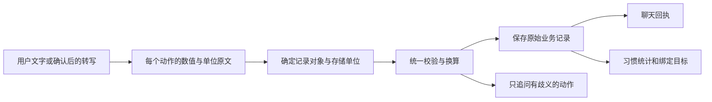

# HoloAI 数值记录与单位方案

2026-11-25 · 已在本地实现

## 用户看到的结果

用户按平常说法报数，Holo 按该条习惯或目标的数据单位保存。同一个体重习惯用公斤记录时，「83 公斤」「83 千克」「83 kg」都保存为同样的值。明确采用大陆市斤口径时，「166 斤」也保存为 83 公斤。绑定该习惯的目标直接读这笔数据。

| 用户输入 | 已配置的数据来源 | 预期结果 |
| --- | --- | --- |
| 今天体重八十三公斤，做了五十个俯卧撑 | 体重以 kg 记录，俯卧撑以个累计 | 分别保存 83 kg 和 50 个，两个回执都来自保存结果 |
| 今天体重 83 | 已唯一匹配以 kg 记录的体重习惯 | 采用该习惯的单位，保存 83 kg |
| 今天跑了 500 米 | 跑步以公里累计 | 保存 0.5 公里，跑量目标增加 0.5 公里 |
| 练琴 1 小时 30 分钟 | 练琴以分钟累计 | 保存 90 分钟，两段时长归同一次练习 |
| 看了 20 页 | 阅读以页累计 | 原样保存 20 页 |
| 喝了 500 毫升，做了 20 个深蹲 | 喝水习惯以杯记录，尚未定义每杯容量 | 询问喝水对应的杯数，深蹲正常保存 |
| 今天体重 83 公斤，目标是 80 公斤 | 体重以 kg 记录 | 只保存本次观测 83 kg，目标数字留在目标语境 |

## 决策

采用一套端侧单位规则处理 HoloAI 的数值习惯和量化目标写入。语言模型负责识别意图和提取原文中的数量表达与对象线索。端侧确定要写入的对象，核对数量与单位，再用同一套代码换算。复用习惯和目标现有的数据仓库。

换算放在应用里，是因为实际的存储单位和目标绑定都在这里。语音、文字和客户端兜底可以共用规则。每新增一种换算，需要随应用版本发布并验证相关数据源，服务端改一个 Prompt 无法单独改变保存倍率。

### 数量与单位

- `quantityQuote` 保存数字和单位的原话，`quantityScope` 保存包含它的动作原句。客户端在实际发送的文字中定位这两个片段，并核对数字、单位和动作归属。应用支持中文数词、小数、数字分隔符和复合时长。「一百六」这类有歧义的表达请用户补充。
- 单位目录按质量、长度、时长、体积和次数归并别名与换算倍率。应用地区设为中国大陆时，口语「斤」可按市斤换算。明确说「市斤」也可换算。旧记录里单写「斤」的序列按原口径读取，跨设备查看时使用同一规则。
- 页、杯、组等量词按对应项目的口径保存。在没有每杯容量或每组次数的配置时，由用户确认杯数或组数。货币使用账本的币种和金额规则。
- 用户说出单位时，以原文为准。省略单位时，采用已唯一确定的记录对象的单位。记录对象不明确时，询问名称。单位冲突或原文无法核对时，留下对应动作供用户补充。一次有多项待补时，可逐项按名称回答，保存结果更新原批次。

### 保存、目标和历史

- 现有习惯以该系列的存储单位接收新记录，换算结果传给 `HabitRepository`。纯手动目标使用自己的存储单位与 `GoalRepository`。目标绑定习惯时只写原习惯，目标快照沿有效来源读取。同源的当前值、起点、门槛和限制量在计算前对齐到一个单位。观测型按最新值读取，累积型按既有范围求和。
- 回执由保存成功的对象、数值和单位生成，实际换算时可附原话供核对。显示格式可按语言或用户偏好调整；内部精度按指标要求保存，四舍五入留给展示。
- 复用现有记录结构。已有记录的习惯和手动目标可以改成同单位的别名。改变存储倍率时使用新建的习惯或手动目标。继续保留原系列及回收站记录的存储口径。若将来要在同一系列内切换倍率，需要逐笔标明单位版本。
- 靠近保存处读取并校验生效单位，结合每条聊天动作的身份，防止用户改配置或重试时把同一个数值交给意外的来源。同一动作确认时只保存一次。

### 跨版本发布

新客户端用 `X-Holo-Intent-Quantity: 1` 声明数量原文能力。网关向它启用 V37 字段和规则，旧版仍走已有字段。新版收到旧版意图回包时，只有原文能证实数字和单位才保存。服务端默认提示与客户端兜底共用 V37 规则。

同一个能力标识用于 HoloAI 聊天语音。支持 V37 的语音网关保留转写原话，用户确认后走文字入口。旧版聊天仍沿用中文数字整理，量词里的「千」会保留在「千克」「千米」等完整单位中。新版聊天接旧语音网关时沿用旧服务转写，完整语音能力随新版后端生效。

## 代码证据

- 语音转写由用户确认后进入聊天的发送入口。 [ChatView.swift](../../../Holo/Holo%20APP/Holo/Holo/Views/Chat/ChatView.swift#L926) · [语音网关](../../../HoloBackend/src/app.js#L1710)
- 体重、数值习惯和量化目标共享原文校验及换算，补充动作回到原批次。 [AIQuantityInput.swift](../../../Holo/Holo%20APP/Holo/Holo/Services/AI/AIQuantityInput.swift#L4) · [IntentRouter.swift](../../../Holo/Holo%20APP/Holo/Holo/Services/AI/IntentRouter.swift#L1311) · [ChatViewModel.swift](../../../Holo/Holo%20APP/Holo/Holo/Views/Chat/ChatViewModel.swift#L2180)
- 目标快照读取实际习惯记录，再换成目标配置的对比单位。历史数值的单位由系列配置承载，编辑时核对存储口径。 [GoalEvaluationSnapshotBuilder.swift](../../../Holo/Holo%20APP/Holo/Holo/Services/AI/Goals/GoalEvaluationSnapshotBuilder.swift#L240) · [HabitRepository.swift](../../../Holo/Holo%20APP/Holo/Holo/Models/HabitRepository.swift#L592)
- 聊天回执复用无卡行，只显示名称和保存的结果。文字放不下时自然换行。 [ChatRecordReceiptRow.swift](../../../Holo/Holo%20APP/Holo/Holo/Views/Chat/Cards/ChatRecordReceiptRow.swift#L4)

## 实施与验收

1. 后端使用合成语音转写和意图回包验证协议分流，客户端读取新旧格式验证数量取证和换算。
2. 模拟器使用隔离存储验证三项同录、单位冲突、单项补答、重复提交、目标读数及历史单位保护。模拟器开页测试检查聊天能反复打开。
3. 真机验收时直接说「今天体重八十三公斤，做了五十个俯卧撑，三十个深蹲」，核对转写、逐项识别、实际记录、回执和目标进度。上线后再复跑同一组输入。

本地结果为 iPhone 模拟器 49 项回归及 1 项聊天开页测试通过，后端 873 项测试通过。Mac 构建卡在共享图表组件的 `import UIKit`。 [HoloCartesianChart.swift](../../../Holo/Holo%20APP/Holo/Holo/Components/Charts/HoloCartesianChart.swift#L3)

生产语音识别、真机回执和双设备同步待验收。 [目标进度数据方案](2026-11-17-目标创建与进度数据关联方案.md) · [Holo Agent 研发与验收规范](../../standards/Holo-Agent研发与验收规范.md) · [跨端接口契约](../../standards/跨端接口契约规范.md)
