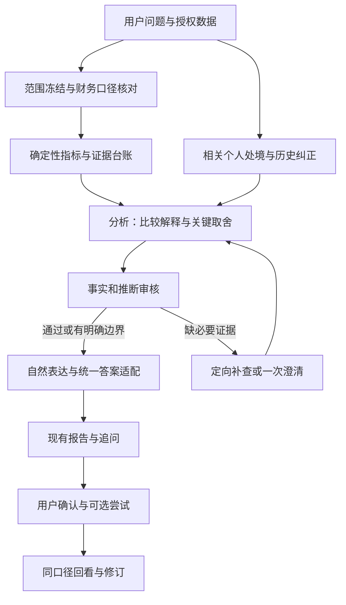

# HoloAI 深度洞察升级完整方案

日期：2026-10-17。版本：设计稿 v1。适用：HoloAI 深度分析；财务作为第一试点。

**交付状态：本轮完成方案，不代表功能完成。** 东林确认试点材料是 Holo 可直接录入/使用的数据；是否已导入及具体记录尚未核对。当前依据为工作区源码与既有规范；生产模型、有效 Prompt 和实际费用未在本轮核验。实施顺序、预算和验收是推荐设计。

## 1. 产品结论与推荐决策

Holo 已经能查询多域数据、生成带证据的结论，也有个人档案、记忆和反馈基础。下一步的重点是把这些能力组织成一次有判断力的分析：理解用户真正想弄明白的事，识别重要变化，比较可能解释，给出适合其处境的选择，并允许未来修正。

推荐决策：先把东林准备的 Holo 财务数据作为固定试点，建立现有深度分析的真实报告基线；用同份快照验证方法，再增量接入现有云端任务、统一答案和报告，最后补齐采用与回看。本地核算和离线消融是诊断辅助手段。整体复用现有 Agent、模型路由和入口。

### 1.1 用户能感知的三个变化

1. 打开报告，先看到一条与自己问题有关、能帮助判断的结论，而不是各模块报数。
2. Holo 解释为什么这样判断、还有什么说不准；用户可以纠正背景，结论随之调整。
3. 用户愿意尝试时，只选择一项适合现实条件的调整；下次能接着看有没有帮助。

### 1.2 三种专业能力落成可验收行为

| 能力来源 | Holo 应表现的行为 | 边界 |
|---|---|---|
| 资深分析师 | 同口径比较、贡献拆解、反例检查、标出哪项信息改变判断 | 数据不足时缩小问题，承认没有明显新发现 |
| 咨询中的理解 | 从用户原话了解在意之事、负担和矛盾；核对而不代替用户定义感受 | 账单时刻/品类不能直接推出动机、人格或心理诊断 |
| 人生规划中的取舍 | 区分结果目标、行动、限制；说明选择的代价和适用条件 | 不默认用户要省钱、提高效率、减少所有非必需消费 |

Holo 对外仍是同一个生活助理。用户本轮希望它有更强理解与判断力，这个方向优先于旧文档中的角色措辞；生产人格变更需统一更新真源和双端模板，不能在某个分析 purpose 另造人格。

## 2. 当前事实、推断与未知

| 层 | 当前工作区确认 | 可能的用户影响 | 证据状态 |
|---|---|---|---|
| 输入 | 云端首轮注入问题、工具目录、冻结任务；档案/记忆通过数据集查询 | 相关处境是否被取到，依赖模型的工具选择 | 源码确认；实际取用率未知 |
| 方法 | agent_loop 默认 v25 已包含个人基线、财务五层深挖、历史观察、生活含义 | 单纯增加“更深入”指令收益可能有限 | 源码确认；改法需对比 |
| 表达 | 至少三个维度、点破式标题、数字纪律与多版附录并存 | 可能诱发凑维度、强行解释或套路标题 | 风险假设，未用真实输出归因 |
| 取数 | 云端财务行字段为 date/amount/type/category/account/project/text | 外部明细的退款、币种、时间精度等语义可能无法原样表达 | 目录确认 |
| 能力 | 云端可聚合、比较、按时段分组和取样；不支持 aligned_analysis、expression、linearTrend、coverage | 不能要求模型调用不存在的对齐和复杂计算 | 目录确认 |
| 完整性 | 默认 180 天，单数据集最多 2000 行，含截断元数据 | 大数据集不能直接宣称全量；核对 Holo 全量统计与实际上云范围 | 源码确认 |
| 财务口径 | queryRows 使用含对账调整的 getTransactions；本地固定聚合使用排除调整的 getStatisticsTransactions | 云端消费统计可能把调整算作行为变化，需先统一读源 | 源码确认；线上具体报告影响未复现 |
| 回看 | OutcomeReviewStore 和卡片记录入口存在，但当前存储不冻结完整基线 | 尚不能把“记下行动 ID”视作效果闭环 | 源码确认；生产行为未知 |

本方案把前述点作为待验证的改进位置，不宣称已经找到了所有浅分析的唯一根因。详见 [实施文件与证据](05-实施任务与决策.md)。

## 3. 产品边界与第一版范围

### 3.1 第一版要做到

- 财务单域：全量可用记录体检、关键变化拆解、重要情景核对、建议取舍。
- 按问题选取少量已授权个人背景，缺背景也能完成有价值的财务分析。
- 事实、模式、解释、行动分层；结论可以直接追溯原始行与确定性计算。
- 自然中文、允许短报告和没有异常；有依据才提供新发现。
- 用户可确认/否定解释，愿意时采用一项调整，并预约下次回看。

### 3.2 后续再扩展

- 健康、任务、习惯和想法采用同一问题/证据/解释契约，各有领域规则。
- 跨域先做范围一致的并列观察；统计关联需要真实对齐、缺失处理、样本与反例验证。
- 更强模型在固定输入和任务上证明有增益后，再按复杂度分流。

本期不提供投资品买卖、贷款适配、税务结论或医疗诊断；这些不是本次个人账单洞察的需求范围。也不为试点自动改预算、删除账单、创建长期心理档案或开启新的后台全库萃取。

## 4. 用户动线

### 4.1 发起

保留“深度分析 → 财务”入口及可编辑问题，不新增专家选择页。问题类型分为了解、解释变化、作取舍；用户原话优先。宽泛问题默认寻找最值得了解或核对的一处变化，不把“最近怎么样”自动改成“如何减少消费”。

发起时只要求真实必需的信息：分析范围与已有数据。目标、限制优先取现有确认内容；当缺失信息会改变主判断时，最多提一个相关问题，同时先交付已经能确认的事实。用户跳过后缩小建议，不重复追问。

### 4.2 分析过程

进度沿用现有任务状态：核对记录 → 比较变化 → 整理判断。每个阶段须由实际阶段驱动；不能用定时器伪造“已理解你的生活”。缺少背景无需新增等待状态。取消沿用现有任务取消与清理机制。

### 4.3 报告

第一屏：主判断、实际范围、必要边界。随后最多展示三项关键发现；相关证据可展开。用户要求建议时，展示一个优先选择和至多一个值得比较的替代选择；纯查询不附赠计划。

按内容需要自然分段，不强制把事实/模式/机制/建议做成四块用户可见栏目。缺口只放会影响结论的部分。允许“目前没有发现值得调整的异常，但某条变化值得继续观察”。

### 4.4 用户回应

- 解释旁：符合我的情况 / 情况不同。否定后询问或接收更正，不把用户归为“不接受建议”。
- 建议旁：试试看 / 暂时不做。采用不等于执行，明确区分。
- 追问继续使用同一份报告、冻结范围、证据和已确认背景；数据变更后显示基于新数据的修订版本。
- 未采用的建议不自动生成任务；采用后若需创建任务或改预算，使用现有明确确认流程。

## 5. 分析方法：从问题到可修正判断

### 5.1 先界定问题

内部形成 `AnalysisTaskV2`：用户原话、问题类型、范围、对比期、关注对象、可用数据、已知限制、用户期望结果和回答清单。当前 AnswerTaskV1 保留；V2 是增量设计名，不能直接替换既有协议。

### 5.2 先排数据造成的假象

判断变化前检查：重复/遗漏、日期精度、跨币种、退款/转账/还款、分期重复记账、一次性事件、范围不同、分类变化、截断、预算是否同一周期。数据疑点能影响主判断时先指出，无法确认的记录单独列出，不让语言模型默默决定账务事实。

### 5.3 用个人常态判断变化

比较本期与可比基线，并检查一次性事件、发生次数、每笔金额、分类/项目构成。关注绝对影响和与目标的关系，不能只按百分比增长排序。没有历史时分析结构与集中度，不编造趋势；事件没有记录的日期不自动判为漏记。

### 5.4 比较解释

对重要变化提出必要的候选解释，并检查能区分它们的证据。例如餐饮增加可能来自记录补齐、聚会、笔数增加或每笔金额增加。候选数量由问题决定，最多保留三个，不要求每题凑满。

每个解释记录支持证据、反例、缺口、当前状态和改判条件。纯账单通常能回答“增加主要来自哪里”，难以独立回答“你为什么这样选择”。用户的明确表达可以补充解释，但“用户这样理解自己”也不自动成为经过验证的因果。

### 5.5 形成对用户有意义的判断

将确定事实与确认处境联系起来，明确影响的是哪一个目标、约束或选择。用户没有预算或省钱目标时，不以减少支出作为默认方向；也可以建议保持、调整安排、核对记录，或暂缓行动。

### 5.6 选择小范围尝试

用户需要行动时，给一个适合当前限制的动作，并说明代价、适用前提、观察窗口和是否值得继续的依据。预计节省只在有可追溯计算与可行前提时给出，并标为情景推演；不能把“砍掉一半”当成默认可执行方案。

### 5.7 回看与改判

采用时冻结对比范围、口径、指标、当时数据版本及用户目标。下一周期分别核对是否执行、环境是否变化、指标是否同口径、用户是否觉得值得。结果只能支持观察到的变化，不能把单人前后对比写成行动导致改善的证明。

## 6. 仅账单与有背景时的不同交付

| 输入条件 | 可交付 | 不作承诺 |
|---|---|---|
| 只有汇总 | 结构、同口径变化、重要缺口 | 商户/具体事件/情绪动机 |
| 有明细和可靠日期 | 贡献、频次、项目、可核对样例 | 缺失的消费用途与真实支付时刻 |
| 有用户确认的目标和限制 | 哪项变化影响目标、调整优先级和代价 | 任意行为都需要被优化 |
| 有同期其他生活数据 | 同期并发现象与待核对解释 | 未对齐的关联强度和因果 |
| 有多期及采用/执行信息 | 解释是否仍成立、尝试是否值得继续 | 单次试验推导长期普遍规律 |

这是能力随证据逐步增加的规则，不是要求用户先补齐全部数据的门槛。

## 7. 表达与人格

### 7.1 写作原则

- 第一段回答具体问题，少量数字用于支持判断，来源放证据入口。
- 用用户实际的分类、事件、目标与限制；不为增加亲密感复述无关隐私。
- 避免每段固定转折、三条建议、机械共情、“本质上/深层次/多维度协同”等空泛概念。
- 不把“可能/似乎”当作无证据心理解释的通行证。
- 标题允许直述问题或判断，不强制金句；没发现模式时不用强行点破。
- 篇幅随问题变化；首轮样板可用约 400–800 中文字作为阅读目标，复杂题可展开，不能用字数作为质量门槛。

### 7.2 假设示例，不来自真实用户数据

已核实事实：本期餐饮增加主要来自一次已标注的家庭聚餐；日常工作午餐没有明显变化。用户确认近期要为一次旅行留预算。

可接受表达：“这次餐饮增加主要来自那次家庭聚餐，日常午餐还比较稳定。我会先把这笔单独看，避免按这个月总额给日常开销设过紧的限制。你现在想为旅行留钱，下一步更值得核对的是哪些重复扣费可以暂停；目前账单还不能证明它们是订阅，需要先确认。”

需拒绝：“你通过聚餐补偿情感需求，应减少社交消费，建立健康消费观。”没有用户表达与证据支持动机，还擅自替用户定义价值排序。

## 8. 推荐系统结构

推荐复用当前 Hono/Node 执行器、Swift 侧数据源、个人情境检索、加密快照、结果领取和统一报告。先用逻辑阶段隔离职责；默认分析调用同时输出结构化判断与简洁正文，经程序核验交付。只有表达单独失败时，才启用一次基于已核验判断的改写。不能默认每份报告串联多个大模型评审与写手。

以 Holo 实际记录形成确定性统计，核对 2000 行截断是否影响试评。需要深入诊断时，使用同一记录版本的受控快照做本地核算；App 阶段先对齐财务统计读源与快照完整性，再考虑预计算摘要。新增字段、权限和数据使用必须显式声明。

## 9. 契约与验证分工

详见 [数据与分析契约](02-财务数据与分析契约.md)。核心新增逻辑结构：

- `PersonalSituationBrief`：当前目标、限制、相关事件、历史尝试与纠正；每项含来源、有效期、确认状态与使用权限。
- `EvidenceLedger`：数值、单位、范围、口径、来源行、计算版本、完整性和独立血缘。
- `InsightAssessment`：事实/模式/解释/建议分层，解释可被反例或用户更正推翻。
- `DecisionOption`：动作、理由、适用条件、代价、替代选择及回看方式。
- `ReviewAnchor`：采用、执行、基线、窗口、口径和修订身份。

程序负责范围、数值、单位、币种、引用、字段权限与状态；模型负责基于证据比较解释、识别意义、组织语言。语义审核只是辅助，不能声称程序已证明心理解释或自然语言因果正确。

旧字段 `title/narrativeSummary/keyInsight/claims/interpretation` 保留。新字段按 capability 协商可选，适配器位于统一答案边界；旧客户端拿到经过审核的保守事实与建议。不能把未经确认的解释塞进旧版事实正文。报告的建议顺序由类型化结构确定，UI 不再猜。

## 10. 成本、性能、隐私与可靠性

### 10.1 成本

- 第一轮固定同一模型和参数；不引用旧成本报告作为当前单价，不先换供应商。
- 背景按相关性取用，试点初值最多 8 条、约 2000 token，按真实 token 计量，超出优先删无关项；删去限制时需记录，不能静默丢关键限制。
- 默认一次最终判断同时给出正文；必要工具查询仍按现有循环执行、每次调用都计费。定向补查后继续，最多一次有明确原因的修复。付费上游调用、超时与失败都计入预算。
- 首次小样实验总调用数设计上限 12 次，总费用上限在冻结运行清单中声明；未填写金额不启动付费批跑。已有用户明确预算则沿用，不重复索取。
- App 试点暂以单次总费用 ≤¥0.10、P95 用时 ≤180 秒作为待校准设计目标，既含所有调用和失败，也含可选改写。若真实路由不适配则报告成本与质量取舍，不能为达数字放松证据。
- 主动分析与后台记忆预算分开；本方案不触发历史数据全库重评。

### 10.2 隐私

本地原文件不变；脱敏副本、依据和报告留在忽略目录。只向已授权模型通道发送本次必要数据，不通过网页搜索服务处理账单。不将完整卡号、地址、无关原文或私人账单放诊断日志。个人情境受现有使用开关、敏感级别、遗忘和来源权限约束；用户更正/删除须使缓存、候选和未来取用失效。

### 10.3 故障与状态

结构不合法给一次针对性修复；关键事实不一致撤回相关结论，主结论失效则诚实失败。只有部分可答时交付 `degraded` 并明确缺口。预算耗尽、取消和不可恢复错误停止上游调用；付费次数与产品额度分账，沿用既有失败释放规则。重试须复用稳定任务身份，不能创建无限新 operationId。

## 11. 分阶段实施与退出条件

| 阶段 | 交付 | 进入下一阶段的依据 |
|---|---|---|
| S0 Holo 实际数据基线 | 确认记录就绪、从现有入口生成基线、核对依据和人工目标样板 | 主口径可确认，东林能具体指出哪些判断有用/不准 |
| S1 同快照方法验证 | 固定 Holo 快照与模型的方法/背景对比，必要离线消融，边界案例 | 无严重事实/动机错误；新方法有稳定偏好和可解释收益 |
| S2 财务云端接入 | 财务读源统一、V2 可选契约、相关处境、核验和统一报告 | 合成回归、真实模型样本、模拟器/真机和兼容通过 |
| S3 小范围使用 | 显式试点开关、采用/执行与冻结基线、下一周期回看 | 至少两个周期，用户能确认帮助判断/行动，成本可接受 |
| S4 跨域扩展 | 每域独立语义、跨域真实对齐、分场景评测 | 财务效果成立且其他域证明新增价值 |

若只有措辞变好：保留表达收益，退回分析方法和背景质量继续验证；不宣称“更懂用户”。若仅背景丰富的题有效：缩小产品承诺，明确适用条件。若更强模型才能达到质量：先核单次成本与额度，再讨论路由。若用户喜欢阅读但不改善判断：保留回顾价值，重新界定深度分析定位。

## 12. 完成标准与回退

### 12.1 方案完成

完整方案、数据契约、试评步骤、提示词原型、实施任务和验收齐全；明确待数据和未验证项。本轮到此不要求模拟器编译，文档通过检查即可交付。

### 12.2 功能完成

事实与口径门槛通过；主观评测有留出案例；真实用户样板可核对；UI 及旧客户端兼容；后端发版生效；任务运行/取消/失败真实；采用与执行不混淆；回看有基线且不夸因果。各层证据分别记录，编译、mock 或一份优秀报告不能替代实际效果。

### 12.3 回退

财务 V2 方法与新解释展示独立开关。遇到严重错误停止 V2，回到原有经核验事实报告；不撤销新增的账务正确性修复，不删除历史报告。新解释与用户纠正按版本存储，回退不把待确认解释升级为事实。Prompt 与代码版本成对记录，可指定回到上个已验证组合。

## 13. 方法参考

“精选相关上下文、用代表性样例而非不断叠加边界指令”参考 [Anthropic 上下文设计](https://www.anthropic.com/engineering/effective-context-engineering-for-ai-agents)。本方案的具体字段和资源上限由 Holo 场景提出，尚待验证。

“从真实失败案例起步，分开确定性核验与主观质量、使用人工校准”参考 [Anthropic Agent 评测方法](https://www.anthropic.com/engineering/demystifying-evals-for-ai-agents)。这些方法不证明本方案已经有效。
