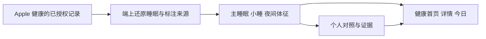

# Holo 健康分析产品方案

2026-11-17 · 产品决策稿 · 首版从睡眠切入

## 用户为什么要打开 Holo 健康

用户手里已经有手表记录。他每天需要的是三件事：**知道最近一次睡得怎样，看见和自己平时相比有什么变化，决定要不要试着调整一个习惯。** Holo 可以把睡眠、运动和日常行为放在同一条时间线上，让用户核对变化是从哪一天开始的，并在过几天回看时知道它是否持续。

第一版交付两个能独立使用的结果：**最近一次主睡眠记录**、**近两周作息变化**。只有一晚记录，也能把这一晚讲清楚。使用了一段时间，才逐步回答「最近发生了什么变化」。健康首页继续提供活动和运动入口，步数、站立或活动时长、运动会话仍能直接查看。

## 用户实际看到什么

| 场景 | 首页回答 | 点开可核对 |
| --- | --- | --- |
| 早上打开 | 「昨晚睡了 7 小时 12 分，23:48 入睡，07:16 睡眠记录结束。」这一天有午睡就单列。 | 主睡眠时间轴、分期、明确记录的夜醒、样本来源。有数据时显示睡眠心率与呼吸，HRV 有足够夜间样本时再展示。 |
| 最近作息有变化 | 「近两周有 10 晚记录，入睡时间比此前晚约 40 分钟，睡眠时长中位数少了约 35 分钟。」 | 两段时间范围、纳入的晚数、入睡和时长对照。只有两项都在足够的同一批有效晚得到支持，才合写一句。 |
| 近期记录稳定 | 展示近期典型入睡时间、睡眠时长和有记录晚数。 | 可点选某天回看，图上的断点保留为断点。 |
| 刚接入或缺数据 | 「近 14 天有 3 晚记录，已有的睡眠可以查看。更多可比较的记录将用于判断作息变化。」 | 最近一次记录的日期、哪个指标有样本，以及查看 Apple「健康」设置的入口。暂时无法读取时用相应状态。 |

首页首屏只突出一条最重要的变化。无明显变化时，近期摘要本身就够用。对于已设睡眠目标、且想调整的人，详情最多给一个可自行尝试的小动作。例如「如果你想恢复到之前的作息，这周挑两天，把睡前准备提前半小时。下周回来看入睡时间有没有变化。」默认由用户自己决定是否尝试，回顾时沿用同一口径。以上数字均为界面示例。

AutoSleep 最值得借鉴的是把心率、呼吸和睡眠放在同一晚里，以及用同一个人的历史解释变化。Holo 在此基础上应把可核对的运动和习惯记录接进来。首页采用明确的时长、时间和差值，分期留在详情和长期趋势里，方便用户直接理解发生了什么。 [AutoSleep 睡眠详情](https://autosleepapp.tantsissa.com/clock/sleep) · [AutoSleep 作息一致性](https://autosleepapp.tantsissa.com/today/sleep-consistency) · [Apple Watch 睡眠分期验证](https://www.apple.com/health/pdf/Estimating_Sleep_Stages_from_Apple_Watch_Oct_2025.pdf)

## 先把一晚算对

当前健康首页和洞察会按午夜截断，睡眠详情按前一日中午到当日中午归晚。23:00 到次日 07:00 的连续睡眠，因此可能在首页看到 7 小时、详情看到 8 小时。体征页的「夜间呼吸频率」取的是自然日均值。现有分期汇总还会分别合并各阶段，同一时间来自不同来源的冲突分期可能同时进入统计。 [睡眠查询](<../../../Holo/Holo APP/Holo/Holo/Models/HealthRepository.swift#L491>) · [睡眠阶段聚合](<../../../Holo/Holo APP/Holo/Holo/Models/HealthRepository.swift#L585>) · [体征聚合](<../../../Holo/Holo APP/Holo/Holo/Models/HealthRepository.swift#L807>)

1. **先还原睡眠段，再归到结束记录所在的当地日期。** 先读取带前后余量的时间范围，完成分段、去重和来源选择，再按结束日筛选。跨午夜和跨中午都保留原时长。用绝对时间算时长，有可靠来源时区时按当时的当地时间展示。检测到时区变化且无法确认当地时间时，保留时长，暂停这段记录参与作息时间比较。
2. **主睡眠、小睡、无法确定的额外睡眠段各有清楚的显示。** 有多段时，以有明确依据的主睡眠为准。没有明确标记时，可用最长且覆盖可靠的一段作默认。遇到同日两段相近的长睡，展示两段记录并暂缓主睡眠对比。标题明确用「入睡」和「记录结束」，在床、清醒、实际睡着分开统计。入睡耗时和睡眠效率只用边界可靠的在床记录，在来源可以对齐时计算。
3. **同一时间只采用一套分期。** 同来源重叠先合并，再按整段选择分期来源。评估连续性、覆盖情况和来源，优先保留覆盖充分的同一设备分期。只有时长可信时，展示未分期睡眠。分期冲突无法可靠裁决时，保留可核对的记录与来源，相关夜醒和分期结论降级。缺采样区间留白。睡眠心率、HRV 和呼吸均值使用落在主睡眠已记录睡着区间内的样本，静息心率保留独立口径。
4. **用同一份结果支撑各入口。** 首版让健康首页、睡眠详情、趋势、新的健康洞察，以及「今日」里标为「昨晚睡眠」的入口读取同一事实。用户查自然日合计时，可保留明确标注的自然日查询。上线前逐一核对目标、日历回顾、周报、对话和记忆调用方的含义，再迁移确实在引用「整晚」的入口。新端上摘要接替旧健康页的跨模块洞察，同步退出旧健康页专用的后台生成任务。生活关联达到新的对照标准后再进入首页。 [今日睡眠入口](<../../../Holo/Holo APP/Holo/Holo/Views/DailyKanban/KanbanHealthSection.swift#L136>) · [现行健康洞察取数](<../../../Holo/Holo APP/Holo/Holo/Services/AI/HealthInsightContextBuilder.swift#L311>) · [旧生成任务入口](<../../../Holo/Holo APP/Holo/Holo/HoloApp.swift#L439>)

## 怎样从记录得出结论

**事实可以从第一晚开始。** 有什么展示什么，每项指标独立判断覆盖。单点 HRV 或血氧可以在详情作为采样点查看。夜间体征没有足够的有效采样时，周期比较仍可由有数据的睡眠时长和作息时间支撑。正常显示过的历史记录也带日期，最新可用记录和当天读数各自表述清楚。查询无样本统一写「没有可用记录」。HealthKit 允许按类型和历史范围授权，也会隐去特定读权限是否被拒绝。 [Apple HealthKit 读取授权](https://developer.apple.com/documentation/healthkit/authorizing-access-to-health-data)

**变化需要自己的历史。** 首版先做主睡眠时长、入睡时间和记录结束时间。试用默认将最近 14 天与此前 28 天比较，两个窗口分别至少有 7 晚、14 晚同指标的可比记录，两段互不重叠。以中位数和波动范围描述个人常态。时间点用跨午夜正确的本地钟点算法。必要时区分工作日和休息日，样本不足或两段构成差异很大时只展示各段摘要。比较还应检查来源是否跨设备突变，以及变化是否持续。试用先用可感知的 30 分钟级差值作为睡眠时长和入睡时间的展示候选，再按个人波动及真实样本校准。夜间体征先提供趋势和覆盖，等采样密度核验后再设各指标的比较门槛。这里的窗口与门槛是产品试用参数。

**生活关联需要有效对照。** 现有 14 天洞察允许短睡组仅两天就进入计算，并用整段日历天数算对照频率。新版先做两个能回答明确问题的对照：「傍晚运动后的那一晚，入睡时间有什么变化」和「短睡后的当天，原本安排的习惯完成了多少」。前者按运动结束时间对齐下一段主睡眠，后者按醒来日期匹配当日应做习惯。两组都要有明确的记录覆盖，排除时序不符和无法确认记录状态的日子。优先在相同日型下比较，近期两段时间方向一致才进入首页，详情同时展示两组样本量、差值、日期和例外。账本咖啡记录可以回看购买时间，只有用户记录了饮用才用于咖啡因摄入分析。用户可在证据详情标注旅行、夜班等背景，相关日期重算并显示纳入规则。 [当前关联计算](<../../../Holo/Holo APP/Holo/Holo/Services/AI/HealthInsightContextBuilder.swift#L656>)

睡眠报告只讲已记录的事实、变化和可选的生活尝试。默认产品文案使用可重算的结构化结果。体征展示采用用户自己的历史，睡眠分期作为设备估计。多项信号同时变化时分别列出，用户可以看到每项的依据。

## 做到哪一步再加数据

| 交付顺序 | 用户得到什么 | 下一步的依据 |
| --- | --- | --- |
| **首版 · 统一记录与作息回顾** | 最近一次主睡眠、单列小睡、近两周作息、同一晚的睡眠心率和呼吸；有足够样本时看 HRV。全部沿用当前读取范围。 | 首页、详情、今日入口对上同一晚。用户能区分未记录与实测，并找到一句趋势背后的具体日期。 |
| **后续 · 生活关联** | 把运动前后、睡眠和习惯对齐。有可靠对照时给一条可回看、可纠正的发现。 | 先用缺数据、同日顺序颠倒、周末偏差和反向案例验证，再用真实记录试用。 |
| **按需 · 更多体征和健康主题** | 优先补手腕温度、夜间血氧。有来源和采样信息才给个人趋势。再按用户需求推进体重/体脂、心肺适能、运动后心率恢复。 | 用户进入对应用途再请求读取，先查真机覆盖。环境噪声、Apple 已记录的睡眠呼吸紊乱等随明确问题启用。 |

新增接入要能回答一个具体问题。例如腕温回答「这几晚和我平时差多少」，血氧回答「手表在睡眠期间实际记录了哪些读数」。腕温按个人基线看，离散血氧样本保留实际采样信息。 [Apple 夜间腕温](https://support.apple.com/zh-cn/102674) · [Apple 血氧采样说明](https://support.apple.com/zh-cn/120358) · [HealthKit 数据类型](https://developer.apple.com/documentation/healthkit/data-types)

## 实现决策与验收

**决策一 · 在现有 HealthKit 读取层统一按晚结果。** 复用现有睡眠切分和时间轴，保留样本来源，补齐跨日期和跨来源的规则。页面和趋势共用同一批结果。字段至少能表达起止、归属日期、睡着时长、额外睡眠段、分期或体征覆盖、来源和数据状态。比各页面各算一套多一次入口迁移，日后修正一个口径可同时覆盖相关入口。历史从 Apple「健康」按需重算。

**决策二 · 首版端上计算和展示。** 时长、基线、比较与筛选均可用本地计算和模板表达，离线时仍可阅读已有可用记录。原始样本、按晚摘要和新增洞察均留在本机。同一屏切换日期时复用已验证的查询范围，样本补写、删除或来源改变后重算受影响的日期。应用回到前台时重新核对最近可用数据，撤权或无记录时将受影响的衍生结果移出展示。后续接入 HoloAI 时要逐用途明确可读范围，端上结果可以供经授权的场景引用。 [Apple App Store 健康数据条款](https://developer.apple.com/app-store/review/guidelines/#health-and-health-research) · [Holo Agent 证据与统一口径规范](../../standards/Holo-Agent研发与验收规范.md)

| 验收项 | 判定通过的现象 |
| --- | --- |
| 同一晚 | 23:00 到 07:00 的样本在三个入口都为 8 小时。单独增加 30 分钟午睡，主睡眠仍为 8 小时。跨中午、轮班、时区和夏令时均按支持边界显示归属或不确定状态。 |
| 来源与缺失 | 两个来源同段重叠、分期冲突、只记录时长、缺失 REM、无 HRV、锁屏暂不可读分别验证。分期总时长合乎已记录的总量。空白时间保持空白，明确的实测零值保留。 |
| 个人比较 | 23:50 和 00:10 算作相邻的入睡时间。覆盖不足、单次变化和设备切换时，首页不生成持续趋势。晚到和更正的记录能改变相关结果，旧结论随之失效。 |
| 生活关联 | 两组实际完成率相同但一组缺记录，结果保持「当前无法比较」或有效样本内无明显差异。运动结束晚于当前睡眠结束时，不能把该运动用于解释这段睡眠。 |
| 用户理解与表现 | 试用中让有 Watch、只有时长记录、记录稀疏的用户分别完成两件事：说出最近一晚和个人趋势，点回一项依据。记录他们是否误把缺读数读成零、把提示读成因果。真机核对来源和时长，记录冷打开与连续切天表现，更新任务避免逐日重复查询和旧结果覆盖新日期。 |

首版的完成标准是用户可以独立回答「我最近睡得和以前有什么不同」，并在需要时知道这句话用了哪些晚。本文是产品方案。多来源优先规则、跨时区样本覆盖和试用参数均需经真机与真实记录验证后定稿。
