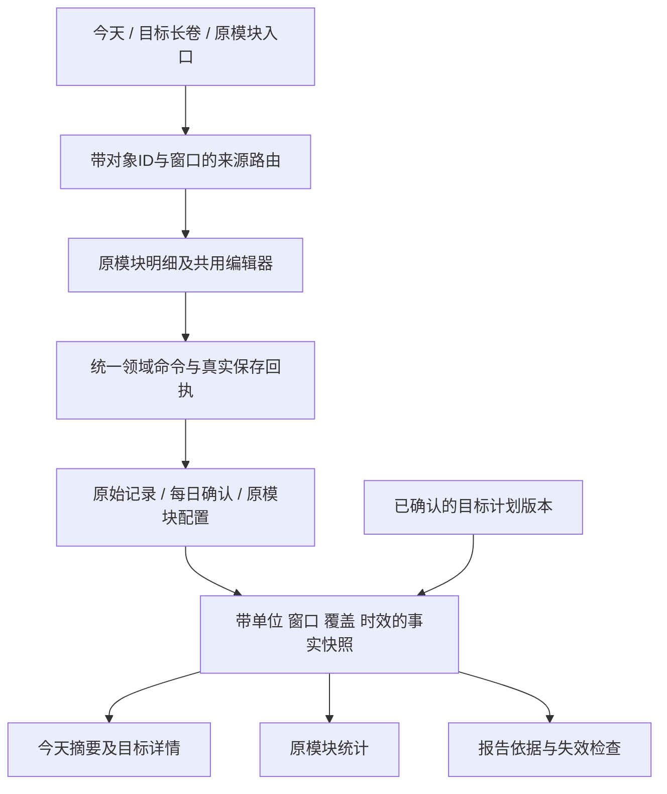

# 今天、目标长卷与原模块：整体方案及操作一致性契约

2026-10-21。产品评审版。原生实施后续状态见 [原生实现与验收记录](原生实现与验收记录.md)。本轮核对当前工作区代码、修正交互方案与原型；不修改原生代码、真实数据、Prompt、后端或 CloudKit Schema。

本文承接 `docs/_common/plans/2026-10-20-目标管理跨模块能力评估/最终方案与GLM实施交接.md` 的原模块职责、报告复用及修正事务规则，补充本轮已确认的今天/长卷位置、每日确认与完整编辑闭环。前几版 Today 原型若与本文冲突，以本文为准；原型不是已有能力证明。

## 1. 已确认的产品边界

东林本轮明确选择：

1. 今天只显示重点目标摘要与今天可做的事，完整长卷放在目标详情。
2. 奶茶、宵夜、上床等需要明确区分「确认未发生 / 没做到」与「尚未记录」，补齐每日确认入口。

继续沿用已确认规则：保留现有主导航、个人中的目标入口与原模块职责；事实只记录一次；目标区分成果、行动、限制；允许多个模块及多个习惯关联同一目标；共享对象不被单个目标抢走归属；目标与 HoloAI 使用同一报告。

## 2. 一套页面分工

### 今天：选出现在能做的一步

首屏保留一个重点目标的事实摘要、当前一步和少量其他安排。习惯、记账与其他工具保留紧凑入口；任务日历、四象限、列表继续在任务模块。目标摘要打开原目标详情；某个具体行动打开其原模块。

未关联目标的日常任务仍可正常执行。没有活跃目标时回到日常安排，不强迫创建目标。共享同一任务只在今天出现一次；多个目标关联作为出处，而不是复制任务。

### 目标详情：长卷解释进展

保留目标概览、关联对象、设置和既有生命周期操作。长卷展示同一目标的时间变化、依据、回顾和已确认的计划版本。

长卷中的金额、次数、分钟、符合晚数和约定值都有明确操作：

- 点事实摘要：进入对应来源及相同统计窗口的明细。
- 点来源明细中的某条记录：编辑或删除该条原记录。
- 点「记录」：新增本次事实或按原模块规则补记。
- 点「调整本目标约定」：进入计划差异单，不进入实际记录编辑器。

历史段落的数值打开冻结依据；需要纠错时进入原始记录编辑，并明确这会刷新当前事实。旧报告正文不被改写，只标记当前调整依据已变化。

### 原模块：统一记录与纠错

来源页和编辑器由原模块所有。从今天、目标或模块首页进入同一对象，使用相同动作、校验、权益和保存回执。目标不维护另一份「本周总数」或资金字段。

返回时恢复原目标、长卷时间位置、统计窗口和入口锚点；不把用户丢回首页或另一个目标。

## 3. 截图中每一个数怎样修改

| 展示 | 点开后看什么 | 正确修改方式 | 不允许的方式 |
|---|---|---|---|
| 消费回顾 2 次 | 对应周期内每次回顾的记录 | 新增一次；编辑对应记录备注；误记则删除那一次 | 把累计数直接改成 3 |
| 奶茶 1 杯、宵夜 2 次 | 对应周期的逐条数量记录和每日确认 | 记录本次数量；改某一笔数量；删除误记；确认某日未发生 | 用支出金额推杯数；覆盖本周总数 |
| 运动 2 次 | 两条真实活动记录及来源 | 新增/改/删对应活动；若源是打卡，则按完成日计数并写「天」 | 把一次活动自动等同一天，或把里程直接当次数 |
| 上床 3 晚符合 | 每夜「符合 / 明确未做到 / 待确认」及覆盖 | 修改对应夜的事实状态；补确认缺失夜 | 直接输入「本周符合 5 晚」；用上床证明入睡 |
| 阅读 110 分钟、听读 120 分钟 | 每段时长记录 | 新增这次时长，或改对应一段 | 把最新一次值与周期累计混用 |
| 口语 2 次 | 每次练习的真实记录 | 新增一次、改备注或删误记 | 改次数后自动认定真实提案完成 |
| 旅行资金 6,000 | 已确认的单账户余额、组成与明细 | 在财务记收支/转账，修账单或做余额核对 | 在目标页覆盖资金总数；把预算或少喝奶茶当到账 |
| 每周最多 2 杯、运动 3 次 | 本目标的规则和版本 | 在目标计划差异单改要求，显示适用范围和起效方式 | 通过编辑实际记录来改变要求 |
| 餐饮预算 1,500 | 财务预算详情及实际支出 | 编辑实际交易；改预算时显示全局影响并另行确认 | 把改预算当支出变少；静默改其他用途的预算 |
| 体重等测量 | 最新真实测量与原记录 | 在原习惯录入当前测量；修改对应记录 | 把目标体重写成实际体重；把测量值相加 |
| 健康自动观测 | 来源、授权、时间及原始证据 | 去原来源查看或更正；无权限提供原授权入口 | 给自动观测弹出手填覆盖框 |
| 旧手动目标 | 既有 GoalMetricLog | 保留原手动记录及其累计/最新语义 | 强制迁移成财务记录；新财务目标用手填冒充账户 |

一致性是「相同含义、相同来源、相同周期得到同一个值」，不是把所有数都做成输入框。同一活动可以在一个目标回答「跑了几次」，在另一个目标回答「累计多少公里」；两个名称和单位必须明确，底层记录仍只有一条。

## 4. 每日确认：明确事实，不虚构零和失败

### 决策 A：在习惯域补日确认，独立于目标

新增的是习惯原模块对某日事实完整性/状态的声明，不是目标专用打卡。建议以独立日确认对象增量保存，包含 `habitID`、归属日/时区、观察区间、状态、确认时间及对应记录摘要。正式字段和 Core Data 迁移需实现前专项审查。

- 计数/时长：正数来自原记录。「这一天没发生」表示已结束归属日明确为零；「这一天记全了」确认当日已有记录完整。未确认只是已记录量，不保证无漏记。
- 当前尚未结束的日子只能确认「截至当前」，不能提前宣布全天或整周上限守住。正式上限达成需周期结束且必要覆盖齐全；已知超限可立即提示。
- 上床等条件：日状态为符合、明确未做到、待确认，三者分开。未做到不制造一次成功打卡；缺记录不当失败。
- 新增/编辑/删除已确认日的原记录后，相关完整性确认需要重核。新增正数与「整日未发生」冲突时取消该确认的有效性，不静默同时保留零与正数。
- 原始数量依旧从正数记录求和；日确认不作为另一笔可相加数量，不带来双重统计。
- 旧数据无确认就保持未知，不能批量补成「没发生」或「失败」。归属日遵守习惯结算时间，暂停、未开始及未到观察时段另行显示。

普通输入继续遵守计数 >0、测量可为真实 0 的现有规则；「确认未发生」是有明确语义的动作，不能靠开放所有数值框随便填 0 代替。补记/确认的日期、暂停、权益及同步规则由原习惯域统一检查，不因来自目标绕过限制，也不把事实确认当作补签奖励。

**取舍**：多一层日确认数据，换取可解释的零/未知/覆盖；默认不强迫所有习惯每日确认，只有需要上限或完整覆盖的目标才提示最少缺失日期。可以显式批量确认选定日期，不能自动替用户确认。

## 5. 事实、规则与版本分开

### 决策 B：统一来源投影与操作入口

路由至少携带 `entityType/entityID`、统计窗口及归属日规则、必要时 `recordID`、来源目标/报告与返回锚点。新增、补记、编辑、删除和日确认走原模块服务；所有入口不各写一套保存逻辑。

### 决策 C：目标约定不等于共享习惯默认设置

目标只改本目标的要求、绑定与适用阶段；原记录不变。修改共享习惯的全局频次/单位/含义必须走原模块设置，明确其他关联用途和影响范围。含义改变则建替代来源并结束旧绑定，不能给旧记录改名冒充新行为。

现有 V2 绑定只有 role 和阶段，没有完整的每绑定成果/条件要求。多习惯共同构成成果、事件次数、符合日数、覆盖要求、自然周或滚动窗口等需要兼容扩展，不应在 UI 内硬编码。旧 `windowDays=7` 继续按现有「最近7天」解释；新计划只有明确选自然周，才能写「本周」。

保留单一真实来源，按每条规则读取：累计数值、事件数、完成归属日数、最新测量、符合日数及覆盖、单账户余额等。多必要条件逐项判断；不同指标不补偿、不平均。旧客户端遇到新计划版本只读，不能丢掉不认识的条件后写回。

**取舍**：目标与习惯首页的「要求」可以不同，但必须标为各自要求；事实相同。不能为了视觉一致而全局重设共享习惯。

### 决策 D：当前事实刷新，历史报告冻结

新增、改、删原记录后，原模块、今天和目标读取新的同一事实快照。报告仍显示生成时的版本、窗口、截止时点和依据；受影响的调整失效，刷新并再次确认后才采用。

历史数字的「查看当时依据」与「纠正原记录」分成明确动作。纠正原记录影响当前/可重算历史统计，不篡改已保存报告的原文与当时决策。目标与 HoloAI 继续打开同一 `reportMessageID`。

### 决策 E：保存成功后才关闭和反馈

编辑 → 校验 → 保存中 → 成功回执 → 刷新来源与目标 → 返回原位置。失败留在同一表单保留输入；重复点击不新增重复记录。保存失败不得先改页面事实或先关表单。

本机保存成功与云端已同步是两个状态；同步等待不重建记录。需要事务隔离处理失败，不能对共享 context 随意全局 rollback，误伤其他编辑。

## 6. 当前代码核对结果及落地前缺口

原生根目录：`/Users/tangyuxuan/Desktop/Claude/HOLO/Holo/Holo APP/Holo/Holo/`。工作区存在其他在途改动，以下是本轮读取到的事实，不是已修复结论。

| 位置 | 当前事实 | 必须统一的内容 |
|---|---|---|
| `Models/HabitRecord.swift`、`HabitPresentationProjector.swift:922` | 逐条记录；计数按 SUM，测量按 LATEST；尊重日归属 | 页面不保存另一份可手填总数；保留记录ID与窗口 |
| `Services/Habits/HabitActionCoordinator.swift:32` | 已有新增、补记、编辑、删除和真实回执 | 今天与目标来源入口统一复用 |
| `Views/Habits/HabitTodayRecordSheet.swift:128`、`HabitRecordEditSheet.swift:118` | 可编辑具体记录；编辑闭包发起异步动作后弹层直接 dismiss | 等真实成功回执再关；失败保留表单 |
| `Views/DailyKanban/DailyKanbanView.swift:349` | 快捷记录绕过协调层；测量分支把 targetValue 写作记录值，其他非负数值分支走 toggleCheckIn | 按记录类型派发；实际数值须用户输入，目标值不能当观测 |
| `Services/Today/HoloTodaySnapshotBuilder.swift:456` | 测量型按目标大小判断完成；与测量仅需真实记录的习惯投影规则不同 | 今天复用习惯投影结果，不能自行按越大越好判断测量 |
| `HabitModuleContainer.swift:402`、`Services/DeepLinkState.swift:77` | habitDetail 能进入单习惯回顾，但没有完整来源窗口/记录/返回上下文 | 扩展类型化来源路由，支持同窗明细与返回长卷 |
| `Views/Finance/AccountDetailView.swift:170`、`FinanceRepository+Accounts.swift:332` | 已有 ReconcileSheet；对账调整带标记，参与余额、不计普通收支统计 | 资金纠错走财务明细/核对，不覆盖目标资金变量 |
| `Models/GoalPlanContract.swift:222`、`GoalEvaluationSnapshotBuilder.swift:92` | V2 resultSource 单项；多个绑定/限制已存在 | 多独立必要成果、日确认、条件聚合、周期语义需兼容扩展 |
| `GoalAdjustmentCommitService.swift:454` | 共享保护拦改名/统计口径，但频次/目标值仍直接写全局 Habit | 目标局部要求与全局设置分离，不能静默影响其他目标 |
| `GoalMetricEvaluator.swift:117`、`GoalDetailView.swift:108` | 旧概览 ledger 仍取全账本净结余；新分析有单账户结果快照 | 概览、列表、今天与报告用同一已确认来源，避免同一目标两套金额 |
| `GoalDetailView.swift:633` | 通用编辑直接改 Goal 字段 | 有生效计划时，成果/期限等变更走版本化差异提交，避免 Goal 与计划分叉 |
| `GoalAnalysisSection.swift:36` | 监听报告和 goal 通知；未直接监听 habit/finance 变化 | 合并领域事件或观察统一事实版本，返回时强制重取相关快照 |
| `GoalReviewCoordinator.swift:97`、`GoalEvaluationSnapshotBuilder.swift:560` | 已有快照、sourceDigest、报告身份与失效判断 | 新确认/条件/依据纳入摘要；仅用于解释的源变化也按实际取用证据失效 |

上述位置需在实施时再次读取当前工作区；不能覆盖其他会话的新实现。核心数据变更先做增量迁移评审及导出备份提醒，不重置开发库。

## 7. 实施顺序与验收

1. 先统一原模块记录命令和保存回执，纠正今天快捷记录分支。
2. 增量补每日确认与事实覆盖，旧记录保持原意；确认零与正记录冲突可解释。
3. 扩展目标条件与本目标要求，统一来源投影和来源路由；旧目标兼容。
4. 实施今天减法与目标长卷，入口全部落到上述服务；接通同一报告和修正事务。
5. 按功能开关灰度；缺少新能力的客户端保持只读/原入口，不能静默降级丢条件。

必须验收的用户动作：

1. 从今天、长卷、全部习惯进入同一习惯、同一窗口，值一致。
2. 奶茶新增 1 杯；编辑该条为 2 杯；删除后重算。实际数量与目标上限从不互相修改。
3. 编辑阅读某一段 30→45 分钟，总数增加15，原记录ID不变，不重复新建。
4. 运动一条里程记录同时更新周活动次数与月里程，底层只写一次。
5. 修改本目标运动要求3→2，实际记录及另一目标要求不变，另行确认成果标准变更。
6. 确认某日没喝奶茶：已记录量仍0，但覆盖从未知变为确认；当前日仍进行中。
7. 在已确认无发生的日子补入正数，旧日确认失效，不能同时显示完整0与正数。
8. 上床明确没做到与尚未记录分开；补确认改变覆盖，不伪造一次符合。
9. 真实测量0保留；计数普通输入0不当正记录；目标值绝不自动写成实测。
10. 修改目标上限2→1，只改版本和限制判断；共享习惯默认设置不变。
11. 财务修交易/记转账/核对余额后，账户与旅行资金一致；对账差额不计普通收入。
12. 预算调整显示全局影响；历史支出不变；未确认不提交。
13. 资金到账但任务未完成时，成果和任务分别呈现；是否影响达成取决于已确认角色。
14. 修改原事实后，今天和目标刷新，旧报告正文冻结，旧建议待刷新。
15. 保存失败留输入，不增加记录/改总数；重试一次只保存一次。
16. 双击保存、返回再进入、不重复创建目标/习惯/交易/版本。
17. 取消编辑、计划预演和未确认差异不改变事实或规则。
18. 来源被删/暂停/归档、权限关闭或未来版本只读时有明确恢复入口。
19. 补记日期、习惯结算时间、跨午夜、自然周/滚动窗口和权益在所有入口一致。
20. 旧手动目标、未关联目标任务、任务多视图、习惯回顾、提醒和历史入口保持可用。

原型只验证上述交互与合成数据契约；原生编译、Simulator、真机、VoiceOver、CloudKit 双设备及真实 AI/后端仍需分别验收。不能把浏览器通过写成 App 已修复或上线。

## 8. 本轮交付及实际验证

整合原型：`/Users/tangyuxuan/.codex/visualizations/2026/10/20/01a15a2d-886d-7f40-8325-d706a0af90d9/holo-today-goals-integrated.html`。在对话内直接交互，手机无需访问本机服务。此前候选稿保留为探索记录；本轮不再提供多套互相冲突的操作规则。

原型覆盖四类目标：财务加习惯/预算/任务、多个必要习惯、行动加真实成果反馈、同一活动服务不同目标。历史时间段只显示历史内容；当前来源和当前要求在回到「现在」后展示。拨动的是时间位置，不是目标完成率。

记录与要求可按同一条路径完成操作：

- 全部习惯 / 目标事实 → 同窗明细 → 编辑或删除具体原记录 → 返回重算。
- 需要完整观察的奶茶、宵夜及条件型习惯提供每日确认；普通阅读和测量页不强加每日确认步骤。
- 财务改原账单、记转账或核对余额；预算改动单独说明全局范围并确认。
- 真实英语提案有「未验证 / 仍需协助 / 已独立表达」的本人反馈；完成任务不会替用户判断成果。
- 回顾保留历史正文与身份，支持当前依据的算术预演；存钱按剩余4期平分差额，4,800 时为3,300，纠正到6,000后为3,000。采用前核对依据，采用后标记计划版本；后续来源再变化时重新标记待回顾。它不是调用真实 AI 的结果。

已完成的验证：

1. `一致性模型检查.cjs` 直接读取整合原型的同一模型，32项业务检查通过：逐条纠错、共享活动、零与未知、确认冲突、局部要求、预算范围、失败不写入、重复操作、过期建议和报告身份等。删完原记录后，摘要和报告也保留未知。
2. 浏览器实际操作通过：奶茶1→2杯仍为一条记录；阅读50→65后累计125；新增5公里后两个目标分别为3次/20公里；上床没做到增加覆盖但不增加符合，撤回恢复待确认。
3. 浏览器实际操作通过：修改转账、核对余额、预算1500→1800但支出1600不变；任务完成后成果仍待验证；真实反馈为需协助时不判达成；回顾刷新、打开旧报告、预演3000并确认新版本、已采用状态。
4. 检查320与390宽度，页面无横向溢出；修正正文短数值按钮后，已核对目标页控件触控区域。时间位置可调整，进入报告再返回能恢复。未验证真实手机拖动手感。
5. 脚本语法检查通过；最终浏览器无错误/警告日志。代表性记录状态约4.8KB，持久化快照设16KB上限，超限只回传简要上下文，当前会话仍保留演示数据；不把演示持久化作为正式数据存储方案。

仍未完成：原生缺口修复、增量数据迁移、实际原模块路由复用、真实保存回执、来源删除/授权/权益全分支、真机辅助功能与多设备同步。原型不包含新建目标和全部生命周期页面的完整重做；原有入口在正式实施中必须保留，不能按原型删功能。其他会话的原生及后端改动未由本轮提交、测试或部署。
